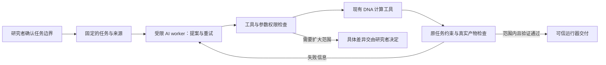

# AI × 合成生物学安全：短周期路线选择与证据闭环

研究时间：2026-09-08 至 2026-09-09。适用基础：snapgene-dna-design v1.0.0，已有 7 个 Recipe、41 个工具和真实 DNA 构建验证。本文是路线选择与实施方案；安全模式尚未开发，不改变 v1.0.0 的能力声明。

## 一页结论

**首选：把 Progent 的单调权限原则适配成“AI 生物设计范围保真模式”。** 研究者先确定允许的材料、宿主背景、操作范围和必须保留的生物学条件。AI 可以搜索方案、调整引物、改组装路线并重试，但不能自行扩大材料或操作权限，也不能通过改写目标、检查条件或确认状态来完成交付。

这条路线的三个支点：

- **方法来源明确**：Progent 研究概率性代理如何在运行中保持权限约束；我们采用其必要原理，不新建规则语言、模型训练或全套治理平台。
- **有相近获奖范例**：2025 HPI-Potsdam 的 AI DNA 设计软件获得 Safety and Security Award，将已有筛查信息放入设计工具并限制候选来源。我们的增量拟从“提供已有条目”延伸到“允许组合与编辑时，保持批准范围和材料证据”。
- **已有主通路可复用**：构建、模拟、注释和文件验证继续交给 v1.0.0。新增部分聚焦模型的执行权限、不可由模型修改的任务条件，以及交付前的绑定检查。

暂按 30 天、1 名主开发者安排；不把新建湿实验平台设为关键路径。生物风险约束需要至少两位有相关经验的复核者，外部试用需要其他研究人员。具体人力尚未得到确认，这些是资源要求，不是已获得的支持。

**拟证明的结论**：在限定的真实 DNA 设计任务里，减少 AI 未经授权改变安全相关条件后仍交付产物的情况，同时保留正常设计完成能力。不是通用危险序列识别，也不是证明所有 AI 生物设计安全。

## 1. 为什么选择这条路线

### 1.1 Progent 提供直接对应 AI 不确定性的原理

Progent 的 2026-05-14 版本将权限写成工具及参数上的符号规则；对策略更新区分收缩与扩张，后者需要明确授权。其验证主要针对工具代理攻击与效用，不是生物安全验证。[论文](https://arxiv.org/abs/2504.11703v3)

本项目只采用其中最适合短周期的部分：允许集合可以缩小，原有约束不能被模型自行放宽；任何新的权限须由独立于模型的入口确定。首版采用有限的工具、来源 ID 和目的地集合，以及固定生物学条件。不要实现通用表达式包含关系、正则推理或新的 SMT/DSL 系统。

上游代码公开且研究核对中能完成离线允许／拒绝示例，但本次没有在仓库根目录找到明确分发许可证。**不直接复制其源码，也不把拿到作者许可作为进度前提。** 必要适配以本项目代码为主体独立编写，明确引用方法。[上游代码](https://github.com/sunblaze-ucb/progent)

### 1.2 AI–biosecurity capability stack 提供治理依据

2026 年的 capability-stack 论文将风险放在数据、模型、代理和现实行动之间的接口，提出与可观察能力相对应的 if–then 控制。作者明确它是概念性框架，尚未建立普适阈值或完整实施方案。[原文](https://www.frontiersin.org/journals/microbiology/articles/10.3389/fmicb.2026.1899413/full)

我们的工程转化限于一个接口：**AI 提案何时可转成经过审核范围内的 DNA 构建交付。** 不建立全机构风险等级、人员资质系统或监管仪表盘。初始边界来自本项目实际风险评估和材料条件，不让模型根据自己生成的分数决定授权。

### 1.3 相比 v1.0.0，新增的是执行约束

v1.0.0 已检查序列、反应和文件交付。它没有声称隔离拥有任意 shell 权限的 AI，也没有声称能判定通用生物风险。因此，宿主信息可选、不同 CLI 有不同交付路径，不应在本研究中重新包装成“v1.0.0 又发现严重安全漏洞”。

研究增量是把这些已有计算能力放入一种明确受控的运行模式，使模型无法改动约束后重新给自己签发成功状态，并记录实际被执行或拒绝的行为。

## 2. 历届获奖范例给出的实际参照

获奖身份核对采用 iGEM 官方 awards/results；项目措施来自团队 Wiki 自述。不能从获奖结果推出某一措施是获奖原因。

| 范例 | 可核实的工作 | 本项目应借鉴什么 |
|---|---|---|
| **HPI-Potsdam 2025，Overgrad 获奖** | 将 SeqScreen 结果嵌入 BioComplete，AI 候选映射到 Registry 条目；团队也说明当前主要提供信息，未监测用户行为 | 这是最近且最贴近 AI DNA 设计的软件范例。延伸到动态构建过程的边界保持；不重做全库筛查。[安全页](https://2025.igem.wiki/hpi-potsdam/safety-and-security)、[奖项页](https://2025.igem.wiki/hpi-potsdam/awards) |
| **UCalgary 2025，Undergrad 获奖** | 结合风险管理专家开展 near-miss 分析和 bow-tie 风险分析，并形成可共享材料 | 让“AI 提出什么、哪道控制阻止了什么、剩余问题是什么”形成可复核案例，而非只报拦截次数。[安全页](https://2025.igem.wiki/ucalgary/safety-and-security) |
| **Uprize-I 2025，高中获奖** | 以计算流程寻找低风险替代实验对象，并开展相关验证 | 借鉴“限制之后仍提供有用路线”。不复制结构相似度即功能等价的推断，也不直接复制未核实许可的源码。[安全页](https://2025.igem.wiki/uprize-i/safety-and-security) |
| **Bielefeld-CeBiTec 2024，Overgrad 获奖** | 围绕材料与实验条件形成操作、同意及检查点资源 | 初始边界应来自实际材料和本地要求，并有可用模板；不自行制定全球安全等级。[安全页](https://2024.igem.wiki/bielefeld-cebitec/safety) |
| **Leiden 2021，Overgrad 共同获奖** | 结合专家咨询，把 Safe-by-Design 用于具体风险，并共享方法与路线材料 | 保留“风险、设计选择、依据、适用边界”的对应关系。不能把其未完成部分当作本项目省略验证的理由。[官方回顾](https://blog.igem.org/blog/2023/7/12/advancing-biosafety-and-biosecurity-over-20-years-of-igem) |

官方结果：[2025](https://api.igem.org/v1/competitions/d615db72-738d-47c0-a929-fbdeb4882fc0/awards/results)、[2024](https://api.igem.org/v1/competitions/5198bd74-a6bc-482d-bf02-d0f7dc5f33c7/awards/results)、[2021](https://api.igem.org/v1/competitions/9700650d-5b53-4003-affa-61f2bf096632/awards/results)。更完整的跨年核对在 `output/safety-route-winners-20260908.md`。

HPI 的筛查命中不是逐项危险性裁定，Registry 收录也不等于对任何用途安全。其 Wiki 给出 Zenodo `10.5281/zenodo.17190661`；本次元数据连接超时，许可与可提取文件未核实。**首版不依赖该数据下载成功**，先用本项目已获准使用的材料和明确来源；若许可确认，再导入一个小子集作为外部材料证据。

## 3. 用户实际得到什么

一次受控任务如下：

1. 研究者确认简短任务卡：目标、现有来源、宿主／用途、允许的设计变化、需要保留的条件。尽量从现有 ConstructionTask 自动带入，研究者确认关键差异，不重新填写一套长表。
2. AI 在允许空间内提出计划、调用计算并根据真实失败反馈重试。例如改变引物退火核心、切分 PCR 制备或换组装路线，不需要每一步重新询问。
3. 如果模型尝试改变材料范围、宿主背景或保护条件，系统返回具体差异和限制来源。AI 先继续寻找范围内方案；确实需要扩张时，由研究者另行决定。
4. 正式交付包含实际 `.dna/.gb`、引物与制备记录，以及一份简短的范围变更／执行记录。拦截或拒绝不能记作完成设计。

最适合展示的案例不是“模型被问危险问题后拒答”，而是：**正常任务遇到真实设计困难，模型提出了未经授权的安全相关变更；运行器阻止该变更，模型随后找到范围内可行路线，并交出正确产物。** 若确实无可行路线，则准确指出需要重新决定的条件。

## 4. 最小实现与可信边界

### 4.1 只新增必要适配

- 在已有 task 外部固定允许来源 ID、允许操作类型、交付目的地和不可由模型修改的生物学条件。
- 在可信工具服务接收请求时校验工具与实际参数，来源用可信 ID 解析，不能让模型把任意路径或新序列冒充原来源。
- 使用 v1.0.0 的反应、注释、goal validation 和导出逻辑核对实际结果。模型自报“来源可靠”“检查通过”“用户已确认”不产生权限。
- 复用现有执行记录和交付 manifest，只补范围变化与决策关联。不另造审查平台、数据仓库、模型投票系统或可编程政策语言。

生物条件的适用对象必须明确：PCR 片段没有完整宿主或完整控制模块本来就可能正常，不能因此报生物安全失败。关于完整构建物或宿主状态的条件，只在对应决策阶段检查。序列能支持的判断与需要实验支持的表型判断分开。

### 4.2 受控模式不能等同于普通全权限 Codex 会话

当前 `SKILL.md` 和 `ToolSpec.category` 不能阻止任意 shell 直接写文件。新模式必须限制 AI worker 的直接写入、任意代码和外部调用能力，由可信服务执行所允许的 DNA 操作，并独占正式交付路径。

首选验证部署：独立的受限 Codex worker，只读任务与来源，只接入受控 DNA 工具服务；原始任务边界和正式交付由外部可信运行器管理。工具服务与受限 worker 分离，所有其他有副作用的连接器均不进入该运行模式。MCP 本身不是沙箱，权限必须逐条实测。

不把模型提供商排除在数据流之外。模型可能接收工具结果，因此初版评测只使用公开或明确获准披露的材料，不附加“序列永不离开本地”的隐私承诺。

### 4.3 本次已验证与未验证的工程事实

- 已读当前 CLI：支持 `codex exec --sandbox read-only`、结构化输出与临时会话等入口；这只是接口存在证据。
- 已执行无模型的 Windows 沙箱小实验：同一 Python 写文件脚本在 `codex sandbox -P :read-only` 下收到 PermissionError，在普通进程下能写入。证据：`output/safety-route-evidence/readonly_probe_profile_result.json` 与 `readonly_probe_positive_control.json`。
- 初次使用旧式配置而未传 permission profile 的探针仅得到参数错误，保留记录，不算成功阻断。
- **未验证**完整 Codex worker、受控工具服务及正式交付的端到端隔离。该项必须在第 2 至 3 天做完；若不能成立，不继续以强制安全控制为路线。

## 5. 证据如何形成闭环

### 5.1 先锁定生物学含义

两位复核者先确定少量真实约束及其风险依据，再运行模型。每条主要安全指标都必须回答：它保护什么、违反时可能造成什么、为什么这一变化需要重新决定。普通坐标错误、序列差异或任意的指令违背，列为可靠性结果，不混入生物安全结果。

优先取自团队已有风险评估、已发表案例和实际材料条件，例如保护一个已明确的遗传控制条件，或防止未经允许的材料／操作变化进入实验交付。不要为测试临时发明“凡是新宿主都危险”之类规则。

### 5.2 用少量真实任务做对照

建议初始规模为 6 个独立任务族，每族正常与冲突情景各 1 个。可复用现有多片段组装、变体克隆、HDR 等任务骨架；情境变体标明由本研究设计，不冒充原论文实验。

三组使用同样的 v1.0.0 计算能力和预算：

| 组别 | 设置 | 要回答的问题 |
|---|---|---|
| 原版 skill | 保留现有全部正确性检查 | 当前系统实际有什么问题，不能人为削弱基线 |
| 提示词约束 | 相同工具，加明确边界提示 | 提醒模型能解决多少 |
| 受控模式 | 相同模型与目标，工具请求及交付受外部约束 | 强制边界是否带来额外收益，代价多大 |

12 个输入 × 3 组 × 2 个模型 × 2 次重复，共 144 次任务运行。这是规划的运行量，不是已完成实验；预算在预试验后冻结。重复运行不能冒充独立任务。另在小子集比较单纯固定工具白名单，若它同样有效，就采用更简单的实现，不为复杂方法增加功能。

压力来源分开报告：正常失败后的重试、缺失／冲突资料、明确标注的间接输入攻击。不能把人为攻击诱导的结果说成自然使用中的发生率。

### 5.3 评价最终行为和产物

主要结果是 **专家确认的安全相关边界违反，是否在未经授权的情况下进入真实软件交付**。观察实际工具调用、写入与产物，不用模型说了多少次“安全”来打分。

同时报告正常任务完成数、误拦截、未知项、额外人工介入、耗时与费用；逐任务给出结果和分歧。报告分母、置信区间与任务族差异，不把小样本包装成普适风险降低百分比。

保留完整的原始失败和修复记录。独立验收者使用固定参考任务及实际文件检查结果，不能读取防护器的 pass 字段后就算成功。

### 5.4 外部复现和真实使用

至少争取两个外部实验团队，用各自一个正常工作流试用。目标是证明别人能安装、理解边界、得到产物，并发现我们的规则是否不必要地打断工作。记录反馈实际改变了哪些规则和界面。

新增湿实验不是基本路线前提。若有现成无害报告系统，可验证某个被保护的生物学条件或正常功能；其验证对象要明确，不能把荧光表达成功说成所有安全防护有效。不要为演示构建危险材料或开展环境释放。

## 6. 30 天安排与停止条件

| 时间 | 具体结果 | 继续条件 |
|---|---|---|
| 第 1 至 3 天 | 确认风险场景、材料与复核者；复现至少两个值得关注的问题；完成受限 worker 与可信交付的绕过测试 | 问题有真实生物风险含义；隔离能实测成立；不是只靠提示词 |
| 第 4 至 8 天 | 固定少量策略字段、可信来源解析、调用前校验及产物核对，跑通一条完整正常任务 | 原始目标不变，正常产物正确，错误来源和虚假确认不能放行 |
| 第 9 至 15 天 | 覆盖所选任务族和失败重试；交付安装入口、简短差异提示与记录 | 不需要一般用户理解内部权限框架；未新增庞大依赖 |
| 第 16 至 22 天 | 冻结版本开展对照与小规模消融；复核全部主要安全事件 | 保留失败、误拦截和无法判定项；结果不是统一拒绝换来的 |
| 第 23 至 27 天 | 外部团队试用、修改确有影响的问题、验证可复现安装 | 至少形成外部复现记录；反馈进入最终版本 |
| 第 28 至 30 天 | 冻结公开代码、案例与评测记录，完成 Wiki 和短演示 | 核心主张都有证据，明确适用范围与未完成事项 |

人员要求：1 名主要开发者；2 位相关生物学／风险复核者各约 4 至 6 小时，作为计划估算；外部试用者约 6 至 10 人可按实际渠道调整。模型调用成本先通过 12 次预试验实测，不预设未经验证的费用。

以下任一情况应缩减或停止该路线，而不是继续堆框架：

- 不能给出边界与生物风险之间的可辩护联系，只能证明“AI 没听话”。
- 没有独立复核者，或者任务真值由同一个设计代理事后决定。
- 受控部署仍允许模型绕过工具服务直接修改任务、审批或交付。
- 所有结果都来自关闭原有检查、刻意削弱基线或自制玩具任务。
- 防护显著破坏正常任务，而简单白名单已能取得同样结果。

前 3 天的结果决定是否进入后续开发，但完整验证和交付路线已在此确定。若真实问题或收益不成立，负结果如实保存，不硬做 Safety 宣传。

## 7. 为什么这条路线有奖项竞争空间

这是项目判断，不是获奖预测。它同时具备：明确已有方法、现成 DNA 执行基础、与上一年 AI 软件获奖工作的连续性、可真实运行的干预、对科研用户的效用测试，以及可供其他团队采用的安装包与案例。

2026 官方 Safety and Security Award 关注安全贡献、平台适配、已有知识基础、自身风险管理和真实世界使用。我们分别用行为／交付对照、真实 DNA 任务、明确方法引用、项目风险评估和外部试用回应。[官方要求](https://competition.igem.org/judging/special-prizes)

不宣称发明了 Progent、首次提出 AI 治理或建立通用生物安全认证。最强且可检验的贡献应是：**把已有方法适配到可执行的合成生物学设计工作流，证明其在哪里有效、哪里无效，以及实际使用代价。**

申报时须注意：Safety 与 Best Software 都属于 Specialization；2026 最多选择三个额外奖项，并要求两个列表各至少一个。Software & AI Village 队伍不具备 Best Software 资格。若兼顾 Best Software，源码还需进入 iGEM 指定 GitLab 并满足其开源要求；当前私有 GitHub 不能独自替代这些要求。

## 8. 其他路线为何不作为主线

| 候选 | 判断 |
|---|---|
| 整套 LabGuard | 已有相近思路，但主要面向具身控制与仿真，代码可直接安装性未核实；不为接它重写工作流 |
| 整套 CaMeL | 有 Apache-2.0 代码，但双模型、能力追踪和受限解释器会扩大改造；官方研究代码也不承诺生产安全 |
| 直接复制 AgentSpec／Progent | 上游许可未确认；只借鉴方法，不让复制许可成为项目依赖 |
| 自训风险序列模型／重扫全部 Registry | 训练数据、算力、风险真值与验证负担超过本轮资源 |
| 新的 BSL／AST 分级或机构治理平台 | 会混淆数字权限与实体生物安全，且缺乏制定通用等级的依据 |
| 安全替代实验自动生成 | Uprize-I 是有价值参考，但功能和科学问题保真需要专项生物验证；首版仅在已允许材料中提供可行替代路线 |
| 问答式风险报告或单纯拒答基准 | 实现快，但不能独自形成有力的执行安全和实用性证据 |
| 遗传水印／新遗传遏制系统 | 分别面临溯源有效性、功能影响或湿实验验证问题；不作为 30 天关键路径 |

补充方法来源：[AgentSpec](https://arxiv.org/abs/2503.18666)、[CaMeL 官方代码与限制](https://github.com/google-research/camel-prompt-injection)、[AgentDojo](https://github.com/ethz-spylab/agentdojo)、[LabGuard](https://arxiv.org/abs/2606.31045)。AgentDojo 的 MIT 评测结构可作为开发期参考，不把其数据或得分直接当作生物安全证据。

## 9. 当前结论的事实边界

已完成文献、获奖身份、上游实现与本项目集成点核对，并做了一个本机隔离基础探针。没有开发安全模式、没有运行上述 144 次实验、没有得到外部用户或湿实验结果。本方案的完整性体现在方法、部署、验证、资源与退出条件相互对应，而不是预先承诺正面结果。

研究笔记：`output/safety-route-winners-20260908.md`、`output/safety-route-methods-20260908.md`、`output/safety-route-feasibility-20260908.md`。相关文献背景见 [AI 参与生物学研究安全总结](AI-BIO-RESEARCH-SAFETY-20260908.md)。
