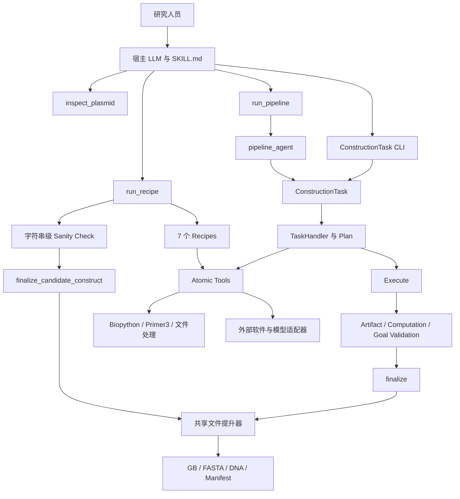
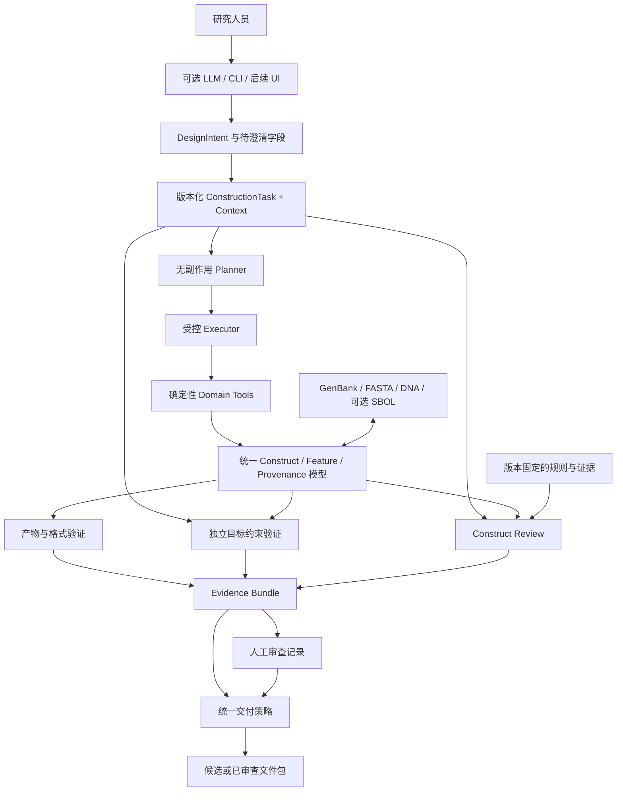

# iGEM 2026 Software Architecture, Product & Safety Audit

天津大学 iGEM 2026 软件项目审计报告

| 项目 | 说明 |
|---|---|
| 项目 | SnapGene DNA Design |
| 审计对象 | `D:\codex_project\github\snapgene-dna-design` |
| 证据快照 | 2026-09-05 审计期间的工作树，HEAD `1d7ec2c` |
| 文档生成 | 2026-09-06 |
| 本轮性质 | 将已完成审计整理为文档，没有重新运行审计 |
| 主要目标 | Best Software 竞争力与可验证的 Safety 模块设计 |
| 边界 | 审计阶段不修改源代码；本文件不代表实施批准 |

审计包含原有未提交修改：`DEVELOPMENT-MANIFEST.json`、`SKILL.md`，以及未跟踪的 `scripts/annotate_primers.py`、`tests/test_annotate_primers.py`。结论对应该快照，不自动适用于之后版本。

本文区分代码事实、当次运行结果、审计判断和拟议方案。测试通过不等于湿实验验证；拟议 benchmark 数量、指标和工作量不属于已完成成果。

## 1. Executive verdict

1. **项目已经是真实软件工具，不是纯 prompt wrapper。** 当前工作树有 209 个 Python 文件，约 5.3 万行，包含测试；运行时注册 39 个工具，已有确定性计算、任务契约、配方、验证和格式交付。
2. **当前属于功能较丰富的工程原型，尚不能支持 `production-grade` 声明。** 已复现酶切末端错误、复合 feature 提取错误、缺失审查报告仍可交付等问题。
3. **最大优势是已有资产可以形成闭环：** 意图、构建操作、注释迁移、验证、可编辑文件、来源记录。价值在闭环的可靠性，而非功能数量。
4. **最大问题是“验证通过”的含义不统一。** Recipe 和 Pipeline 使用不同准入条件；部分 `goal_valid` 只证明输出符合执行计划，未证明计划符合用户目标。
5. **测试规模可观，验证说服力不足。** 调整入口和编码后，631 项测试完成，7 项跳过，无失败；这些测试没有捕获本次最小反例。
6. **100/100 benchmark 不能证明意图理解或用户体验优秀。** 十项任务通过断言后，都直接写入五项满分。
7. **Best Software 有可发展的基础，目前不足以主张获奖级竞争力。** 缺少独立正确性证据、外部用户验证和稳定的新用户路径。
8. **Safety 首选：构建设计上下文与证据审查。** 检测宿主、构件、用途、来源及既有审查之间的缺失、冲突和失效，输出可解释发现。
9. **先修核心正确性，再接 Safety。** 现有错误会直接污染 Safety 的输入与判断。
10. **Genome Resurrection 适合作为复杂真实案例，不应成为软件功能边界。** 软件面向广泛研究和实验室研发，iGEM 是早期验证群体。

## 2. What the software actually is

**当前定义：由宿主 LLM 驱动的 Python DNA 构建工具集，包含配方执行器、组合流水线、任务验证及 SnapGene/GenBank/FASTA 交付。**

| 层次 | 当前事实 |
|---|---|
| A. 文档声称 | Production-grade、38 个纯确定性工具、统一 authoritative gate、完整注释交付 |
| B. 代码实现 | 39 个注册工具：34 compute、3 inspect、1 write、1 external；两类交付准入路径；多个历史入口 |
| C. 本次验证 | 环境检查、快速检查、标签配方、组合 Pipeline、发布打包、完整测试、部分内部格式往返 |
| D. 尚不能证明 | 自然语言理解可靠性、普遍生物学正确性、完整注释保真、宿主适用性、真实用户效率提升、湿实验成功率 |

宿主 LLM 负责理解请求、选择工具、编写参数和 Pipeline。软件确实承担了序列计算。问题在于，“让 LLM 负责思考”不能同时意味着“让 LLM 自己决定目标是否已经完成”。

精准定位句：

> This software is an agent-accessible DNA construction toolkit for synthetic biology researchers that executes reproducible sequence operations and produces editable design artifacts with validation evidence.

“验证证据”是已有能力；“证据足以支持完整设计正确性”仍需补齐。

## 3. Current architecture



另有 `agent/orchestrator.py → DesignSpec → planning` 历史链路，其 formal 模式已明确禁用，不能视为当前正式入口。

### 架构判断

| 问题 | 判断与影响 |
|---|---|
| 模块边界 | Tools、Recipes、Handlers、Gate 已存在；边界执行不完整，部分操作在错误阶段执行 |
| Skill 与逻辑分离 | 大量计算已进入代码；Skill 对验证和交付的描述强于实际实现 |
| LLM 合理职责 | 理解目标、澄清缺失信息、选择策略、解释结构化结果 |
| 程序必须承担 | 解析、坐标转换、计算、变换、规则适用性、目标验证、文件一致性 |
| 输入 schema | ConstructionTask 顶层较严格，内部 operation、Pipeline steps 等仍宽松 |
| 输出 schema | 部分工具结果为 dict/any/string，完整结果不能自然串联 |
| 扩展新工具 | Registry 提供基础，但参数 schema 和 callable 仍需人工同步 |
| 强耦合 | core 与 scripts 存在反向依赖和路径注入；入口依赖仓库布局 |
| 重复实现 | 多套提取、检查、写出语义并存；兼容 re-export 不应误判为完整重复实现 |
| 测试性 | 工具和 handler 易做反例测试；独立 oracle 不足 |
| Failure handling | 有结构化错误，但 missing/unknown/pass 语义不一致，部分 CLI 错误退出行为不统一 |
| 大型项目 | 部分算法存在范围截断；本次没有大型基因组性能与覆盖验证 |
| 模型锁定 | 核心无需某家 LLM API；仍依赖 Python、目录约定和外部程序 |
| 他队使用 | 生物任务通用，但安装、路径和文档阻碍首次使用 |
| 新开发者接手 | 有大量文档，但当前入口、历史路径和版本声明不统一 |

**物理交付位置统一，不代表逻辑准入条件统一。** 两条路径最终进入相同文件提升器，但没有经过同一套验证。

**重算不等于独立验证。** Pipeline 的规划与重算调用同一套工具逻辑，共同错误可以同时通过。

证据：[组合 Pipeline](D:/codex_project/github/snapgene-dna-design/core/handlers/composite_pipeline.py:46)、[任务适配入口](D:/codex_project/github/snapgene-dna-design/agent/pipeline_agent.py:100)、[旧入口禁用逻辑](D:/codex_project/github/snapgene-dna-design/agent/orchestrator.py:49)。

## 4. Repository health

### 4.1 审查范围与运行结果

完成全目录文件索引，检查 README、Skill、依赖、schema、源码关键路径、测试、fixtures、规则、来源文档、外部适配器、CLI、构建与 CI、许可证、Git 状态及近期历史。160 个非测试 Python 模块完成语法解析检查；49 个测试模块进入完整测试发现流程。没有发现独立应用 UI 或标准 Python package 安装配置。

| 检查 | 结果 | 能证明什么 |
|---|---|---|
| quick_validate.py | 通过 | 基础分析、酶切、写出和验证入口能运行 |
| check_env.py | core_ok=true，release_real_ok=false | 核心依赖可用；Cas-OFFinder v2/v3 缺失 |
| 默认 run_test_suite.py | 566 项，5 errors，7 skipped | 独立脚本入口和中文环境存在问题 |
| 模块入口，PYTHONUTF8=1，真实 Primer3 启用 | 631 项，0 failures/errors，7 skipped | 当前环境下已执行测试通过 |
| 十任务 benchmark | 100/100，约 1.36 秒 | 十条预设脚本断言通过 |
| 标签配方 | 66 bp component | 配方 CLI 可用，但不是完整质粒交付 |
| 组合 Pipeline | 717 bp，verified-candidate | 该路径可运行；输出 feature 数为 0 |
| 发布构建 | 两种 ZIP 成功 | 打包流程可运行；版本 0.9.1-dev2 |
| 两个 rich fixture 转 DNA | core passed，strict failed | 核心结构可保留，qualifier 存在丢失 |

当次环境为 Windows、Python 3.12.4；核心依赖包括 Biopython 1.88、snapgene_reader 0.1.23、sgffp 0.21.0、jsonschema 4.26.0；Primer3 core 2.6.1 可用。环境检查发现 SnapGene 可执行文件，但本次列出的往返测试只进行了内部 read-back，未完成官方应用往返验收。

默认测试错误涉及：

- run_test_suite.py 只添加 scripts/ 导入路径，部分测试找不到 core 或 scripts。
- 子进程输出与读取编码不一致。
- 中文路径下按默认 GBK 读取 UTF-8 文件失败。

因此不能把后一次通过描述为“默认安装后全部测试稳定通过”。

运行记录：[默认测试](C:/Users/祝浩淇/AppData/Local/Temp/snapgene-readonly-audit-0s77snap/full-tests.log)、[UTF-8 模块入口测试](C:/Users/祝浩淇/AppData/Local/Temp/snapgene-readonly-audit-0s77snap/tests-module-utf8.log)、[最小反例](C:/Users/祝浩淇/AppData/Local/Temp/snapgene-readonly-audit-0s77snap/targeted-probes.json)、[额外反例](C:/Users/祝浩淇/AppData/Local/Temp/snapgene-readonly-audit-0s77snap/additional-probes.json)、[Pipeline 结果](C:/Users/祝浩淇/AppData/Local/Temp/snapgene-readonly-audit-0s77snap/pipeline-result.json)。临时目录链接用于本机追溯，不能代替公开发布证据。

### 4.2 P0：候选交付入口对缺失检查报告默认放行

finalize_candidate_construct() 使用：

```python
if not sanity_check.get("all_applicable_pass", True):
```

最小反例使用含内部终止密码子的合成 CDS。实际 sanity check 失败，向公开函数传入空 sanity_check={} 后，返回 delivery_status=delivered。

这是 API 层反例，不代表普通 CLI 用户会自动传入空报告。但它否定“只有经过验证的构建才能交付”的全局保证。该路径也没有执行正式任务路径的完整 task/plan/execution/validation 链验证。

证据：[候选交付准入](D:/codex_project/github/snapgene-dna-design/core/runtime_gate.py:358)。

### 4.3 P0：复合 feature 被展开成外包区间

get_feature() 使用 location.start/end 提取连续区间，没有按 CompoundLocation.parts 提取。

| 输入 | 正确提取 | 当前提取 |
|---|---:|---:|
| 自建 joined CDS | 12 bp | 18 bp，包含间隔区 |
| rich_cross_origin.gb | 9 bp | 16 bp |
| 简单负链 CDS | 9 bp | 9 bp，正确 |

Sanity checker 使用类似切片方式。错误会改变后续设计实际使用的序列，不只是图谱显示问题。

证据：[feature 提取](D:/codex_project/github/snapgene-dna-design/core/tools/feature_ops.py:73)、[CDS 审查提取](D:/codex_project/github/snapgene-dna-design/core/guardrails/checklist.py:437)。

### 4.4 P0：上下文和注释在主要路径丢失

Recipe CLI 将 prod_seq 字符串传给 sanity checker，没有传 res.features；Gibson Recipe 自身返回 features=[]。Pipeline 把每步结果压成 out_seq。

本次从带注释质粒提取 GFP，输出 717 bp、0 features，同时三层验证均为 true。这不证明该序列错误，但证明 verified 不包含完整注释保留保证。

证据：[Recipe 审查调用](D:/codex_project/github/snapgene-dna-design/scripts/run_recipe.py:82)、[Pipeline 字符串环境](D:/codex_project/github/snapgene-dna-design/core/handlers/composite_pipeline.py:74)、[Gibson 配方](D:/codex_project/github/snapgene-dna-design/core/recipes/gibson.py)。

### 4.5 P0：酶切查询与模拟互相矛盾

对于 AAAGAATTCTTT，EcoRI 查询返回 top cut=4、bottom cut=8，却标为 blunt，overhang 为空；消化模拟报告 AATT、5prime。

原因：restriction_hits() 不提供 overhang 字段，上层默认回退到 blunt。默认 inspect 直接展示该结果，宿主 LLM 可能据此选策略。

证据：[错误默认值](D:/codex_project/github/snapgene-dna-design/core/tools/restriction.py:185)；切割几何对照 [NEB 官方识别与切割表](https://www.neb.com/en-us/tools-and-resources/selection-charts/alphabetized-list-of-recognition-specificities)。

### 4.6 P0：Pipeline 的目标验证不够独立

适配入口创建空 target 和空 assumptions。组合 handler 主要检查序列非空、序列哈希符合 plan、通用 sanity check 通过。expected_components、forbidden_components 虽被放入计划，该 handler 的 validate_goal() 没有逐项检验它们。

执行错误计划，也可能得到符合计划的正确输出。

证据：[空目标构建](D:/codex_project/github/snapgene-dna-design/agent/pipeline_agent.py:131)、[目标验证](D:/codex_project/github/snapgene-dna-design/core/handlers/composite_pipeline.py:190)。

### 4.7 P1：规划和重算执行有副作用工具

Registry 已区分 write、external，但 Pipeline dispatch 不按类别限制执行阶段。用只增加内存计数器的 write 工具验证：plan 和 recompute 后计数为 2。真实 registry 存在文件导出和打开 SnapGene 工具。

规划、验证可能重复写文件或启动程序。应利用现有 category 修复边界，不必增加另一套调度框架。

### 4.8 P1：生物学启发式被写成普遍规则

- gene 与 CDS 一起做读码框检查，非编码基因可被误报。
- CDS 审查固定 start_offset=0，此处未使用 codon_start、transl_table。
- BIO-08 只有 ori 和 marker 都没找到才失败，只找到其中之一即可通过。
- 用名称关键词和短 motif 推断功能性复制起点。
- 宿主缺失时，甲基化检查仍输出确定性阻断措辞。
- CRISPR HDR Recipe 自动启用 U6 检查，传入整个 donor 序列，未限定对应转录单元。
- 引物检查只取前两条。
- 反向重复扫描起点上限为 8000，不能据此声称覆盖整条大型序列。

这些主要属于设计质量或适用性检查，不能直接升级为 biosafety 判断。证据：[checklist 实现](D:/codex_project/github/snapgene-dna-design/core/guardrails/checklist.py)。

### 4.9 P1：文件一致性被描述成签署与强正确性保证

Gate 默认比较三种文件的序列一致性；官方 SnapGene 往返可选。SHA-256 支持内容身份与变更检测，不能单独证明来源真实、人类身份认证、生物学功能正确或审查充分。

两次 DNA 往返显示 note、gene 等 qualifier 丢失。现有比较器将部分 note 丢失归为 safe difference；若未来 Safety 信息写在 note，这个分类将不再可靠。

证据：[三格式检查](D:/codex_project/github/snapgene-dna-design/core/runtime_gate.py:275)、[语义比较器](D:/codex_project/github/snapgene-dna-design/scripts/validate_roundtrip.py)。

### 4.10 整体健康度

| 方面 | 判断 |
|---|---|
| 模块化 | 分层可用；core 与 scripts 仍有反向依赖和路径注入 |
| 技术债 | 多代入口、状态和数据语义并存，需要合并关键连接 |
| 重复代码 | 提取与检查语义重复；scripts/construct_model.py 等已是兼容 re-export |
| 测试 | 数量充分，独立真值和关键负例不足 |
| 文档 | 数量充分，当前性不足，版本、测试数、工具数和依赖描述冲突 |
| 依赖 | 核心部分锁版本；Primer3 同时出现在核心与 optional requirements；缺完整解析锁定 |
| 可移植性 | Windows/Linux CI 存在；中文路径问题仍可复现；本次无 macOS 运行证据 |
| 可复现性 | 确定性工具可复现；LLM 层缺固定评测协议；重算存在副作用 |
| 可维护性 | 无标准安装包配置；外部开发者依赖仓库目录和 sys.path |
| Git 与发布 | 仅看到 GitHub remote；没有当前指定 iGEM GitLab 发布证据 |

## 5. Best Software audit

官方 2026 页面确认六个 ballot questions。资格要求包括 OSI-approved license、iGEM 指定 GitLab 源码仓库；Software & AI Village 队伍不能参评。六项问题未要求软件只能服务本队湿实验。泛用定位成立，但仍需证明实际需求与用途。[官方 Best Software 规则](https://competition.igem.org/judging/special-prizes)

下列 1–6 分为审计模拟，不是官方未公开的逐题细则，也不是获奖概率。

| 维度 | 当前状态与证据 | 最大缺口 | 最值得补的一件事 | 优先级 | 难度 | 边际收益 | 模拟分 |
|---|---|---|---|---|---|---|---:|
| Standards | GB、FASTA、DNA、JSON Schema、坐标模型 | 语义保真不稳定；未见 SBOL 实现 | 有损/无损字段矩阵与独立往返测试集 | P0/P1 | 中 | 很高 | 3 |
| Validation | 631 项条件通过；预设 benchmark；真实 Primer3 | 自验证和预设评分偏多；外部证据不足 | 隐藏真值集，分开测计算、目标满足和用户成功率 | P1 | 中高 | 最高 | 3 |
| Usefulness | 通用构建任务，与湿实验主项目解耦 | 他队持续使用及节省时间未证明 | 3 个外队完成真实任务并记录失败原因 | P1 | 中 | 很高 | 3 |
| Integration | CLI、可导入工具、registry、外部引擎、标准文件 | 无稳定安装包；结构化结果链不完整 | 可安装 package 与版本化 CLI/API 契约 | P1 | 中 | 高 | 3 |
| User friendliness | inspect、Recipe CLI、Markdown | 完整示例不足，旧入口混杂，错误语义不统一 | 安装后可复制执行的完整 happy path | P1 | 低中 | 很高 | 2 |
| Documentation / extensibility | schema、CI、开发文档、规则来源 | 多个当前架构；缺性能与可靠扩展示例 | 当前入口说明与增加一个工具的完整示例 | P1 | 低中 | 高 | 3 |

### Eligibility

- 根目录 MIT license 属于 OSI-approved 类型。[OSI MIT 页面](https://opensource.org/license/mit)
- 第三方模型与数据另有许可证记录；部分 notice 描述历史 fixtures，需核对发布包实际内容。
- 当前 remote 只有 GitHub。不能据此断言团队未建 GitLab，但此仓库没有完成指定托管要求的证据。
- 团队 Village 未从现有材料确认，应核对参评资格。
- 审计时官方日历列出 Software Freeze：2026-10-21 15:00 UTC，北京时间 23:00。从 2026-09-05 起约剩六周半。[官方日历](https://competition.igem.org/about/calendar)

不必为拿分立即增加 SBOL 标签。先把已支持格式做可靠，收益更高。

## 6. Product audit

**用户：** 有明确 DNA 构建需求，希望减少跨工具操作的研究人员和实验室研发团队。

**问题：** 自然语言目标到可编辑构建文件之间，容易发生坐标误解、方向错误、注释丢失、来源混淆和验证遗漏。

**相对通用 LLM 的价值：** 从真实文件读取，用算法执行变换，将目标变为可检验条件，记录未完成检查，交付可追溯文件。当前这些环节之间仍有缺口。

| 替代方案 | 已有优势 | 本项目合理定位 |
|---|---|---|
| SnapGene | 图谱、克隆模拟、引物、历史与文件操作 | 自动编排工作流并提供机器可读证据，不靠“也能做克隆”竞争 |
| Benchling | 设计、组装、协作与追溯 | 本地、可脚本化、可独立运行的小型执行层 |
| ApE | 免费编辑与多类克隆模拟 | 减少手工操作，显式验证任务约束 |
| Biopython | 数据结构与基础算法 | 将基础库组合成有任务语义的产品 |
| SBOL tooling | 设计表示、关联与标准互操作 | 执行和审查工作流，通过适配器交换设计信息 |

竞品能力依据：[SnapGene](https://support.snapgene.com/hc/en-us/categories/10304176221716-SnapGene-User-Guide)、[Benchling](https://www.benchling.com/molecular-biology)、[ApE 论文](https://jorgensen.biology.utah.edu/%20%20MANUSCRIPTS%20pdfs/2022%20Davis%20ApE.pdf)、[Biopython](https://biopython.org/wiki/SeqRecord)、[SBOL](https://sbolstandard.org/)。

**差异化候选：可执行的设计意图契约，以及贯穿构建、注释和审查的证据链。** 尚不能宣称行业唯一。

需要纠正的产品表达：

- “Host LLM is sole brain”不能替代明确契约。
- 工具数量增长不等于成熟度增长。
- 没有用户测试，不能给 usability 实证满分。
- 文献引用不能自动使配方成为经过验证的黄金 SOP。

陌生实验人员在 5–10 分钟内独立完成完整质粒设计尚无证据。建议主路径收敛为：读取示例 → 确认目标与上下文 → 执行构建 → 查看发现与缺失项 → 导出候选 → 完成人工审查后记录交付。

优先补完整示例、稳定入口、清晰状态、独立目标检查；暂缓扩充克隆菜单、评分模型和独立 GUI。

## 7. Safety design space

### 7.1 三类价值必须区分

- **设计正确性：** 序列、方向、读码框、接缝是否符合目标。
- **Biosafety decision support：** 宿主、修改、用途及控制措施相关信息是否充分，是否出现值得重新审查的变化。
- **数据与操作安全：** 来源、完整性、上传许可、文件覆盖。

现有 BIO-01 至 BIO-10 主要属于第一类，部分涉及适用性。整体改名 Safety 不成立。

WHO 风险评估框架重视实际活动与上下文。由此推导，本项目适合收集、核对和追踪审查依据，而非从 DNA 字符串直接给风险等级。[WHO Risk Assessment](https://www.who.int/publications/i/item/9789240011458)

以下六个候选对应不同决策点，均定位为 decision-support / design-review tool，不是 biosafety certification system，不输出 SAFE/UNSAFE。

### 7.2 A：构建上下文与证据审查

| 分析项 | 方案 |
|---|---|
| 真实问题、用户、时机 | 设计者和审查者准备构建或交付时，宿主、构件角色、用途、来源可能缺失或矛盾 |
| 输入 | 构建文件、结构化上下文、来源与审查证据 |
| 实际计算 | 解析 features，核对声明与产物，检查材料角色、证据关联和规则适用性 |
| 输出 | 缺失项、明确冲突、未完成评估、受影响字段及下一步证据需求 |
| Deterministic | 规则匹配、关联、状态、证据定位、版本绑定 |
| LLM | 将自然语言转为待确认字段，解释已产生的发现 |
| 标准与数据格式 | GenBank/FASTA + 版本化 JSON sidecar；可选 SBOL 适配 |
| 外部数据库 | MVP 不需要在线危险序列库 |
| 数据可靠性与维护 | 固定版本的指南、规则依据和专家审阅；维护负担中等 |
| 避免误报 | 先判 applicability；未知不当异常；注释缺失不等于功能缺失 |
| 避免黑盒判断 | LLM 不生成最终 findings，不补造证据，不裁定安全性 |
| 解释依据 | 每条发现链接具体字段、观测、规则、来源和限制 |
| 验证与 benchmark | 删除字段、制造声明冲突、导出丢信息的配对案例；测 precision/recall |
| 他队测试 | 使用普通构建和实际上下文即可，不依赖本队湿实验 |
| 架构接入 | 现有检查与交付节点，共用 review 服务 |
| Genome Resurrection | 核对 donor、recipient、传播宿主和编辑系统状态 |
| 独立价值 | 任意多阶段 synthetic biology 构建均有相似问题 |

六维潜在收益：Standards 高，Validation 高，Usefulness 高，Integration 高，User friendliness 高，Documentation 高。是完成后潜力，不是当前得分。

### 7.3 B：生物设计语义保真检查

| 分析项 | 方案 |
|---|---|
| 真实问题、用户、时机 | 文件编辑或转换丢失来源、说明、feature 位置；跨软件交接前由设计者使用 |
| 输入 | 转换前后 records、metadata 和待保留语义集合 |
| 实际计算 | 比较序列、拓扑、分段坐标、qualifier 和关联信息 |
| 输出 | 损失清单、格式能力差异、受影响审查记录 |
| Deterministic | 比较、规范化、差异分类与字段追踪 |
| LLM | 不需要；可用于解释差异 |
| 标准与数据格式 | GenBank、DNA、JSON；后续 SBOL |
| 外部数据库 | 无需在线数据库 |
| 数据可靠性与维护 | 依赖格式定义、转换库版本和明确能力矩阵 |
| 避免误报 | 排序等无语义变化单独处理；不能把所有 note 丢失视为安全差异 |
| 避免黑盒判断 | 明确字段比较，不推断设计整体安全性 |
| 解释依据 | 展示原值、新值、丢失字段与引用关系 |
| 验证与 benchmark | rich fixtures、往返矩阵、故意丢 qualifier 的负例 |
| 他队测试 | 提交跨工具文件对，检查真实交接损失 |
| 架构接入与维护 | 复用比较器和 ConstructModel，成本较低，格式维护成本中等 |
| Genome Resurrection | 复杂酵母构建适合检验注释和来源保留 |
| 独立价值 | 通用互操作价值很高 |

六维潜在收益：Standards 很高，Validation 很高，Usefulness 高，Integration 高，User friendliness 中，Documentation 高。单独作为 biosafety feature 的科学价值偏弱，应作为基础设施。

### 7.4 C：设计变更触发的审查失效检测

| 分析项 | 方案 |
|---|---|
| 真实问题、用户、时机 | 已审查构建换宿主、payload 或用途后仍沿用旧结论；多人迭代时使用 |
| 输入 | 两版设计、上下文、审查记录及规则依赖关系 |
| 实际计算 | 语义 diff，定位受变化影响的审查依赖 |
| 输出 | 需重审的结论、变化原因、未受影响记录 |
| Deterministic | Diff、依赖关系和失效状态 |
| LLM | 解释变化，不决定失效范围 |
| 标准与数据格式 | 版本化 JSON、GenBank、provenance |
| 外部数据库 | 不需要 |
| 数据可靠性与维护 | 维护规则依赖，成本低中；不依赖大型生物知识库 |
| 避免误报 | 区分格式变化、旋转等价、注释纠错和实质变化，仅使相关结论失效 |
| 避免黑盒判断 | 明确 dependency 规则，不让模型自行判断风险是否增加 |
| 解释依据 | 变化字段、前后值、依赖规则与受影响审查 |
| 验证与 benchmark | 变更矩阵；测 stale-review 检出率、不必要重审率 |
| 他队测试 | 对历史设计版本盲测 |
| 架构接入 | 复用现有 hash、revision、diff 和交付记录 |
| Genome Resurrection | donor/recipient 背景切换自然触发 |
| 独立价值 | 任意长期、多人的 DNA 设计项目均可使用 |

六维潜在收益：Standards 中，Validation 高，Usefulness 高，Integration 高，User friendliness 高，Documentation 高。

### 7.5 D：有限范围的宿主与载体适用性核对

| 分析项 | 方案 |
|---|---|
| 真实问题、用户、时机 | 把“注释存在 ori/marker”误认为“在目标宿主适用”；选择载体时使用 |
| 输入 | 宿主/菌株标识、元件身份、功能声明、参考证据 |
| 实际计算 | 匹配有限、经审阅的适用关系 |
| 输出 | supported、contradicted、unknown，附适用范围 |
| Deterministic | 受控关系匹配 |
| LLM | 收集待确认声明，不能外推宿主适用性 |
| 标准与数据格式 | 稳定标识、GenBank 注释、JSON |
| 外部数据库 | 需要小型人工维护知识库 |
| 数据可靠性与维护 | 公开记录、厂商资料需保留版本；领域审阅和长期维护成本高 |
| 避免误报 | 不从模糊名称推断功能；未收录即 unknown；菌株证据不外推到整个属 |
| 避免黑盒判断 | 只输出证据支持的具体关系，不输出总体安全等级 |
| 解释依据 | 显示宿主、元件、资料出处、实验或声明条件 |
| 验证与 benchmark | 专家标注配对集，按菌株/元件家族留出测试 |
| 他队测试 | 使用普通载体，检测系统支持范围内的适用性 |
| 架构接入 | 可接 BIO-08，但须先重写当前判定逻辑 |
| Genome Resurrection | 多宿主酵母流程自然适配 |
| 独立价值 | 不依赖本项目；覆盖范围受知识库限制 |

六维潜在收益：Standards 中，Validation 高，Usefulness 高，Integration 高，User friendliness 高，Documentation 高。主要风险是有限覆盖被误读为普遍检查。

### 7.6 E：构建来源与交接证据包

| 分析项 | 方案 |
|---|---|
| 真实问题、用户、时机 | 合成前或交接时，来源、版本、修改历史、未解决问题散落；设计者、实验员、审查者使用 |
| 输入 | 源文件、accession/version、操作记录、已有审查 |
| 实际计算 | 核对内容身份、引用完整性、来源和文件对应关系 |
| 输出 | 机器可读 dossier 与简短人类报告 |
| Deterministic | 内容身份、引用关联、文件绑定 |
| LLM | 写摘要，不补造来源 |
| 标准与数据格式 | GenBank accession/version、JSON provenance，后续 SBOL PROV-O |
| 外部数据库 | 离线可用；在线来源解析为可选增强 |
| 数据可靠性与维护 | 保留原始引用、版本和核验状态；维护低中 |
| 避免误报 | 来源未验证与来源错误分开；hash 不证明来源真实 |
| 避免黑盒判断 | 不从“有来源”推断“设计安全” |
| 解释依据 | 文件、版本、来源记录与操作链逐项关联 |
| 验证与 benchmark | 错版本、错文件、缺引用、缺链路与正常交接；测准确率、漏检和交接时间 |
| 他队测试 | 交接普通构建，与现有工作方式对比 |
| 架构接入 | 复用 provenance 和 export 资产 |
| Genome Resurrection | 多来源构件链适合展示 |
| 独立价值 | 通用价值高；biosafety 贡献须证明补足实际审查信息 |

六维潜在收益：Standards 高，Validation 中，Usefulness 高，Integration 高，User friendliness 中，Documentation 高。

### 7.7 F：序列外发与工具副作用控制

| 分析项 | 方案 |
|---|---|
| 真实问题、用户、时机 | 在线分析发往错误服务，或规划阶段写文件；执行外部操作前使用 |
| 输入 | 目的地址、用途、序列身份、操作类别、既有许可 |
| 实际计算 | 核对目的、内容和作用域绑定；限制执行阶段 |
| 输出 | 执行、待确认、拒绝及操作记录 |
| Deterministic | 授权核对、许可消费、类别限制与 dispatch |
| LLM | 解释目的，不能扩大许可 |
| 标准与数据格式 | JSON receipt、tool category、provenance |
| 外部数据库 | 无生物数据库依赖 |
| 数据可靠性与维护 | 外部服务政策需要持续更新；维护中等 |
| 避免误报 | 精确匹配目的、内容和作用域，仅在实际副作用发生时检查 |
| 避免黑盒判断 | 执行权限由明确策略决定，不用模型判断代替 |
| 解释依据 | 指明不匹配项、许可范围、操作与时刻 |
| 验证与 benchmark | 本地 mock 测试改目的、改序列、重放、验证阶段误写，不上传真实序列 |
| 他队测试 | 可直接复用相同适配器与 mock 测试 |
| 架构接入 | 已有 SequenceUploadConsent 和工具类别，复用价值高 |
| Genome Resurrection | 项目序列可作示例，无需绑定主项目 |
| 独立价值 | 数据和操作安全价值高，不适合作为唯一 biosafety 功能 |

六维潜在收益：Standards 中，Validation 高，Usefulness 高，Integration 高，User friendliness 中，Documentation 高。宿主 LLM 自身的数据处理不受该模块全面控制，不能声称端到端隐私保障。

## 8. Safety decision matrix

以下为基于当前代码和范围的工程判断，不是实测排名。工作量假设为一名熟悉代码的开发者、有领域审阅者定期参与；不包含修复 P0 或外部测试等待时间。

| 比较项 | A 上下文审查 | B 语义保真 | C 变更重审 | D 宿主适用性 | E 来源交接 | F 外发控制 |
|---|---|---|---|---|---|---|
| Scientific value | 高 | 中 | 中高 | 高 | 中 | 低中 |
| 实际需求 | 高，待用户验证 | 已有缺陷证据 | 高，待用户验证 | 高 | 高 | 高 |
| 独特性潜力 | 中高 | 中 | 中高 | 中 | 中 | 低中 |
| 当前架构适配 | 高 | 很高 | 高 | 中 | 很高 | 很高 |
| Best Software 相关性 | 很高 | 很高 | 高 | 高 | 高 | 中 |
| Standards 潜力 | 高 | 很高 | 中高 | 中 | 高 | 中 |
| Validation 潜力 | 很高 | 很高 | 很高 | 高 | 高 | 很高 |
| 他队复用 | 高 | 很高 | 高 | 受知识库限制 | 高 | 高 |
| Integration 潜力 | 高 | 高 | 高 | 高 | 高 | 高 |
| UX 潜力 | 高 | 中高 | 高 | 高 | 中高 | 中 |
| 实现复杂度 | 中 | 低中 | 低中 | 高 | 低中 | 低中 |
| 维护负担 | 中 | 中 | 低中 | 高 | 低中 | 中 |
| 外部数据依赖 | 低 | 低 | 低 | 高 | 低中 | 低 |
| 误报风险 | 中，可控 | 低中 | 低中 | 高 | 低 | 低 |
| 可解释性 | 很高 | 很高 | 很高 | 高 | 很高 | 很高 |
| 主项目适配 | 很高 | 高 | 很高 | 很高 | 高 | 中 |
| MVP 工作量 | 10–15 工程人日 | 5–8 人日 | 6–10 人日 | 15–25 人日另加数据审阅 | 5–8 人日 | 4–7 人日 |
| 扩展性 | 高 | 高 | 高 | 数据成本明显 | 高 | 高 |

**Rank 1：A，构建上下文与证据审查。** 位于设计交付决策点，同时提升六维。限定信息缺失、明确冲突、审查有效性，不扩展为自动生物风险评级。

**Rank 2：C，设计变更触发重审。** 如果一周内不能获得领域专家协助定义 A 的规则和标签，选择 C。真值更容易客观确定，可复用 revision/hash/diff。

**基础工作：B。** 无论选 A 或 C，都必须先修语义保真；不单独包装为完整 biosafety 模块。

**Postpone：D。** 科学价值高，知识库维护和宿主外推问题超过当前预算。

**复用而不另起项目：E、F。** 作为 A/C 支持组件。

## 9. Recommended Safety MVP

### 9.1 Goal 与用户流程

名称建议：**Construct Review**。展示具体发现与证据，不增加泛泛的 Safety tab。

目标：在构建交付前，发现影响人工审查的信息缺失、矛盾、过期记录。

1. 导入构建与来源文件。
2. 自动提取注释和来源标识。
3. 只询问当前审查确实需要、文件中没有的上下文。
4. 运行确定性规则。
5. 展示发现、依据、缺失证据和下一步。
6. 补充信息后重算相关规则。
7. 输出报告，绑定到设计与上下文版本。

计算完成、人工审查完成、允许实验操作是不同状态。

### 9.2 Input 与 schemas

建议三个独立、严格、版本化对象：

| 对象 | 最小字段 |
|---|---|
| ConstructContext | 构建标识、内容身份、来源材料、传播宿主、目标宿主、用途、构件功能声明、编辑系统声明、证据引用 |
| ReviewRule | rule_id/version、适用条件、所需事实、确定性检查、发现模板、来源、维护者、测试案例 |
| ReviewResult | 输入与上下文身份、规则包版本、逐条结果、未完成检查、证据定位、审查状态 |

字段区分文件观察事实、用户声明、外部证据支持的声明、未核实信息。

organism/source 不能直接充当最终 recipient。GenBank /lab_host 有特定定义，不能改造成通用实验上下文字段；额外上下文放 sidecar。[INSDC Feature Table](https://www.ddbj.nig.ac.jp/ddbj/feature-table.html)

### 9.3 Core logic

首版约 10 条规则，限定四类：

| 类别 | 检查示例 |
|---|---|
| 上下文充分性 | 需要宿主适用性审查，但 recipient/strain 未提供；传播宿主与目标宿主角色混用 |
| 声明与产物一致性 | 声明编辑工具暂时使用，但产物仍有经确认的对应 feature；声明 marker 已移除，但产物保留关联注释 |
| 证据有效性 | 证据关联旧构建、旧菌株或旧用途；关键声明没有来源 |
| 交付保真 | 导出丢失支撑审查的 feature、来源或说明；sidecar 与实际序列版本不匹配 |

第二类仅基于明确注释或确认过的构件身份，不做不受控名称猜测，不判断构件本身危险。

每条规则状态：finding、clear_within_scope、unknown、not_applicable、execution_error。unknown 不计为检测阴性，not_applicable 不计为已完成检查。

### 9.4 Output 与 explainability

> **发现：当前宿主与已有审查记录不一致。**
>
> 位置：context.recipient。
>
> 依据：本次上下文声明与上一审查记录使用不同菌株标识。
>
> 检查范围：只比较明确标识，不评估菌株风险等级。
>
> 下一步：审查者确认原结论是否仍适用，并更新宿主相关证据。

Confidence 用证据状态与匹配方式表达，例如 exact identifier match、user-declared、unverified source；不制造未经校准的百分比。

### 9.5 Deterministic 与 LLM 分工

| 程序必须完成 | LLM 可以承担 |
|---|---|
| 解析、坐标语义 | 自然语言整理为候选上下文 |
| 适用性、规则执行 | 解释为何需要某字段 |
| 版本、内容身份、引用关联 | 基于已生成发现写摘要 |
| findings、coverage、失效状态 | 帮用户定位原始材料 |
| 导出、报告绑定 | 不补造证据，不裁定安全性 |

### 9.6 Standards、dependencies、CLI/API

- 首版使用 Biopython、现有 JSON Schema、GenBank/FASTA、JSON sidecar。
- DNA 用于编辑互操作；审查证据不能只保存在可能丢失的 qualifier。
- SBOL 为可选适配器，不是 MVP 前置依赖。映射 Component、Sequence、来源关系时声明自定义字段，不能把自定义 JSON 称为符合 SBOL。SBOL 3.1 提供 PROV-O 表达基础。[SBOL 3.1 规范](https://sbolstandard.org/docs/SBOL3.1.0.pdf)
- 不新增在线生物风险数据库，不训练模型。
- 提供一个库函数和一个 CLI；Skill 调用相同接口。
- CLI 区分“完成审查但有发现”和“执行失败”；自动化需要时提供显式严格退出模式。
- 人类输出复用 Markdown 报告，暂不新建完整 Web 应用。

限制：只发现支持范围内的信息问题；不能发现所有未注释生物功能，不能认定湿实验成功、合规或安全，不能替代领域审查。

### 9.7 Validation / benchmark

标签任务是检测审查信息问题，不是检测危险生物设计。

建议 200 个案例，均为拟议数量：

| 分组 | 数量 | 内容 |
|---|---:|---|
| 完整正常案例 | 40 | 上下文充分、声明一致、证据有效 |
| 故意缺失或矛盾 | 50 | 缺宿主、角色混淆、声明与产物不符 |
| Annotation edge cases | 40 | join、跨原点、负链、partial CDS、多值 qualifier、Unicode |
| Host / use context | 40 | 相同构建，不同菌株、用途、来源角色 |
| 格式与版本交接 | 30 | GB/DNA/FASTA+sidecar、丢字段、旧审查、内容不匹配 |

标注与划分：

1. 冻结规则范围、输出定义、标签准则。
2. 两位独立领域审阅者标注，分歧记录并裁决。
3. 按构建家族划分开发集与隐藏测试集。
4. 同一构建的删字段、旋转、格式变体必须在同一分组，避免泄漏。
5. 包含非规则作者编写的外队案例。
6. 用完整/缺陷配对案例验证灵敏度，不需要危险序列。

| 指标 | 定义与用途 |
|---|---|
| Precision | 正确发现 / 所有发现，衡量告警可信度 |
| Recall | 检出的标注问题 / 所有标注问题 |
| FPR | 错误标记的阴性案例 / 全部阴性案例 |
| Coverage | 在支持范围内，具备输入且成功执行的规则比例 |
| Abstention | 缺证据导致 unknown 的比例，单独报告 |
| Interoperability | 跨格式后应保留的事实与发现是否一致 |
| Runtime | 按序列长度、feature 数、构件数报告 p50/p95 和硬件 |
| User utility | 审查时间、遗漏问题数、无效告警数 |

拟议开发目标：支持范围内 precision ≥95%、recall ≥90%、正常案例 FPR ≤5%。最终发布实际值与置信区间，不把目标当结果。

基线包括人工查看原始文件、静态 checklist、现有 BIO sanity checker、新模块。外部试用建议 3 队、6–10 名用户，交叉任务顺序，控制学习效应。

## 10. Integration into current architecture

| 当前模块 | 接入方式 |
|---|---|
| [ConstructModel](D:/codex_project/github/snapgene-dna-design/core/models/construct_model.py) | 完整 record/feature 语义基础，先修使用方错误展开 |
| [任务 schema](D:/codex_project/github/snapgene-dna-design/schemas/construction-task-v1.json) | 显式关联上下文与审查要求，宿主信息不藏在自由文本 |
| [Registry](D:/codex_project/github/snapgene-dna-design/core/tools/registry.py) | 注册无副作用 review 工具，完整输入输出 schema |
| [Recipe CLI](D:/codex_project/github/snapgene-dna-design/scripts/run_recipe.py) | 审查完整 record；与 Pipeline 共用 review 服务 |
| [Runtime validation](D:/codex_project/github/snapgene-dna-design/core/runtime_validate.py) | 引用 ReviewResult，分开工程正确性与审查充分性 |
| [Runtime gate](D:/codex_project/github/snapgene-dna-design/core/runtime_gate.py) | 核验报告绑定内容、上下文和规则版本；缺失不得默认通过 |
| [Provenance](D:/codex_project/github/snapgene-dna-design/scripts/provenance.py) | 复用来源与版本结构，不复制另一套系统 |
| [Roundtrip validator](D:/codex_project/github/snapgene-dna-design/scripts/validate_roundtrip.py) | 将审查相关字段列入关键保真集合 |
| [上传许可](D:/codex_project/github/snapgene-dna-design/scripts/sequence_upload_consent.py) | 保持独立，在线解析或外发时使用 |

### 已有资产中的机会

- ConstructModel + interval：保留注释的序列编辑组件。
- 语义往返比较器：跨软件互操作 benchmark。
- Strict ConstructionTask + handler：可执行设计意图 API。
- 来源记录与上传 receipt：其他生物设计工具可复用。
- Synthetic/rich fixtures：直接扩展为隐藏反例集。
- 尚未跟踪的 primer annotation 工具：对应只改注释、保留其他内容的需求。

这些资产已经存在，但不能统一量化为完成 80%；距离公开稳定接口的缺口不同。优先连接已有资产，不默认全部重写。


## 11. Genome Resurrection case study

将项目建模为通用的材料、构建、细胞背景、操作阶段和审查记录。

1. 导入实际构建文件和已有实验记录。
2. 明确 donor source、传播宿主、recipient 的不同角色。
3. 区分质粒、供体片段、编辑工具和最终保留构件。
4. 检查产物与保留/移除声明是否一致。
5. 更换 recipient、构件或用途后，标记旧审查需要更新。
6. 导出和组内交接时核对审查依据是否完整保留。

案例应展示：发现哪些容易遗漏的信息，哪些字段需要研究者补充，哪些审查因变化失效，哪些问题最终由领域审查者解决。

不因出现 yeast、CRISPR、染色体操作就自动创造风险标签。当前仓库没有足够真实材料证明案例已完成；应取得实际文件和审查记录后再作验证声明。

同一流程适用于报告基因、代谢工程、蛋白表达或其他多宿主构建，泛用性不受限制。

## 12. What NOT to build

- **通用危险序列检测器。** 数据、标签、覆盖范围和误报控制不是当前团队的低成本能力。
- **LLM 安全评分或 SAFE/UNSAFE 按钮。** 缺乏可靠验证依据。
- **Genome Resurrection 专用风险规则集。** 缩窄软件，容易把项目关键词当风险证据。
- **完整法规合规平台。** 时间预算与维护责任不匹配。
- **只生成静态说明的聊天模块。** 无法证明优于模板。
- **自动设计生物防护机制。** 需要远超信息审查的实验验证。
- **一次实现全部 SBOL。** 先明确最小互操作子集。
- **继续增加克隆配方和评分模型。** 当前缺口在一致性与验证。
- **以哈希链替代正确性论证。**
- **状态语义尚不统一时新建完整 GUI。**

## 13. Priority roadmap

| 优先级 | 工作 | 影响/投入 | 完成标准 |
|---|---|---|---|
| P0 | 复合 feature、跨原点提取和 CDS 上下文 | 高影响/中高投入 | 本次反例与独立真值集通过 |
| P0 | 酶切几何契约 | 高影响/低投入 | query、digest、inspect 一致 |
| P0 | 统一交付准入，缺失验证不得放行 | 高影响/中投入 | Recipe/Pipeline 共用验证要求 |
| P0 | Pipeline 保留结构化结果与目标约束 | 高影响/高投入 | 用户目标与执行计划分别验证 |
| P0 | 规划/重算不重复执行副作用 | 高影响/低中投入 | write/external 只在明确执行阶段调用 |
| P0 | 默认测试入口和编码 | 高影响/低投入 | 中文路径默认命令稳定通过 |
| P0 | Village 与 GitLab 发布路径 | 高影响/低投入 | 资格明确，指定仓库可复现运行 |
| P1 | 独立 benchmark 与评分重建 | 高影响/中高投入 | 隐藏真值、明确分母、真实指标 |
| P1 | Construct Review MVP | 高影响/中高投入 | 限定规则集、来源、测试、报告 |
| P1 | 完整新用户路径 | 高影响/低中投入 | 外部用户无需作者指导完成 |
| P1 | 稳定 package / CLI | 高影响/中投入 | 安装、错误与结果契约稳定 |
| P1 | 外部验证与真实案例 | 高影响/中投入 | 任务记录、失败分析、反馈改动 |
| P2 | 有限 SBOL 适配 | 中高影响/中投入 | 声明子集并通过互操作验证 |
| P2 | 小型审查界面 | 中影响/中投入 | 用户试用证明 CLI 是主要障碍 |
| P2 | 性能分析 | 中影响/低中投入 | 按规模报告时间与覆盖边界 |
| P3 | 广泛宿主知识库 | 高投入 | 有持续领域维护资源 |
| P3 | 大型基因组与复杂设计扩展 | 高投入 | 核心模型与基准稳定 |
| P3 | 新模型、更多配方、完整平台 | 当前边际收益低/高投入 | 真实需求驱动 |

四类投入决策：

| 象限 | 代表工作 | 决策 |
|---|---|---|
| High impact / low effort | 酶切默认值、测试入口、版本说明、资格与发布路径核对 | 优先完成 |
| High impact / high effort | 结构化 Pipeline、独立目标验证、Safety MVP、外部 benchmark | 控制范围，安排核心资源 |
| Low impact / low effort | 不影响理解的格式美化、示例输出装饰 | 核心任务完成后处理 |
| Low impact / high effort | 新建完整 GUI、大量额外配方、无用户需求的新模型 | 当前不投入 |

以审计时点为基准的安排：

- 第一周：P0 正确性、入口、资格问题。
- 第二至三周：最小闭环、独立测试、Safety 规则初版。
- 第四至五周：外队测试、真实案例、修复、文档。
- 冻结前：发布包、GitLab、标准软件页面与演示证据统一。

如果第一周不能关闭关键 P0，缩减功能范围，不压缩独立验证时间。

## 14. Proposed target architecture



关键变化：

1. **意图不依赖执行计划倒推。** 执行前确认可检查目标。
2. **数据模型贯穿全程。** 序列、feature、来源、上下文共同传播。
3. **规划无副作用。** 执行与验证分开。
4. **工程验证、审查充分性、人工决定分开表达。**
5. **所有入口共用准入逻辑。** Recipe 是操作模板，不是宽松交付旁路。

无需重写整个仓库。保留正确工具、模型和测试，重点替换路径之间的薄弱连接。

## 15. Final recommendation

如果只能批准接下来三件事：

### 15.1 修复并统一核心正确性与交付链路

覆盖复合坐标、注释传播、酶切几何、目标约束和缺失检查放行。原因：当前错误会污染所有新增模块。

### 15.2 建立外部可复现的产品验证闭环

一个完整示例、稳定入口、独立 benchmark、外队实际试用、iGEM GitLab 发布。原因：这是当前 Best Software 证据缺口最大的部分。

### 15.3 实现限定范围的 Construct Review MVP

首版只做上下文缺失、声明冲突、证据失效、交付信息丢失。原因：自然嵌入现有工作流，可验证、可泛化，也能用于 Genome Resurrection。

本报告为诊断与设计建议。实现方案需另行选择；本次文档生成没有修改源代码，也没有将新测试结果或新功能记作已完成成果。

