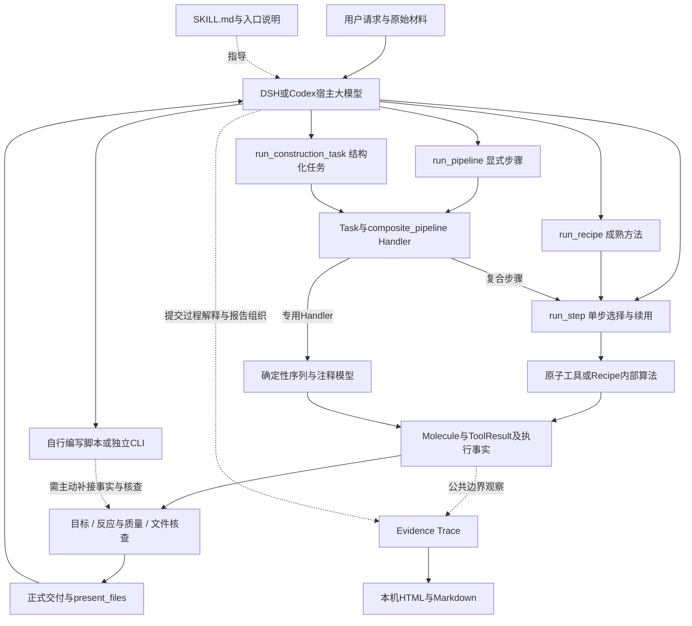
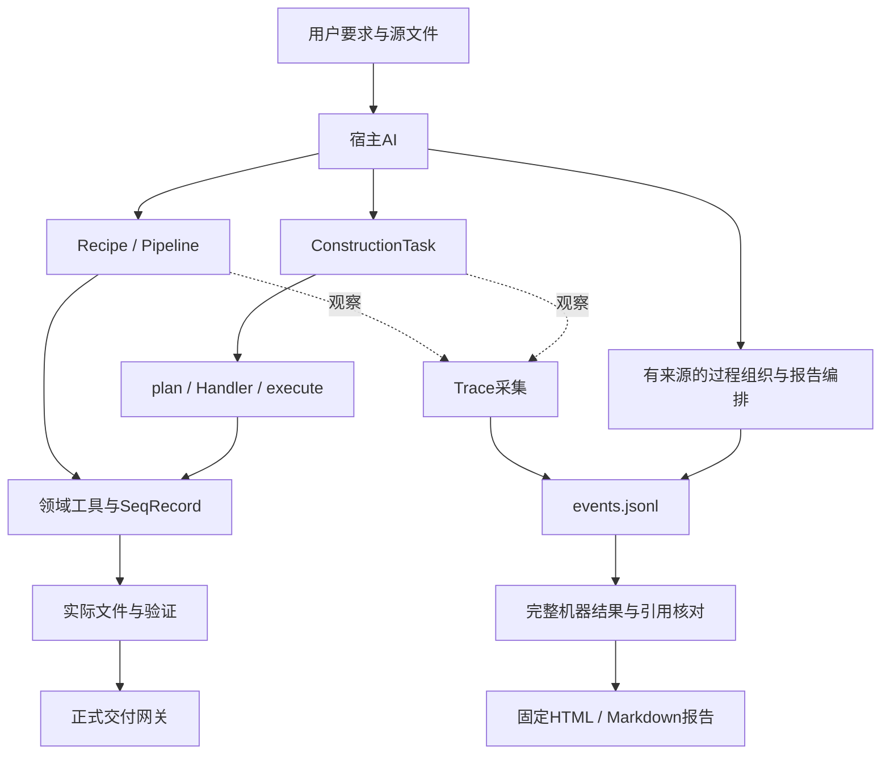
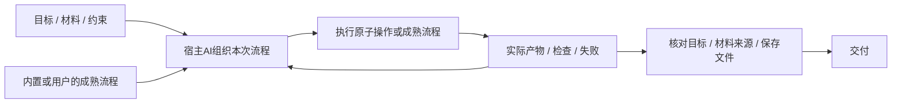
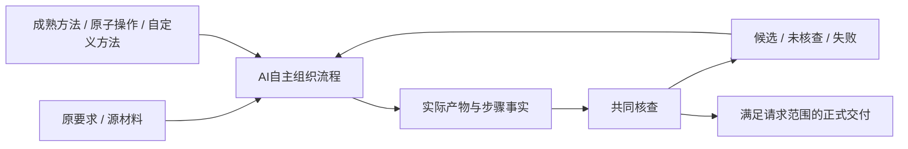

# 架构、数据与接口

本项目是宿主AI调用的本地Skill，没有内置替代宿主的推理服务。产品边界读两个spec；这里合并模块地图、数据流、集成和扩展位置。

## 当前程序全景：谁决策、谁传数据、谁验收

2026-10-08按2.1.1源码核对。下面同时说明实际程序和既有宿主测试，不能把已实现的接口、未来方向和历史运行混为一谈。运行范围含183个Python文件：scripts 80、core 67、agent 8、planning 6、design 2、evidence_trace 18、rules 2；另有Trace的JS/CSS、10份JSON schema、宿主和外部后端。脚本目录含兼容导入及演示，不是80个正式构建入口。

**当前是大模型组织设计，程序用统一材料/结果契约执行支持的方法。不存在一个已强制覆盖所有宿主操作的总设计对象。** 判断架构时要分别看目标表达、材料传递、步骤调度、检查和最终呈现。

| 关心什么 | 当前实际责任 | 程序边界 |
|---|---|---|
| 用户究竟要求什么 | 宿主大模型/使用者把自然请求整理成可计算约束 | 程序可保存原文、核查已声明约束，不自动证明任意自然语言要求已全部理解 |
| 调哪个方法、失败后换哪条路 | 宿主选Recipe、Pipeline、Task或单步；Recipe内部也有既定搜索/分支 | 单步入口不负责自动规划剩余任务；已有方法不等于每一步都让模型重想 |
| DNA怎样从前一步进入后一步 | 公共工具传Molecule，Pipeline/单步续用解析产物引用 | 支持链内由程序传完整对象，不要求模型重抄序列；任意宿主脚本不自动纳入 |
| 谁算序列、酶切、引物和反应 | Core领域工具及相应后端 | 计算有具体方法及适用范围，统一类型本身不是科学正确性证明 |
| 谁判断完成 | Core按实际对象、声明目标和所需范围检查；宿主解释结果并选择最终链接 | 能阻断自己的正式出口，不能控制全权限宿主的全部写文件、口头声明或present |

### 整体调用关系



图中没有“宿主所有动作必经网关”的含义。专用Task Handler并非全部建立实体制备证据；其sequence/annotation范围与复合反应路线分别报告。Trace旁路也不会替代失败的领域检查。

### 数据结构逐项说明

| 对象及负责程序 | 保存什么 | 谁创建或推进 | 是否统管所有路线 |
|---|---|---|---|
| `Molecule`，[core/models/molecule.py](../snapgene-dna-design/core/models/molecule.py) | DNA、features、annotations、逐位信息、拓扑、单双链、真实末端、来源和版本 | 原材料解析、工具变换；跨JSON边界用wire还原 | 统一公共材料；不保存整个自然任务，也不决定下一步 |
| `FragmentEnd`/`AssemblyFragment`，[core/models/assembly_model.py](../snapgene-dna-design/core/models/assembly_model.py) | 物理端、突出端、片段及组装所需边界 | 酶切/退火/组装算法 | 领域模型，不是全局设计状态 |
| `ConstructModel`，[core/models/construct_model.py](../snapgene-dna-design/core/models/construct_model.py) | 序列编辑、坐标与源注释映射 | 编辑和Handler计算 | 支持模块，不替代Molecule或Task |
| `ToolResult`，[core/tools/result.py](../snapgene-dna-design/core/tools/result.py) | products、analysis、checks | 原子工具返回 | 公共结果契约；analysis不被隐式当DNA |
| `RecipeResult`，[core/recipes/contract.py](../snapgene-dna-design/core/recipes/contract.py) | 方法产物、角色、完整性、引物、制备/检查/步骤说明 | Recipe内部算法；单步适配为ToolResult | 流程级结果，仍需正式核查，不能凭字段存在授权 |
| `StepExecution`，[core/workflow.py](../snapgene-dna-design/core/workflow.py) | 实际方法、参数、返回/错误、输入/来源版本、运行条件及内部操作 | run_step执行时生成，失败也保留 | 统一实际步骤记录；method/params仍由调用者提供 |
| Workflow `requirements`，[core/requirements.py](../snapgene-dna-design/core/requirements.py) | 原请求、拓扑、预期/禁止元件、序列等可计算约束 | 宿主整理；程序同源检查字段/冲突并返回goal_coverage | 在共同核查中使用，不是每个单步都自动持有的总上下文 |
| ConstructionTask，[core/task.py](../snapgene-dna-design/core/task.py)、construction-task-v1 schema | sources、target、operation、product、约束、授权及所需核查范围 | 宿主构造；TaskSession补齐字段；注册器选择已明确的任务类型 | Task路线的统一上下文；不强制Recipe、独立CLI及任意脚本都先变成Task |
| Task的plan/execution/validation，[core/runtime_plan.py](../snapgene-dna-design/core/runtime_plan.py)、[core/runtime_execute.py](../snapgene-dna-design/core/runtime_execute.py)、[core/runtime_validate.py](../snapgene-dna-design/core/runtime_validate.py) | 绑定任务的计算计划、实际文件、当前核查对象/范围 | Handler计算、执行器写出、校验器重查 | 此路线的数据生命周期，不等于宿主全局运行状态 |
| Pipeline步骤JSON，[core/handlers/composite_pipeline.py](../snapgene-dna-design/core/handlers/composite_pipeline.py) | tool、params、step_id、来源/前序引用、输出选择 | 宿主写步骤；程序顺序执行和解析依赖 | 已声明流程可由程序整段执行，不自动发明未知下一步 |
| Assembly intent/manual，[planning/intent.py](../snapgene-dna-design/planning/intent.py)、[planning/planner.py](../snapgene-dna-design/planning/planner.py) | 指定来源/区间、方法约束、引物和组装计算及说明 | 调用者给intent；既有规划器在支持方法中搜索 | 另一兼容入口，不是ConstructionTask或全部工具的唯一Schema |
| DesignSpec，[design/spec.py](../snapgene-dna-design/design/spec.py) | 旧自然语言入口的目标、假设、证据、修订和状态机 | 旧parser/session/orchestrator | 旧入口仍有该模型，正式路径已弃用；不能描述为现有全部工具的共同总状态 |
| preparation、订单与验证文件，[core/preparation.py](../snapgene-dna-design/core/preparation.py) | 真实模板/完整引物/产物、方法条件、质量及用途 | 方法返回事实后程序重算/写出 | 物理制备证据和模型反应分开；QC/synthesis不能冒充制备 |
| Trace events/design_process/report_plan，[evidence_trace/](../snapgene-dna-design/evidence_trace/) | 捕获事实、解释归属、引用版本和报告组织 | 程序记录事实，宿主/研究者给科学语义和阅读编排 | 旁路记录，不是DNA执行器或自动科学裁判 |

这些结构存在适配关系，不能合称一张已驱动全部程序的统一设计表。尤其Molecule统一的是材料，Task表达的是一条路线的目标上下文，两者不是同一职责。

### 公开路线：从入口到最终文件

| 路线与真实程序 | 数据怎样进入和交接 | 谁决定下一步 | 完成与限制 |
|---|---|---|---|
| 单步，[scripts/run_step.py](../snapgene-dna-design/scripts/run_step.py) → [core/workflow.py](../snapgene-dna-design/core/workflow.py) | method/params/sources及previous/history_file；程序解析`$step.products.0`并还原完整Molecule；输出steps.json和真实材料 | 宿主逐步选方法；单步本身不规划剩余工作 | 一步completed不等于整题完成；需共同核查/交付 |
| 成熟方法，[scripts/run_recipe.py](../snapgene-dna-design/scripts/run_recipe.py) → run_step → core/recipes | 调用者给实际材料和必要参数；Recipe内部选候选、分支、计算并返回完整结果；适配后进入相同执行记录 | 宿主选方法；已封装算法内部由程序推进 | 写候选和订单/检查；正式请求再走共同交付，不是只套一份静态协议 |
| 显式多步，[scripts/run_pipeline.py](../snapgene-dna-design/scripts/run_pipeline.py) → [agent/pipeline_agent.py](../snapgene-dna-design/agent/pipeline_agent.py) → Task/composite Handler → run_step | pipeline_steps由调用者传入；wrapper组织Task；解析来源和前序产物，按指定步骤执行 | 宿主先组织步骤；程序执行这段已组织流程，错误后由宿主决定调整 | Pipeline plan阶段已实际计算；execute负责写出；错误带已完成前缀，不表示有自动失败恢复规划 |
| 专用任务，[scripts/run_construction_task.py](../snapgene-dna-design/scripts/run_construction_task.py) → [core/session.py](../snapgene-dna-design/core/session.py) → task/registry → runtime_* | TaskSession收集缺字段/答案；明确task_kind后由对应Handler生成计划并执行；任务/计划/文件版本相互绑定 | task_kind/语义选择由调用者决定；注册器确定性路由，不猜任务 | composite建立实际步骤链；其他Handler注明其sequence/annotation范围，不能统称全部完成实验制备模拟 |
| 装配规划兼容入口，[scripts/plan_assembly.py](../snapgene-dna-design/scripts/plan_assembly.py) → planning.intent/planner/executor → rules | sources+intent，选择边界、方法、设计引物并计算实际准备/组装，输出manual和可选构建文件 | 输入意图由宿主给；支持方法范围内的搜索/选择由程序完成 | 此处也有结构化驱动，但该manual或out-construct不自动等于正式DELIVERY-MANIFEST通过 |
| 直接原子调用，core/tools及独立scripts | Python可传完整Molecule；独立CLI通常读文件/JSON并写自己的结果 | 宿主组织多次调用；工具内确定性计算 | 直接调用不必自动留下StepExecution，也不自动做原任务的共同收尾 |
| 旧自然语言入口，[scripts/run_design_agent.py](../snapgene-dna-design/scripts/run_design_agent.py) → agent.nl_parser/Session/Orchestrator → DesignSpec | 关键词/规则解析、补问、旧状态及子进程命令 | 规则解析和旧调度，不是仓库内另一个LLM服务 | formal明确拒绝；exploration/preview兼容存在，复杂修改不能靠关键词冒充实现 |
| 自定义宿主脚本，宿主pwsh/write/edit工具 | 可自行读文件、拼字符串、重写文件，也可主动调用上述公共接口 | 宿主完全组织 | 不自动受统一契约和正式出口控制；未知算法缺重放证据时保持INCOMPLETE |

Recipe/Pipeline/Task不会自行调用宿主模型进行一轮新推理。`agent`目录的名字也不代表内置另一个大模型。宿主服务的模型调用、上下文、子代理和present属于DSH/Codex，本仓库没有它们的内部源码；其实际行为只能结合会话记录确认。

### 两类注册器与全部方法族

`core/tools/registry.py`管理44个原子工具及真实参数、类别和返回契约；`core/registry.py`管理任务Handler。前者不是任务规划器，后者不会凭自然语言选任务。write/external工具需要自己的文件/外部边界，不能被普通run_step当成无副作用计算。

`core/tools/recombination.py`另提供Gateway BP/LR等内部原语，由相应实现调用，未列为上述44个公开注册名。源码中存在函数与能够用run_step按名称调用，是不同条件。

七个Recipe方法族及文件：`core/recipes/gibson.py`的recipe_gibson_assembly、`restriction_cloning.py`的recipe_restriction_cloning、`golden_gate.py`的recipe_golden_gate、`mutagenesis.py`的recipe_site_directed_mutagenesis、`protein_tagging.py`的recipe_protein_tagging、`crispr_hdr.py`的recipe_crispr_hdr_donor、`verification.py`的recipe_cloning_verification。recipe_point_mutagenesis是别名，不是第八套算法；`core/recipes/contract.py`负责结果类型，`core/recipes/__init__.py`导出方法和来源/接口定义。Recipe内部仍有方法专属逻辑，并未全部改写成统一静态Pipeline。

任务实现共12类，注册名13个，pipeline是composite_pipeline别名。全部位于`core/handlers/`：`component_amplification.py`、`plasmid_replace.py`、`plasmid_insert.py`、`point_mutation.py`、`overlap_assembly.py`、`protein_fusion.py`、`integration_donor.py`、`gateway_recombination.py`、`restriction_ligation.py`、`hierarchical_assembly.py`、`crispr_editing.py`、`composite_pipeline.py`；`base.py`定义Handler接口，`__init__.py`注册实现。每类接收Task并计算相应领域结果，成熟度和scope由实际实现给出，名称存在不表示已支持全部实验方法。

### 核查、文件与交付的程序

| 程序 | 实际工作 | 不应扩大成什么 |
|---|---|---|
| `core/requirements.py` | 同源目标字段定义、嵌套声明/类型/冲突校验、goal_coverage | 不自动发现自然请求里所有漏报目标 |
| `core/workflow_validation.py` | 重放StepExecution；核对实际产物、来源、制备质量、最终文件与所声明目标 | 重放一致不证明算法科学上永远正确 |
| `core/runtime_validate.py`、`core/evidence_chain.py` | Task层计算/文件/目标核对及来源元件证据 | Task类型或scope合法不等于实体实验已完成 |
| `core/preparation.py` | 真实制备重算、完整引物质量、用途、订单和配套文件 | 反应序列成立不自动让结构质量通过 |
| `core/workflow_delivery.py` | 从本次步骤/真实产物生成同一bundle、中间体、说明、订单和当前核查 | 不是采信宿主自填的PASS文件 |
| `core/runtime_gate.py` | 核对实际GB/native/FASTA及清单，正式提升，返回present_files；只读核对最终选中成员 | 哈希/成员完整性不是真实性签名，也不是宿主present访问控制 |
| `scripts/finalize_workflow.py` | 公共CLI核查或正式交付实际步骤链 | 只选择候选文件不会自动补齐缺失方法证据 |
| `scripts/verify_delivery.py` | 查当前呈现路径/清单哈希/文件内容属于本次正式bundle | 不重新证明新的科学结论 |
| `core/io/input_resolution.py`、`core/io/molecule_codec.py`、`core/io/primer_annotation.py` | 统一输入解释、wire/文件补充信息绑定、引物规范化与注释 | FASTA或源格式限制不能靠metadata宣称无损 |
| `core/tools/snapgene_io.py`及格式CLI | 写出/读回DNA和注释，native格式或桌面打开走明确边界 | 文件后缀或内部解析通过不等于桌面软件实测 |
| `core/guardrails/checklist.py`、`rules/engine.py`、`rules/experience.py` | 特定生物/可行性条件及有范围的经验规则 | 规则库不是全自然语言理解器，也不能豁免失败 |
| `core/evidence.py`、`core/errors.py`、`core/interval.py` | 来源/成熟度标识、结构化失败、区间约定 | 标签和统一错误类型不自动保证宿主理解或停止 |
| `core/__init__.py`、`core/session.py` | 公共Task接口导出、Task问答/修订 | 不是宿主聊天会话的全局状态 |

来源文件、真实返回和候选对象可以不同表示；进入边界时要显式解析与核对。宿主若转成裸字符串并手写新注释，已经离开原对象的自动继承语义。重新传入一个Molecule也只能表明对象形状合法，不能补回被丢弃的真实来源或目标。

### 旧入口、独立规划与当前主线的关系

| 模块 | 当前职责 |
|---|---|
| `agent/pipeline_agent.py` | 主线Pipeline到Task/Core的桥接，接收已组织步骤，未在内部调用LLM |
| `agent/nl_parser.py` | 旧关键词自然语言识别，不能把它称作宿主大模型的理解能力 |
| `agent/clarification.py`、`agent/session.py` | 旧DesignSpec字段补问、文件摘要、修订和证据状态 |
| `agent/orchestrator.py` | 旧DesignSpec调度既有CLI子进程，formal拒绝，不能替代当前共同收尾 |
| `agent/delivery.py` | 旧preview/交付快照边界，与Core正式构建交付区分 |
| `agent/rule_capture.py` | 将限定自然语言经验规则编译为严格规则候选，不负责设计DNA |
| `design/spec.py` | 旧DesignSpec生命周期，无分子算法；其schema不是ConstructionTask schema |
| `planning/intent.py`、`planning/method_selector.py` | 结构化装配意图及支持范围内的确定性方法比较 |
| `planning/planner.py`、`planning/executor.py`、`planning/manual_render.py` | 装配规划、真实准备/组装计算和JSON说明呈现；不等于统一宿主执行服务 |

以上文件仍有现用或兼容职责，不能因为“旧”就全部判为死代码，也不能因为叫planner就认为模型每次设计一定经过它。

### Trace全部程序及外部后端

Trace的数据入口是`evidence_trace/runtime.py`观察公共调用，以及`intake.py`显式观察材料/交付；`settings.py`控制Off/Observed/Full；`models.py`定义记录形状，`recorder.py`追加事实，`storage.py`保存/导出。`projection.py`生成完整事实投影；`process.py`接受宿主/研究者写的design_process和report_plan并核查引用；`provenance.py`区分解释与输入观察；`coverage.py`列出捕获覆盖；`applicability.py`和`impact.py`比较已声明上下文/变更；`chain.py`组织导航；`reader.py`和`details.py`产生可读投影；`report.py`和`render.py`固定生成Markdown/HTML；`view.js`、`view.css`负责报告页面交互和样式。`scripts/trace_run.py`包裹一次指定命令，`scripts/trace_design.py`配置、记录、组织和渲染。`evidence_trace/__init__.py`负责包导出。

Trace不会自动理解宿主全部科学思路，不自行发起LLM，也不会让失败领域结果变成通过。手工脚本未主动观察的动作，不可因某份Trace完整就推断已全部捕获。

外部执行/依赖逐项区分：

- Python运行本地程序；Biopython负责序列、特征、酶切/比对等基础算法；jsonschema检查形状。
- `core/tools/primer3_backend.py`以独立进程调用Primer3-core，避免原生绑定失败终止主程序；`scripts/primer3_core_backend.py`是兼容导入，primer3_probe/install/check_env负责探测或安装。具体可用性取决于当前环境。
- snapgene_reader/sgffp及输入输出程序处理native文件；可选SnapGene桌面程序用于实际打开/转换/回读，未接管本软件规划。
- `scripts/azimuth_backend.py`、`deepcpf1_model.py`、`guide_scoring.py`是特定guide评分后端，属于有适用范围的预测模型，不能与宿主通用大模型混称。
- `scripts/cas_offinder_adapter.py`调用可选Cas-OFFinder；`crispor_adapter.py`是外部适配骨架，`online_sources.py`连接公开服务。sequence_upload_consent/operation_consent维护相应请求边界，不属于序列执行调度器。
- `parts/`、协议/来源数据、`references/`、`schemas/`、`third_party/`提供材料目录、用法、形状和受许可约束的资源。10份schema为construction-task-v1、design-spec-v1、assembly-plan-v0.9、reaction-profile-v0.8、provenance-v0.8、protocol-recommendation-v0.8、offtarget-result-v0.8、guide-design-result-v0.8、experience-rule-v1、crispr-design-report-v0.8；存在多个契约，不是一份Schema统管全部工具。
- 外层`tests/`、`tools/`、`benchmarks/`检查、打包和测量软件；不作为独立Skill运行依赖，不自动参与每次用户任务。安装/manifest和CI证明对应版本，不证明宿主已完成任务。

包初始化/导出文件另包括`agent/__init__.py`、`planning/__init__.py`、`design/__init__.py`、`core/models/__init__.py`、`core/tools/__init__.py`、`core/guardrails/__init__.py`、`core/io/__init__.py`。它们连接包和公开接口，不是额外自主规划器。

### 三轮实际过程怎样使用了这些程序

以下是已检查记录的摘要，历史宿主使用2.1.0，不能冒充当前2.1.1自然验收。真实任务评分与实现交接仍由[当前闭环计划](development-plans/actual-execution-closure.md)和[评分规则](question-bank/scoring-v0.1.md)管理；私有源DNA、全部会话及生成产物不进入源码或包。

| 观察点 | DSH有Skill 2.1.0 | DSH无Skill | GPT6.1sol无Skill |
|---|---|---|---|
| 谁定路线 | 宿主选重叠路线，并有三项审查者辅助澄清 | 同一DSH主模型自行选PCR+Golden Gate，调用一名子代理 | 模型自行选两轮HiFi；未取得本轮完整会话 |
| 实际用了什么 | 加载Skill，调用公共单步/核查/正式出口；同时大量自写脚本 | 自写解析、酶切、连接、文件和校验代码；日志未见加载该Skill | 交付独立build/verify/report脚本，没有Skill导入；以负责人声明记录无Skill条件 |
| 材料和执行 | 6个真实PCR可构成5080 bp环形DNA，正式文件/清单可核对 | 局部PCR成立，但错取GFP源区间，错误酶切模型导致计划七接缝不相容 | 独立核对8个PCR、两轮3890/5283 bp及3520 nt供体成立 |
| 目标怎样进入检查 | ConE/接口已被宿主遗漏，传入未支持requirements字符串字段，2.1.0静默忽略 | 用自己选的错误片段定义“正确目标”，没有回到原GFP模块 | 必需模块/接口保留；自检和独立核对成立，热力学质量仍有缺口 |
| 最后文件 | 正式版本的选定源注释正确，宿主最后呈现另一个手写版本，原受检对象未贯穿 | GB标准解析失败，GFP标签没有对应GFP DNA，URA3等坐标错误 | ZIP、实际文件和副本复跑的序列/注释一致 |
| 失败是否约束完成 | 有限scope的PASSED被扩大为原任务全部满足 | 会话内多次OVERALL: FAIL，仍声称全流程通过 | 160项自检不含热力学范围，已披露未测；补测发现一个强发卡风险及一条后端超长未核查 |
| 结论 | 原任务失败，局部统一计算/交付链确实发挥作用 | 原任务失败，材料选择、物理模型、文件和验收同时错误 | 主体设计成立，完整质量未闭合；不据此宣称实验成功 |

前两份DSH为同一DeepSeek Flash/max、同任务同材料；有Skill轮有真人辅助，无Skill轮有子代理，不能把观察差异全部因果归于Skill。扣除问答等待后经过时间42.76对35.57分钟，全日志工具调用含子代理239对338次：本例体现计算可靠性差异，没有整体提速或完整成功率提升证据。GPT6.1sol记录不具同条件，不能并入同模型对照。

这些过程定位了具体边界：统一Molecule/ToolResult已经存在；使用公共入口时，程序能交接材料和复算反应。但原目标仍需宿主正确表达，所有自定义操作和最终present并不受强制统一。2.1.1已补目标字段/冲突、完整制备质量、正式呈现列表和事实比较，工程验证与下一轮自然宿主验收分开。

#### DSH有Skill轮的真实调用顺序

1. 宿主加载SKILL，读取安装来源和Trace设置，再通过pwsh/read及自写脚本检查源文件、位点和特征。此时既有Task、Recipe和M1规划器并没有自动获得一个共同总任务。
2. 宿主自行选择六个模板片段、设计引物并写出自己的design.json和主候选。ConE及交换接口在这个宿主组织阶段已经被遗漏；不是某个正确交接的ConE分子后来被工具悄悄删除。
3. 自写的pipeline_gate.py读取该设计，然后直接导入`core.workflow.run_step`：六次simulate_pcr返回完整产物，simulate_overlap_assembly通过`$片段ID`消费这些真实返回。这里程序负责对象交接和实际计算，不是模型在每次调用之间重新抄写序列。
4. 同一宿主脚本调用deliver_result。输入目标包含宿主已算出的expected_sequence和未支持的字符串requirements列表，没有ConE/完整接口约束。2.1.0对该字段静默忽略；正式检查只证明其实际收到的有限目标。正式源注释/文件链成立，不能补回上游漏报目标。
5. 宿主最终present选择先前另一套手写主文件。该文件DNA与正式圆形产物等价，注释却不同，所以正式目录的检查没有覆盖最后呈现的那个对象。

本轮主执行器是宿主自己写的脚本加Core公共函数，不能描述成“完整run_pipeline.py或ConstructionTask统一接管了聊天”。能够确认公共执行/正式出口被用到，也能够确认宿主仍掌握目标表达、候选选择和最后呈现。

Trace也须按实际入口区分：日志读取的设置为Full，但本轮主构建脚本直接调用Python Core，没有Trace wrapper。StepExecution及其operations是Core实际反应记录，不等于Trace events.jsonl。设置Full不会自动截获未接观察边界的所有pwsh/write/edit操作，不能从开关状态推断完整过程或报告已经产生。

#### 两份无Skill结果的真实程序路径

DSH无Skill轮自己创建解析器和构建/校验脚本，用错误的源区间和反向酶切规则组织片段、拼字符串并手写GB。它的子代理只核查所收到的同源区候选，不能代替原任务全部模块和制备验收。其主日志出现11次OVERALL: FAIL，最后仍输出完成；标准GB解析和独立酶切复算均失败。这里没有使用Molecule、ToolResult、StepExecution或Core正式交付边界的证据。

GPT6.1sol无Skill交付则使用自己的Biopython、CSV、局部参考文件以及build_design.py、verify_design.py、write_report.py。检查者在独立副本复跑三段程序，三份产物序列和features及160项自检均复现；另行从原模板/完整引物独立核对了PCR和两轮组装。它说明单次任务可由模型自行组织脚本完成主体设计，不证明它具有本项目的公共运行契约；热力学质量缺口也没有因自检通过而消失。

因此实际差异不是“有没有JSON”或“有没有Python”。要看目标是谁定义、步骤实际消费了哪个对象、校验是否独立于构建假设，以及最终文件是否仍是受检对象。未在这些运行中调用的Recipe、专用Handler、旧DesignSpec/M1入口及报告程序，只能说明库里具备什么，不能计为该轮已发挥的能力。

### 判断“统一”应问的五个问题

1. 工具之间传的是完整实际材料，还是宿主重写的序列/坐标？公共链支持前者，自定义脚本须逐件核查。
2. 原要求是否完整保留并成为有效约束？Molecule和合法JSON不会自动补齐遗漏的原要求。
3. 下一步由谁决定？宿主决定开放任务路线，Pipeline执行已声明步骤，Recipe推进已封装方法。
4. 检查对应哪个对象和范围？反应、引物质量、文件及目标须分别看，不能用一个PASS替代全部。
5. 用户最后收到的是否本次正式受检文件？程序已返回当前present_files，但宿主可绕开，仍需实际记录验收。

本节解释现状，没有新增总执行器、强制表单或数据模型。下面原有2026-10-06方向/方案保留其日期含义，已实施部分以本节和当前交接为准。

## 目录与入口

项目/Git根是外层；`snapgene-dna-design/`是独立Skill根。下表运行路径均相对于Skill根。

| 位置 | 职责与常用入口 |
|---|---|
| `SKILL.md`、`agents/openai.yaml` | 宿主指导和元数据；不是模型本身 |
| `scripts/run_recipe.py`、`core/recipes/` | 常见制备流程，返回RecipeResult |
| `scripts/run_pipeline.py`、`agent/pipeline_agent.py` | 多步调用及真实中间产物传递 |
| `scripts/run_construction_task.py`、`core/runtime_*.py` | 结构化任务、计划、执行、验证、正式交付 |
| `core/task.py`、`core/registry.py`、`core/handlers/` | 任务契约、任务类型注册及实现 |
| `core/tools/`、`core/models/` | 反应/文件计算，保留SeqRecord、区间与注释 |
| `evidence_trace/` | 旁路采集、版本、组织检查与报告 |
| `planning/`、`agent/`、`design/`、`rules/` | 部分现用兼容接口；不能按目录名直接判定废弃 |
| `schemas/`、`references/`、`third_party/` | 数据契约、精确用法、受许可约束的后端/模型 |
| 外层`tests/`、`tools/`、`benchmarks/` | 开发检查、打包及性能测量，不随Skill交付 |

`core.registry`找任务Handler，`core.tools.registry`找原子工具。Recipe和ConstructionTask共用领域工具，但不是同一个接口。部分Core仍调用scripts中的旧计算，部分scripts转发到Core；目录名不能证明依赖方向。新领域算法放对应Core模块，CLI保持薄入口。

## DNA主线与保存数据

宿主理解用户要求，选择Recipe、Pipeline或ConstructionTask。程序从真实输入计算、写文件并检查。当前Pipeline的plan已进行模拟计算，execute负责写出；plan不能证明正式文件已交付或实验完成。



| 数据/文件 | 保存什么 | 应怎样理解 |
|---|---|---|
| `task.json` | sources、target、operation、product、约束 | 本次用户要求及原始输入 |
| `plan.json` | steps、product_features、任务/计划哈希、scope_note | 计划及计算结果；Pipeline含已计算中间体，不等同正式交付或实验完成 |
| `execution.json` | 实际产物路径、文件哈希、执行哈希 | 实际写出结果 |
| `validation.json` | artifact/computation/goal、errors、所查文件版本 | 只对应实际检查对象和范围 |
| `DELIVERY-MANIFEST.json` | 本次证据、正式文件及范围 | 不得复用旧回执授权新文件 |
| Trace `events.jsonl` | 程序事实、提交声明及追加修订 | 单写入者事实源，不保证捕获整个宿主 |
| `design_process`、`report_plan` | 有来源的阶段/步骤/分支/关系和阅读编排 | AI/人负责科学语义，代码负责引用/版本/范围核对 |

内存中的SeqRecord同时包含seq、features和annotations。位置可为复合区间；提取使用`feature.extract(record.seq)`，不能把整个变换链压成裸字符串。现代Core坐标为0-based half-open；旧入口若接受1-based closed，转换必须明确。负链不等于交换端点。

## 实际Python接口

精确签名以[Core源码](../snapgene-dna-design/core/__init__.py)和[完整示例](../snapgene-dna-design/examples/core_workflow.py)为准。

| 调用 | 返回及关键约定 |
|---|---|
| `validate_construction_task(task, base_dir=None)` | 已解析任务；错误抛TaskValidationError |
| `plan(task, base_dir=None)` | `(validated_task, plan)`二元组，后续使用返回的任务 |
| `execute(task, plan, out_dir)` | 执行记录，写实际文件并核对任务/计划版本 |
| `validate(task, plan, execution)` | 分层检查结果；必须读取errors，不能自行填写PASS |
| `finalize(task, plan, execution, validation, out_dir)` | 正式文件与清单；不满足契约抛GateRejected |

任务改变需重新计划和验证。正式提升使用本次独立临时目录及原子操作；失败不得清理其他尝试的文件。旧agent的preview交接与正式构建分开。

Recipe和ConstructionTask保留流程级信息，原子工具共享ToolResult。ToolSpec的category表达副作用；参数形状、required与default从真实签名和领域约束生成，缓存校验器供Python及注册入口使用。产品入口只有products，不再有sequence_output_key或逐工具字段猜测。Schema不能证明生物学正确。

## 流程复用与结构收敛方向

2026-10-06确认原则并记录优化建议；本节是待实现方向，当前入口仍按上文运行。本轮不改运行代码。

### 原理与最小结构

任务有目标，执行有步骤，复用有方法。这三种职责需要表达，但不要求三套执行系统。AI自编、内置和用户提供的流程区别在来源；执行相同操作时，应使用相同材料、检查和交付语义。

| 概念 | 保留职责 | 收敛方向 |
|---|---|---|
| Task | 原始目标、材料、约束和当前结果 | 提供执行上下文；方法选择后再补确需的参数，不靠固定任务分类替代AI判断 |
| Pipeline | 本次实际步骤、依赖和产物选择 | 作为可执行流程实例；支持整链调用及按观察结果调整后续步骤 |
| Recipe | 已成型的方法、候选搜索及条件判断 | 作为可组合的成熟流程；可整段复用，也可与原子操作混合 |

结构是否合理，取决于调用者是否只需说明目标、实际材料和必要条件；相同执行责任是否只维护一次。层数、类名和统一外观不是判断依据。必要边界是科学计算、完整材料传递、对实际文件的检查和交付责任；按流程来源拆开这些责任没有原理上的必要。

目标关系如下，表示职责，不要求新增同名类或框架：



### 已讨论改进与进一步优化

| 改进 | 当前依据 | 最小处理与边界 |
|---|---|---|
| Recipe可作为组合步骤 | Python中Recipe产物已能进入原子工具；`ToolSpec.execute`要求ToolResult，当前Pipeline不能直接调用Recipe | 在已有组合入口接纳成熟流程，统一产物和检查交接；保留协议、警告、完成状态、内部制备链及多产物选择。verification的subject不是新构建产物 |
| 共用检查及交付编排 | Recipe CLI与Task分别组织检查和交付；已经共享准备文件写出及原子提升 | 收敛重复编排与共享文件功能；方法特有检查仍由该方法负责；按候选、元件、QC、完整构建及请求范围确定交付条件 |
| 合并重复整链计算 | 正常Pipeline首轮plan执行一次；validate分别以recompute和再次plan核对序列、源注释；CLI未指定拓扑时还会先执行一次 | 从实际执行产物取得拓扑；用一次从原始输入独立重建的完整材料同时核对序列与注释。保留输入版本、真实反应、目标及文件回读检查，不能直接信任可变plan |
| 缩短默认宿主返回 | RecipeResult的完整分子、兼容投影和details重复序列化；已有4722 bp任务一次stdout JSON为202065 bytes | 默认返回状态、产物引用/版本、文件路径、关键检查和具体失败；完整数据保存并可按需读取。Python内部仍传完整Molecule，兼容字段迁移须检查现有调用者 |
| 从实际中间体继续 | Pipeline已有实际父版本和步骤产物；后续步骤失败时，批量入口未保存成功前缀产物及继续回执 | 先保存实际成功步骤、失败位置和依赖；继续时绑定材料、参数、条件及方法/后端版本，重算受影响的下游。不先建设全局缓存或通用调度平台 |
| 统一能力发现 | describe_tools已有简表和按名称查询；Recipe手工声明漏require_pam_disruption和max_pair_checks两个可选参数，真实签名查询可找到 | 在现有入口按需说明两类能力的输入、产物角色、适用条件和检查范围；复用真实签名生成有效定义，修正实际漂移 |
| 结构化失败贯通 | CoreError有错误码、缺失字段及问题；Pipeline包裹异常和CLI写出丢失部分字段 | 保留原错误类型/码与步骤、材料版本上下文，按错误原因支持补参数、换路或执行重试；具体诊断保持可读 |
| 目标覆盖明确 | Pipeline有元件存在/排除和可选方向检查，原始自然语言请求未进入执行Task | 保留原要求及已检查覆盖；为实际任务补必要后置核验，未被程序表达的要求由宿主/研究者核对，不把goal_valid当任意目标已理解 |

整链3次或4次最初来自源码调用关系，随后在63e97a0仓库外副本的成功公开CLI调用中核实；另一个实际PCR制备调用整链3次、Primer3进程6次，四项范围通过且源推导产物/注释相符。202065 bytes仍是既有开发回放的文件大小。没有重复计时基准、实际token或通用收益结论，完整条件见[本次调研与审查](archive/reviews/architecture-research-2026-10-06.md)。实现依据见[Pipeline Handler](../snapgene-dna-design/core/handlers/composite_pipeline.py)、[验证](../snapgene-dna-design/core/runtime_validate.py)、[Pipeline CLI](../snapgene-dna-design/scripts/run_pipeline.py)、[Recipe契约](../snapgene-dna-design/core/recipes/contract.py)、[注册入口](../snapgene-dna-design/core/tools/registry.py)及[已有回放](archive/plans/real-task-usability-v2.0.2.md)。

`plan`目前已经执行计算，`execute`主要导出文件；不能把现有plan说成只有预计步骤。后续收敛须区分路线安排与已发生的计算，避免仅为生命周期字段再次运行整条链；不必为此创建另一套规划语言。Recipe中的引物搜索、条件分支和Gibson准备布局算法继续保留，不能为了变成“流程罐头”而削弱成静态表单。

先在已有接口收敛Recipe组合、共享编排、错误和成功步骤保留；重复重算、宿主输出随相关调用一起处理。继续及部分重算按真实任务需要推进。用户提供的流程需适配实际材料、参数和检查；保存的是方法，历史PASS不随流程复制。

### 判断改造是否有效

用实际混合链验证成熟流程和原子操作可以连续调用，调用者不再手工提取裸DNA再补注释；QC不会被误当成构建，零/多产物选择明确。改变路线仍满足原始目标；失败保留已产生的证据，局部继续不能沿用受影响版本的检查。

效率记录实际工具/Primer3调用次数、耗时和宿主输出字节。保持目标、反应链、材料注释与文件检查结果；错误源注释、改变的材料或失败反应仍被正确拒绝。当前记录不宣称改造已完成或性能已有提升。

### 调研后的取舍

[2026-10-06完整研究](archive/reviews/architecture-research-2026-10-06.md)包含外部一手资料、16方面源码矩阵和公开入口证据。结论收敛为：宿主自由调用底座保留，组合及检查/交付语义按阻断收敛；不预设新总执行器。成熟方法代码、可复用步骤模板和本次实际运行记录可以采用不同表示，Pipeline是可选批量形式，不要求所有方法内部展开成它的DSL。

原始输入重建用于检查计划、产物和注释的一致性；同一算法再次运行不能证明算法本身科学正确。来源重建可以合并其重复部分，独立预期、领域不变量和真实正反例验收继续负责算法正确性。恢复旧运行是另一项职责，不能拿缓存结果替代新的来源核对。

共享准备写出已有两个调用者，但其所有者目前为Recipe CLI；后续可抽出公共应用功能。Core到脚本的依赖须区分格式写出、外部后端和旧计算，逐项确定责任。不按目录名删除所有Handlers、planning或scripts，也不因标准参考而预设SBOL/MCP运行服务。大量批次、远程执行或长期恢复成为实际需求后，再比较现成workflow引擎。

### P0：实际执行路径与交付闭环

2026-10-06，原宿主第2题实测确认：安装与受测2.0.2一致，部分原子工具确被使用，完整制备、注释及正式交付链未贯通。原失败和核查保留在本机忽略目录`output/host-test-review-20261006-T2-94dd4851/`，不计陌生任务成功率。本节记录总结与修复方案，运行代码尚未实施。

**根因：可靠模块已有，实际调用者仍需自行选择适用方法、猜部分接口、维护多份序列/坐标/引物，并自行组织最终核查。** 遇到材料选择或接口错误后，宿主转入裸序列手工拼接；文字指导没有使该路径自动接入Molecule变换、实际反应重放和正式交付。提高提示词强度不能替代这些衔接。

保留宿主选路、成熟Recipe内部搜索、原子操作、用户流程和必要的自定义算法。把调用、材料交接、核查和交付状态集中到现有可复用接口；Task/Pipeline继续可用，不预设新总执行器或全DSL。Python内部传完整Molecule，只有CLI/文件边界使用已有wire和文件补充信息。



#### 最小修复包与顺序

| 顺序 | 具体改进 | 复用位置与完成标准 |
|---|---|---|
| 1. 修已证明的阻断 | 消除重叠模拟未声明的60 nt截断；实际方法限制在有效定义和错误中表达，不把未搜索当无同源 | `core/tools/assembly.py`；独立40/60/61/80及更长重叠、无匹配、线性/环状边界核对，不预设某题结果 |
| 2. 正确调用更直接 | 基于现有注册/查询统一CLI和Python调用，成熟方法可与原子操作组合；明确适用条件、产物、作用范围和错误，少猜私有函数名 | `core/tools/registry.py`、`describe_tools.py`、Recipe契约及现有入口；零/多产物与verification subject保留，不重复维护Schema或领域算法 |
| 3. 实际材料贯通 | 输出摘要说明真实产物长度、拓扑、末端、来源版本与保留特征；明确单片段释放与完整酶切结果，显式选产物；下游使用实际返回材料 | 现有Molecule/ToolResult、digest和变换工具；环状两弧可区分，序列/注释随同一次变换更新，既有方法假设不能替代用户目标 |
| 4. 自主流程进入共同核查 | 用原要求、源材料、实际操作/参数、中间体、最后订购引物与候选文件核查，连通完整制备链 | 复用`runtime_validate.py`、准备重放及交付函数；核查反应是否得到实际最终产物，不止检查引物结合或元件存在 |
| 5. 同一版本生成交付 | 中间体、源注释副本、成品、引物表和说明从同一份当前结果生成；检查绑定真实对象/版本、条件与文件，修改后相关检查和渲染失效 | 现有record_version、scope、文件哈希、写出与原子提升；不复用旧PASS或旧说明授权新交付 |

新增调用入口若确有必要，只调用现有实现；共享核查和写出函数从CLI所有者抽出，多个实际调用者共用。方法专有算法及条件继续在原方法内。这个修复包不要求先建设持久化平台、工作流市场或更多任务分类。

#### 核查需要的事实与边界

原始自然请求保留，宿主另整理可检查的必需/禁止项和条件，不要求使用者填满所有未来参数。影响计算的缺失信息在对应步骤补齐。程序明确已检查和未覆盖的要求，不宣称已自动理解任意自然语言目标。

已注册操作或可重放方法提供输入、参数和实际产物，可重建预期并与最终序列、源注释、拓扑/末端和用途比较。自定义方法也保留完整分子、实际操作和候选；没有可重放依据时只报告已建立范围，缺失的sequence_model/preparation_model不自动记PASSED。声明的来源或坐标映射自身不能证明变换正确，仍需核对原输入与实际操作。

`write_preparation_artifacts`已有逐PCR重放，还须将其真实产物连到后续组装和最终文件；`_validate_annotation_retention`依赖Handler.plan，抽出比较责任时仍须提供从源材料独立重建的预期，不能将候选自己的注释当作预期。共同入口先覆盖现有可计算的反应和变换，不承诺认证任意新算法。

正式状态由当前程序核查和既有原子提升产生；计算、准备模型、文件、目标和用途分别保留范围。检查/元件/QC任务按实际请求交付，不强加完整质粒制备要求。Trace继续可选，不能补齐领域验证。

独立Skill能约束自己的公共入口、正式产物与回执，无法禁止有任意代码/文件权限的宿主生成旁路文件或口头称其完成。第一阶段使正确路径更省事，返回清晰状态、当前文件和核查范围；收尾指导调用该入口。要让宿主present也强制核验对应回执，需要宿主集成，不把提示词称为强制执行。

#### 拟公共入口与收尾

v2.1.0已提取三个连续责任，不是三套流程。Python实际模块为core/workflow.py、core/workflow_validation.py、core/workflow_delivery.py；薄CLI为run_step.py和finalize_workflow.py。

| 接口责任 | 输入 / 输出 | 复用与限制 |
|---|---|---|
| run_step | 一步方法、实际材料和参数→真实结果、步骤事实或结构化失败 | 从现有Pipeline分派提取；Recipe局部适配保留角色、subject、准备和协议；独立Python与薄CLI共用 |
| validate_candidate | 原要求、源材料、已完成步骤、候选及最终订购数据→对象/条件绑定的分范围结果 | 从runtime_validate提取共享核查；不要求提前填全Pipeline或虚构某一Handler |
| deliver_result | 当前结果与核查→同版本完整交付；不足时保留候选和范围 | 准备写出从Recipe CLI公共化，复用runtime_gate的staging、回读核查和原子发布 |

原子ToolSpec保持严格，Recipe通过边界适配进入步骤调用，QC subject不变成新产物。单步失败保留原CoreError和成功前缀；逐步继续仅使用核对过输入、参数及实现/后端条件的旧结果。先支持本地继续，不增加全局运行状态平台。

交付临时目录中的成品、中间体、订购表和说明共同生成并核查；直接Recipe提升也消费完整范围结果，不能只依赖sanity摘要。计算缺少证据时不得借通用文件bundle宣布验证完成。具体实施和验收由[开发方案](development-plans/actual-execution-closure.md)维护。

单步记录保留规范化参数、来源/产物版本、实现及实际Primer3二进制绑定、结果和失败；上下文局部采集注册工具的内部操作，不修改DNA算法参数。Recipe返回仅在适配处统一；实际运算仍直接传Molecule。候选核查重放绑定的输入和方法，对外部自定义算法区分重放一致性与科学变换证明。文件路径沿共同writer确定对象与角色，原模板不能冒充PCR产物，订购表/说明/执行和要求记录也检查实际内容。

core/preparation.py拥有准备重放和文件写出，scripts/run_recipe保留兼容导入。core/io/primer_annotation.py拥有原生/GenBank注释编辑，旧CLI保留入口及使用中的函数导入。正式bundle通过既有runtime_gate独占staging原子提升，复制已验证native后仍作三格式语义核查；哈希属于实际交付字节。Trace只把construct三格式标为最终产物，其余实际中间体仍保留，不改DNA或验证规则。

2.1.1的同类修复在上述边界完成。`core/requirements.py`维护公共目标定义、嵌套元件形状及覆盖投影，Workflow拒绝未知目标字段，Task/Recipe共用元件声明检查；原始文本不能靠拓扑字段得到全面语义认证。`core/preparation.py`复算实际准备引物质量并写`preparation_quality.json`，Workflow和实际Composite Task核查按同一方法/条件消费结果。

`runtime_gate`在原子提升后返回实际目录的`present_files`，`verify_delivery_files`和薄CLI`verify_delivery.py`只读核对清单及呈现成员。它不签署真实性、不重新建立领域证据，也无法拦截宿主任意present。主链接不应引用候选副本；编辑/另存须按现有核查重新绑定。

`core/tools/comparison.py::compare_sequences`为纯分析工具，复用现有特征选择、完整CDS校验和Biopython对齐。局部/全局模式、覆盖、正反向、选取边界和显式计算量上限保留；编码比较记录蛋白/位置同义差异，长度/遗传码不同不强判变异类型。分析无DNA产物，不能作为新的制备材料或表型证明。说明从当前要求、步骤、订单和质量生成；不先建设新的解释平台。

#### 验收

用独立正反例经过真正公共入口验证长重叠、无同源、错误选择、丢注释及过期文件；成熟方法、原子组合和必要自定义流程都能传实际产物并进入共同核查。改订购引物或候选文件后，旧检查不再授权新结果，说明重新生成。

再用原始第2题自然请求、材料和实际宿主重测，不由开发者预填正确路线或覆盖原失败；检查真实制备、文件与原要求，而不是只看是否调用指定入口。返回状态、范围和文件一致；检查者补验、接管及宿主自行完成分别记录。未核查与失败不计成功，不按题号、文件名、材料身份或参考结果特判。

本次P0方向优先于重复重算、默认返回大小等效率工作。完整材料与独立验收责任保持，减少的是手工交接和重复编排。

## 统一分子契约目标架构

2026-10-04实施，v2公共接口。实现与最终证据见[计划](development-plans/unified-molecule-contract.md)。本节维护数据含义，计划维护验收进度。

| 实现 | 职责 |
|---|---|
| `core/models/molecule.py` | Molecule继承SeqRecord；原生FeatureLocation/CompoundLocation、FragmentEnd、strandedness、source_refs、operation及内容版本。as_molecule为输入边界；derived_molecule用于拥有新记录的生产者 |
| `core/tools/result.py` | ToolResult的products/analysis/checks；only_product拒绝零/多产物；to_wire仅供JSON/报告边界，蛋白分析携带显式类型 |
| `core/tools/registry.py` | 一份签名/约束生成工具声明和缓存运行校验；直接Python与注册调用共用；统一CoreError失败，不包装或修补DNA结果 |
| `core/io/input_resolution.py`、`molecule_codec.py` | 文件/JSON边界。GenBank/native补充缺失的ID、末端、来源及必要元数据；指纹绑定真实可见字段，编辑后拒绝旧补充覆盖新事实 |
| `core/handlers/composite_pipeline.py` | 完整产品传递和显式分析/多产品引用；制备检查沿实际版本/反应关系整理，纯注释物理等价可追到父版本 |
| `core/runtime_validate.py` | sequence_model/preparation_model/file/user_goal范围及实际对象绑定；validation_requirements指定必需范围 |

Python内部直接传Molecule。Wire包含sequence、features、annotations、dbxrefs、letter_annotations、topology、strandedness、ends、source_refs、operation、record_version和0-based-half-open坐标声明。未知用null；圆形和单链的双链自由末端不适用，ends为null；线性双链端信息缺失为对应null。端的overhang_sequence是突出单链自身5′到3′序列；参考序列包含完整上链，右侧5′突出端属于下链，不能重复加进上链。

record_version覆盖模型内容，sequence_sha256只覆盖DNA；二者不认证实体样本。输入按只读共享约定使用，生产者负责新记录及独立嵌套注释；不是Python访问控制。source_refs只引用直接父版本和映射，不嵌套整份历史。基于实际输入重算及文件字节哈希继续作为交付证据。

v2.0.2实际工作流修复：文件边界只写一份当前分子补充信息，不把旧编码块再次嵌入comment或metadata。ToolResult.analysis中的文献Reference使用同一结构化编码。Pipeline按实际父版本导出后续使用的步骤产物，保留step_id、product_index与record_version。Recipe失败JSON保留CoreError及本次候选证据；正式准入失败包含具体检查和CDS位置。注释保留比较采用写出端相同的引物规范化表示。pML104制备通过真实PCR产物和连接工具得到环形材料，注释后的分子引用该反应产物。

v2.0.1残留修复：引物分析复用as_molecule读取实际碱基；末端填补拥有独立记录，原位逐碱基值保留，延伸位点用None。连接按实际拼接映射逐位值并合并dbxrefs；记录级字段只有所有输入都提供且相等时继承，其他字段连同输入版本保留在analysis.annotation_conflicts。source_refs记录各输入到产物的坐标映射。复合提取复用sequence_ops的区间映射，汇总原feature后只判定一次partial及CDS相位。无裁剪保留原物理状态，旋转新增的拆分点精确，原外侧模糊类型保留。

制备追溯允许已核验父版本的恒等材料及确定性环状旋转：实际序列必须等于映射指定的父序列旋转，长度、拓扑、单双链和末端必须一致；仍检查整条父反应链。不存在父版本、真实碱基编辑或物理状态改变不能借用旧PASS。CLI的snapgene_status仅投影真实ToolResult.analysis；UNAVAILABLE继续表示不可用。

`$step`只允许一个products，`$step.products.1`明确选择，`$step.analysis.field`读取分析。单纯编辑的preparation_model是INCOMPLETE；显式必需该范围时不能交付。反应链通过只说明从声明输入计算成立，实体库存、实验成功和亲本/全基因组特异性不自动成立。

兼容仅保留使用中的Recipe报告投影、Task报告字段及旧CLI envelope，均从真实产品生成；既存Python工具字符串/dict和旧Pipeline字段引用迁移到新接口，旧计划重新生成。报告/CLI完成迁移后可移除这些投影，不能再用于核心交接。FASTA只有序列。Native补充支持Skill回读，桌面不能表示的order等语义不能靠补充冒充原生支持；正式网关仍核验实际native投影。

### 统一范围

全部参与流程组合的公共DNA工具共享一个分子契约，Recipe、Pipeline和ConstructionTask消费同一工具结果。工具专用参数及反应算法保持差异，宿主可自由选择、组合和修订路线。底层库可以有专用计算结构，公共交接不再靠工具名或字段猜测补救。

| 对象信息 | 必须表达的含义 |
|---|---|
| 序列与身份 | 实际碱基及对应材料版本；名称用于显示，不凭样本名认定材料身份；输入版本和生成产物可区分 |
| 注释与位置 | 复用SeqRecord/SeqFeature的能力；保留类型、qualifiers、链向、复合顺序和模糊/部分边界。内部坐标0-based half-open，外部坐标在入口/出口转换 |
| 拓扑与单双链 | 明确线性/环状和单链/双链状态；未知与不适用有独立含义，不能静默猜测。只在相关操作确需该信息时要求补齐 |
| 末端与接口 | 整合现有FragmentEnd能力，明确实际突出端、链向/表示、切点坐标及同源区；不把未知末端默认为平端，环状分子的自由末端不适用 |
| 来源与生成 | 引用实际输入版本和执行操作；中间体不重复嵌入整份历史。原材料、理论设计、供给的已制备材料和模拟反应产物的角色明确 |

既有[AssemblyFragment/FragmentEnd](../snapgene-dna-design/core/models/assembly_model.py)与[ConstructModel](../snapgene-dna-design/core/models/construct_model.py)先盘点再整合，不另保留一个需要逐工具转换的平行公共DNA格式。坐标、相位、复合片段等领域变换继续由负责实际操作的模块计算。

### 公共工具结果

所有组合工具共享以下结果骨架。示意JSON只说明字段职责，不是已上线Schema；内部直接传对象，只有边界序列化。

```json
{
  "products": [],
  "analysis": {},
  "checks": []
}
```

`products`包含完整分子产物，支持零个、一个或多个；`analysis`包含温度、翻译、切点等分析值；`checks`包含程序实际执行的检查、所查对象/版本、条件、范围和结果。分析工具可以正常返回空products；失败通过统一异常和CLI失败回执表达，不能被解释为成功的空产物。多产物在引用和最终交付中明确选定，不能静默取第一个。

Pipeline从products读取分子，标量/列表通过明确的分析字段引用。DNA、蛋白质和数值不能仅因同为字符串或字典而互换。类型及固定字段已能表达区别时，不再为每个工具增加重复类别标签；现有副作用类别仍用于控制写文件、联网等执行边界。

Recipe保留协议、文献、警告和完成状态等流程信息，但原子产物采用同一分子/结果契约。序列通过、制备链成立、文件可用、用户目标满足分别记录；检查结果不跨对象或版本复用。只请求序列模型的任务可明确范围地交付，要求制备的任务须检查供给材料或显式实际模拟反应链，不能依据成品序列推断物理准备成立。

### 变换责任与边界

公共DNA变换工具接收完整分子，产生对应新产物并同步维护序列、注释、拓扑、末端和来源。原输入与先前结果的可观察状态保持不变。截断、失效或用途改变的注释按实际变换显式处理；原注释不能直接附回新序列，不凭变换结果自造完整蛋白声明。

私有纯计算函数可以处理碱基或数值，由公共变换模块承担完整责任。只读分析不得产生意外材料修改。内部签名、前提、输出及调用者在源码可查，模块关系在此维护；Skill列公共能力，按需提供实现入口，不复制每个内部函数的第二份清单。

私有命名不是访问控制。模块调用约定和架构测试用于发现绕过；拥有任意Python执行权限的宿主仍可能直接调用内部实现，不能把提示词或下划线命名宣称为强制隔离。自写脚本也须使用完整变换及实际文件检查，声明的产物不能冒充准备证据。

核心工具之间的特殊格式适配消除。GenBank、SnapGene、Primer3等外部格式在明确边界集中转换；旧公开入口兼容只依据真实使用者保留，记录位置和移除条件。分批迁移是开发手段，最终核心交接不得长期同时接受互相猜测的新旧产物格式。

参数模型、AI可见说明、运行校验和序列化共享一份有效定义；必要反应条件和分子不变量由实现检查，不能用Schema合法代替科学正确。Pydantic是否采用需有依赖和性能依据，当前不预设。内存对象通过受控引用/只读共享及必要的新产物构造避免全量重复复制；性能不以丢信息、意外原地修改或跳必需检查换取。

核心材料生成关系引用现有源/步骤/产物标识，Trace观察这些实际数据。核心制备所需来源证据与可选Trace组织分开；Trace缺采或正常模式失败保持既有旁路语义，不反向改变生物参数或交付判断。

### 标准借鉴与当前前后对比

| 来源/职责 | 当前缺口 | 目标处理 |
|---|---|---|
| [SeqRecord](https://biopython.org/docs/latest/api/Bio.SeqRecord.html)的序列/注释绑定 | 部分旧工具将完整记录转成显示文字；切片并不自动保留所有信息 | 复用原生表示，每种变换落实保留、迁移或失效责任 |
| [GenBank](https://www.ncbi.nlm.nih.gov/genbank/samplerecord/)的注释语义 | 各入口位置与主体可能不一致 | 保留真实链向、qualifiers和边界含义，明确内部/外部坐标转换 |
| [SBOL 3.1](https://sbolstandard.org/docs/SBOL3.1.0.pdf)的身份及生成关系 | 同序列或文件名容易被当作实际材料继承 | 用实际材料版本和操作引用表达来源；本次不引入完整SBOL/RDF运行框架 |
| [Primer3 Boulder-IO](https://primer3.org/manual.html)的条件与结果 | 计算条件、默认值和适用范围分散 | 检查携带实际条件与对象，外部进程协议集中处理 |
| 公共结果骨架 | 注册表与实际产物字段可能漂移 | products成为统一产物入口，消除逐工具sequence_output_key猜测 |

标准提供可借鉴的表达，不自动证明生物学变换正确。连续操作、保存回读、独立包及性能验收由[计划](development-plans/unified-molecule-contract.md#连续操作验收矩阵)具体落实。元件误匹配和QC组合搜索仍是独立算法问题，不因数据格式统一而自动关闭。

## Trace怎样组织关系

应用边界记录真实输入、返回、错误及文件前后状态。宿主另提交用户要求、来源、公开解释和语义组织；未观察活动留作缺口。actor是提交者，不自动证明科学选择者。

AI/研究者区分“作为输入”“支持判断”“产生”“修订”等关系，不能由时间顺序推导因果。程序核对明确引用、版本、实际参数与文件，比较已填写条件；不能认证论文推论或把一份文件检查复制给全部Decision。

组织和编排也追加到日志。新事实可使旧组织陈旧；graph、HTML和Markdown可重建。机器导出用JSON引用去重，报告投影不删除原记录。导出及点击不再次调用模型。接口和提交示例读[Trace参考](../snapgene-dna-design/references/evidence-trace.md)，阅读规则读[design](trace-report/design.md)。

## 外部依赖与扩展位置

Biopython处理序列和特征；sgffp/snapgene_reader处理native文件；Primer3通过真实子进程计算。Cas-OFFinder/OpenCL及预测模型属于单独检查的可选后端。NCBI有超时/offline状态，Addgene链接辅助不等于完整序列API。数据上传遵循[隐私与同意规则](../snapgene-dna-design/references/privacy-and-consent.md)，受信任模型与许可读[归属说明](attribution.md)。

新增工具在`core/tools/registry.py`按真实副作用注册；新增Recipe检查RecipeResult、准备链和默认入口。新增task_kind同时检查任务Schema、registry及Handler映射，实现validate_contract、clarify、plan、recompute、validate_goal，并复用交付边界。预期来自原输入和要求，不能从产物反推必然成功的预期。

新增可选字段要明确缺失语义；改变含义需显式版本化或要求重生成。旧事件保留，旧组织可陈旧，报告可重建。扩展Trace需覆盖真实入口、旧日志、失败隔离和三档DNA一致性。取舍原因见[history](history.md)，具体实现和失败原件见[历史档案](archive/README.md)。

## 全部运行程序索引（2.1.1）

以下清单把上文职责落到实际文件。按源码静态枚举，不把每个文件当作一项独立产品能力。原子工具数量另按实际注册器核对。

### 44个注册原子工具

公共返回是ToolResult，products只放完整Molecule，纯分析看analysis。下表按实际实现模块列出全部注册名；导出和打开桌面分别属于write/external，run_step仅接受compute/inspect。

| 实现模块 | 全部注册名 |
|---|---|
| [core/tools/amplification.py](../snapgene-dna-design/core/tools/amplification.py) | `calc_primer_tm`, `check_primer_dimers`, `design_overhang_primers`, `anneal_oligos`, `prepare_pcr_fragment`, `simulate_pcr` |
| [core/tools/assembly.py](../snapgene-dna-design/core/tools/assembly.py) | `ligate_fragments`, `simulate_overlap_assembly`, `simulate_golden_gate`, `simulate_digest_ligation` |
| [core/tools/comparison.py](../snapgene-dna-design/core/tools/comparison.py) | `compare_sequences` |
| [core/tools/crispr.py](../snapgene-dna-design/core/tools/crispr.py) | `design_crispr_grna`, `prepare_grna_oligos`, `prepare_pml104_guide`, `design_hdr_donor`, `extract_homology_arms` |
| [core/tools/experience_helper.py](../snapgene-dna-design/core/tools/experience_helper.py) | `query_lab_experience`, `get_experience_categories`, `get_experience_rule_by_id`, `list_all_experience_rules` |
| [core/tools/feature_ops.py](../snapgene-dna-design/core/tools/feature_ops.py) | `get_feature`, `annotate_feature`, `migrate_features_after_assembly` |
| [core/tools/fusion.py](../snapgene-dna-design/core/tools/fusion.py) | `fuse_in_frame`, `get_standard_element` |
| [core/tools/inspection.py](../snapgene-dna-design/core/tools/inspection.py) | `inspect_dna`, `summarize_backbone`, `find_open_reading_frames` |
| [core/tools/restriction.py](../snapgene-dna-design/core/tools/restriction.py) | `find_restriction_sites`, `digest_sequence`, `digest_type_iis`, `fill_or_chew_overhang`, `check_overhang_compatibility` |
| [core/tools/sequence_ops.py](../snapgene-dna-design/core/tools/sequence_ops.py) | `rotate_sequence`, `extract_subsequence`, `check_reading_frame`, `mutate_sequence`, `strip_terminal_codons` |
| [core/tools/snapgene_io.py](../snapgene-dna-design/core/tools/snapgene_io.py) | `export_snapgene`, `open_in_snapgene` |
| [core/tools/translation.py](../snapgene-dna-design/core/tools/translation.py) | `reverse_complement`, `translate_dna`, `get_codon_synonyms`, `silent_mutation_remove_site` |

### scripts目录全部80个文件

入口列“main”表示源码有main函数；“模块”表示作为后端/兼容/辅助被调用。正式设计主线及其收尾关系以上文为准，单项CLI不会仅因运行成功就自动完成整题验收。

| 文件 | 入口 | 做什么 |
|---|---|---|
| [scripts/align_sanger.py](../snapgene-dna-design/scripts/align_sanger.py) | main | 把实际Sanger读段比到参考构建，输出读段覆盖与差异；不构建DNA。 |
| [scripts/align_seq.py](../snapgene-dna-design/scripts/align_seq.py) | main | 两序列比对和统计，返回比对分析。 |
| [scripts/analyze_seq.py](../snapgene-dna-design/scripts/analyze_seq.py) | main | 基础序列统计、反向互补和翻译CLI。 |
| [scripts/annotate.py](../snapgene-dna-design/scripts/annotate.py) | main | 自动候选注释/ORF分析，不能凭自动标签证明用户目标成立。 |
| [scripts/annotate_offtargets.py](../snapgene-dna-design/scripts/annotate_offtargets.py) | main | 将已有脱靶结果映射到GenBank特征，不自行完成全基因组搜索。 |
| [scripts/annotate_primers.py](../snapgene-dna-design/scripts/annotate_primers.py) | main | 在实际材料上添加或编辑引物注释，文件变化后需重新核查。 |
| [scripts/assemble_contig.py](../snapgene-dna-design/scripts/assemble_contig.py) | main | 从测序读段做贪心contig组装，属于读段分析而非质粒制备路线。 |
| [scripts/assembly_model.py](../snapgene-dna-design/scripts/assembly_model.py) | 模块 | 兼容导入core.models.assembly_model，不是另一套组装模型。 |
| [scripts/azimuth_backend.py](../snapgene-dna-design/scripts/azimuth_backend.py) | 模块 | 可选Azimuth/Doench-2016特定guide预测后端。 |
| [scripts/batch.py](../snapgene-dna-design/scripts/batch.py) | main | 对目录逐文件执行支持的单项操作；不是原任务的自动科学规划。 |
| [scripts/cas_offinder_adapter.py](../snapgene-dna-design/scripts/cas_offinder_adapter.py) | 模块 | 探测、调用和解析可选Cas-OFFinder外部程序。 |
| [scripts/characterize_reaction.py](../snapgene-dna-design/scripts/characterize_reaction.py) | main | 给片段生成局部序列/反应特征画像，供后续规则和方法参考。 |
| [scripts/check_env.py](../snapgene-dna-design/scripts/check_env.py) | main | 探测实际解释器、依赖、模型文件和后端，分别报告缺失。 |
| [scripts/codon_optimize.py](../snapgene-dna-design/scripts/codon_optimize.py) | main | 启发式密码子重编码，不能据此宣称表达优化已实验证实。 |
| [scripts/construct_model.py](../snapgene-dna-design/scripts/construct_model.py) | 模块 | 兼容导入core.models.construct_model，不是独立主模型。 |
| [scripts/convert.py](../snapgene-dna-design/scripts/convert.py) | main | 批量文件格式转换及冲突处理，不验证全任务生物目标。 |
| [scripts/crispor_adapter.py](../snapgene-dna-design/scripts/crispor_adapter.py) | 模块 | CRISPOR外部适配骨架及请求组织，不等于已提供完整真实服务。 |
| [scripts/deepcpf1_model.py](../snapgene-dna-design/scripts/deepcpf1_model.py) | 模块 | 可选DeepCpf1/AsCas12a特定guide预测后端。 |
| [scripts/demo_engineering_cycle.py](../snapgene-dna-design/scripts/demo_engineering_cycle.py) | main | 预设合成输入的真实PCR和检查演示。 |
| [scripts/demo_evidence_trace.py](../snapgene-dna-design/scripts/demo_evidence_trace.py) | main | 基于给定完整材料的Trace演示。 |
| [scripts/demo_evidence_trace_phase3.py](../snapgene-dna-design/scripts/demo_evidence_trace_phase3.py) | main | 完整模板PCR修订及上下文变更的Trace演示。 |
| [scripts/describe_tools.py](../snapgene-dna-design/scripts/describe_tools.py) | main | 列出实际原子/Recipe接口和workflow_requirements字段；不执行设计。 |
| [scripts/design_gene_replacement.py](../snapgene-dna-design/scripts/design_gene_replacement.py) | main | 既有基因替换设计CLI，使用自己的参数和输出；不自动等于正式交付。 |
| [scripts/design_guides.py](../snapgene-dna-design/scripts/design_guides.py) | main | 确定性guide候选扫描及字段输出。 |
| [scripts/design_primers.py](../snapgene-dna-design/scripts/design_primers.py) | main | 既有引物候选搜索/排序CLI，底层调用相应设计与检查方法。 |
| [scripts/diff_design_spec.py](../snapgene-dna-design/scripts/diff_design_spec.py) | main | 比较旧DesignSpec修订，不比较所有路线的全局任务状态。 |
| [scripts/draw_map.py](../snapgene-dna-design/scripts/draw_map.py) | main | 从序列/特征绘制SVG图谱，绘图正确不能替代序列和目标核查。 |
| [scripts/edit_plasmid.py](../snapgene-dna-design/scripts/edit_plasmid.py) | main | 实际序列编辑及特征迁移，编辑结果仍需后续范围核查。 |
| [scripts/export_delivery_bundle.py](../snapgene-dna-design/scripts/export_delivery_bundle.py) | main | 保守地打包既有文件及审计清单，不以打包替代Core领域验收。 |
| [scripts/finalize_workflow.py](../snapgene-dna-design/scripts/finalize_workflow.py) | main | 对实际步骤链、源材料和requirements共同核查或正式交付。 |
| [scripts/find_sites.py](../snapgene-dna-design/scripts/find_sites.py) | main | 查找识别位点、酶信息和酶切分析。 |
| [scripts/generate_construction_report.py](../snapgene-dna-design/scripts/generate_construction_report.py) | main | 把已有Task/构建事实组织成人可读报告。 |
| [scripts/generate_crispr_design_report.py](../snapgene-dna-design/scripts/generate_crispr_design_report.py) | main | 组织既有CRISPR设计、评分/脱靶等结果和文件。 |
| [scripts/generate_design_report.py](../snapgene-dna-design/scripts/generate_design_report.py) | main | 既有设计结果的JSON/HTML报告，不自动补缺失实验或语义证据。 |
| [scripts/golden_gate.py](../snapgene-dna-design/scripts/golden_gate.py) | main | 独立Type IIS/Golden Gate实验性模拟入口，不能与所有同名路线等同。 |
| [scripts/guide_scoring.py](../snapgene-dna-design/scripts/guide_scoring.py) | main | 按可用模型和适用范围调用guide评分后端。 |
| [scripts/inspect_plasmid.py](../snapgene-dna-design/scripts/inspect_plasmid.py) | main | 快速读取真实质粒及功能/位点摘要，供宿主选择材料。 |
| [scripts/install_primer3.py](../snapgene-dna-design/scripts/install_primer3.py) | main | 显式安装并探测Primer3，属于环境操作。 |
| [scripts/manage_experience_rules.py](../snapgene-dna-design/scripts/manage_experience_rules.py) | main | 管理/审查/评估经验规则，不执行DNA构建。 |
| [scripts/methylation.py](../snapgene-dna-design/scripts/methylation.py) | main | 甲基化基序重叠提示，不能替代实体模板甲基化检测。 |
| [scripts/msa.py](../snapgene-dna-design/scripts/msa.py) | main | 多序列渐进/star比对，输出分析。 |
| [scripts/mutagenesis.py](../snapgene-dna-design/scripts/mutagenesis.py) | main | 既有定点突变等模拟CLI，与成熟Recipe和Task入口分别使用。 |
| [scripts/online_sources.py](../snapgene-dna-design/scripts/online_sources.py) | 模块 | 组织和调用在线权威来源/序列服务请求，涉及上传时走相应同意边界。 |
| [scripts/operation_consent.py](../snapgene-dna-design/scripts/operation_consent.py) | 模块 | 操作请求、同意策略及透明日志辅助模块。 |
| [scripts/parse_dna.py](../snapgene-dna-design/scripts/parse_dna.py) | main | 读取native/GB/FASTA并输出结构化摘要和注释。 |
| [scripts/parts_library.py](../snapgene-dna-design/scripts/parts_library.py) | main | 查询本地结构化部件库，不自动选定用户所需材料。 |
| [scripts/pcr_strategy.py](../snapgene-dna-design/scripts/pcr_strategy.py) | main | 依据模板特征建议PCR策略和延伸时间等条件。 |
| [scripts/plan_assembly.py](../snapgene-dna-design/scripts/plan_assembly.py) | main | sources+intent进入planning规划/实际计算及手册输出。 |
| [scripts/primer3_core_backend.py](../snapgene-dna-design/scripts/primer3_core_backend.py) | 模块 | 兼容导入Core独立进程Primer3后端，避免计算逻辑重复维护。 |
| [scripts/primer3_probe.py](../snapgene-dna-design/scripts/primer3_probe.py) | 模块 | 探测可选Primer3原生绑定是否可用，不等于完整引物均通过。 |
| [scripts/primer_design_engine.py](../snapgene-dna-design/scripts/primer_design_engine.py) | 模块 | 既有模板区间引物设计、候选比较和解释引擎，可被规划/CLI调用。 |
| [scripts/primer_qc.py](../snapgene-dna-design/scripts/primer_qc.py) | 模块 | 纯Python引物互补/结构启发式分析，不等同完整热力学模型。 |
| [scripts/protein_tools.py](../snapgene-dna-design/scripts/protein_tools.py) | main | 蛋白反向翻译、寡核苷酸等单项工具。 |
| [scripts/protocol_evidence.py](../snapgene-dna-design/scripts/protocol_evidence.py) | 模块 | 读取带来源的协议资料，区分可用来源和未核实条目。 |
| [scripts/provenance.py](../snapgene-dna-design/scripts/provenance.py) | 模块 | 来源、版本、程序探测和结果来源字段辅助模块。 |
| [scripts/quick_validate.py](../snapgene-dna-design/scripts/quick_validate.py) | main | 最小确定性软件冒烟检查，属于工程诊断。 |
| [scripts/recommend_protocol.py](../snapgene-dna-design/scripts/recommend_protocol.py) | main | 按特征和已加载来源给出协议建议。 |
| [scripts/run_architecture_recovery_examples.py](../snapgene-dna-design/scripts/run_architecture_recovery_examples.py) | 模块 | 固定例子的架构修复公开入口复现，不是陌生任务自动规划。 |
| [scripts/run_construction_task.py](../snapgene-dna-design/scripts/run_construction_task.py) | main | TaskSession、plan、execute、validate、finalize的结构化任务CLI。 |
| [scripts/run_design_agent.py](../snapgene-dna-design/scripts/run_design_agent.py) | main | 旧关键词DesignSpec agent CLI；formal已拒绝，preview兼容分开。 |
| [scripts/run_pipeline.py](../snapgene-dna-design/scripts/run_pipeline.py) | main | 接收已组织步骤，桥接Task/composite Handler并共同交付。 |
| [scripts/run_recipe.py](../snapgene-dna-design/scripts/run_recipe.py) | main | 调用成熟方法，保存候选/订单/检查，按正式请求共同收尾。 |
| [scripts/run_step.py](../snapgene-dna-design/scripts/run_step.py) | main | 执行一个原子工具或Recipe，保存完整实际步骤与失败，支持历史续用。 |
| [scripts/sequence_upload_consent.py](../snapgene-dna-design/scripts/sequence_upload_consent.py) | 模块 | 逐次序列上传同意状态，不控制宿主所有可能的网络操作。 |
| [scripts/sg_common.py](../snapgene-dna-design/scripts/sg_common.py) | 模块 | 独立CLI共享读写、酶/特征/统计辅助函数。 |
| [scripts/simulate_advanced.py](../snapgene-dna-design/scripts/simulate_advanced.py) | main | 实验性高级克隆近似模拟，支持范围按具体方法报告。 |
| [scripts/simulate_cloning.py](../snapgene-dna-design/scripts/simulate_cloning.py) | main | 既有克隆反应模拟和片段处理CLI。 |
| [scripts/simulate_gel.py](../snapgene-dna-design/scripts/simulate_gel.py) | main | 根据预测片段绘制/计算电泳结果，不是实际跑胶证据。 |
| [scripts/simulate_pcr.py](../snapgene-dna-design/scripts/simulate_pcr.py) | main | 依据完整实际模板和引物做PCR模拟并输出结果。 |
| [scripts/snapgene_compatibility.py](../snapgene-dna-design/scripts/snapgene_compatibility.py) | main | 检查已知SnapGene读写/注释兼容风险。 |
| [scripts/snapgene_roundtrip_gate.py](../snapgene-dna-design/scripts/snapgene_roundtrip_gate.py) | main | 可选真实桌面SnapGene回读边界，程序可用和结果需分别确认。 |
| [scripts/trace_design.py](../snapgene-dna-design/scripts/trace_design.py) | main | Trace配置、显式记录、过程组织、覆盖/读者投影与报告渲染。 |
| [scripts/trace_run.py](../snapgene-dna-design/scripts/trace_run.py) | main | 执行一次明确命令并观察声明的输入输出文件，不变成DNA科学裁判。 |
| [scripts/validate_construct.py](../snapgene-dna-design/scripts/validate_construct.py) | main | 单个构建的结构/翻译等QC，不能替代原任务和完整制备链检查。 |
| [scripts/validate_design_spec.py](../snapgene-dna-design/scripts/validate_design_spec.py) | main | 旧DesignSpec形状及状态机校验。 |
| [scripts/validate_primer3_integration.py](../snapgene-dna-design/scripts/validate_primer3_integration.py) | main | 真实Primer3外部设计路径工程验收入口。 |
| [scripts/validate_roundtrip.py](../snapgene-dna-design/scripts/validate_roundtrip.py) | main | 内部及可选桌面格式语义回读检查。 |
| [scripts/validation_crosscheck.py](../snapgene-dna-design/scripts/validation_crosscheck.py) | 模块 | GC、Tm、位点和重叠的数值交叉核对辅助模块。 |
| [scripts/verify_delivery.py](../snapgene-dna-design/scripts/verify_delivery.py) | main | 只读核对清单和最终选中呈现文件的成员/内容完整性。 |
| [scripts/write_dna.py](../snapgene-dna-design/scripts/write_dna.py) | main | 将序列/特征写为DNA文件；写出不自动证明已通过领域验收。 |

### 其余103个Python文件的完整归属

每个文件均归入前文说明过的职责组。表中初始化文件负责包连接，不是额外执行路线。

| 职责组 | 全部文件 |
|---|---|
| 宿主桥接与旧DesignSpec兼容 | [agent/__init__.py](../snapgene-dna-design/agent/__init__.py)、[agent/clarification.py](../snapgene-dna-design/agent/clarification.py)、[agent/delivery.py](../snapgene-dna-design/agent/delivery.py)、[agent/nl_parser.py](../snapgene-dna-design/agent/nl_parser.py)、[agent/orchestrator.py](../snapgene-dna-design/agent/orchestrator.py)、[agent/pipeline_agent.py](../snapgene-dna-design/agent/pipeline_agent.py)、[agent/rule_capture.py](../snapgene-dna-design/agent/rule_capture.py)、[agent/session.py](../snapgene-dna-design/agent/session.py) |
| 装配意图、规划、执行和手册 | [planning/__init__.py](../snapgene-dna-design/planning/__init__.py)、[planning/executor.py](../snapgene-dna-design/planning/executor.py)、[planning/intent.py](../snapgene-dna-design/planning/intent.py)、[planning/manual_render.py](../snapgene-dna-design/planning/manual_render.py)、[planning/method_selector.py](../snapgene-dna-design/planning/method_selector.py)、[planning/planner.py](../snapgene-dna-design/planning/planner.py) |
| 旧DesignSpec模型 | [design/__init__.py](../snapgene-dna-design/design/__init__.py)、[design/spec.py](../snapgene-dna-design/design/spec.py) |
| Core目标、执行、核查与交付 | [core/__init__.py](../snapgene-dna-design/core/__init__.py)、[core/errors.py](../snapgene-dna-design/core/errors.py)、[core/evidence.py](../snapgene-dna-design/core/evidence.py)、[core/evidence_chain.py](../snapgene-dna-design/core/evidence_chain.py)、[core/interval.py](../snapgene-dna-design/core/interval.py)、[core/preparation.py](../snapgene-dna-design/core/preparation.py)、[core/registry.py](../snapgene-dna-design/core/registry.py)、[core/requirements.py](../snapgene-dna-design/core/requirements.py)、[core/runtime_execute.py](../snapgene-dna-design/core/runtime_execute.py)、[core/runtime_gate.py](../snapgene-dna-design/core/runtime_gate.py)、[core/runtime_plan.py](../snapgene-dna-design/core/runtime_plan.py)、[core/runtime_validate.py](../snapgene-dna-design/core/runtime_validate.py)、[core/session.py](../snapgene-dna-design/core/session.py)、[core/task.py](../snapgene-dna-design/core/task.py)、[core/workflow.py](../snapgene-dna-design/core/workflow.py)、[core/workflow_delivery.py](../snapgene-dna-design/core/workflow_delivery.py)、[core/workflow_validation.py](../snapgene-dna-design/core/workflow_validation.py) |
| 领域检查清单 | [core/guardrails/__init__.py](../snapgene-dna-design/core/guardrails/__init__.py)、[core/guardrails/checklist.py](../snapgene-dna-design/core/guardrails/checklist.py) |
| ConstructionTask Handler | [core/handlers/__init__.py](../snapgene-dna-design/core/handlers/__init__.py)、[core/handlers/base.py](../snapgene-dna-design/core/handlers/base.py)、[core/handlers/component_amplification.py](../snapgene-dna-design/core/handlers/component_amplification.py)、[core/handlers/composite_pipeline.py](../snapgene-dna-design/core/handlers/composite_pipeline.py)、[core/handlers/crispr_editing.py](../snapgene-dna-design/core/handlers/crispr_editing.py)、[core/handlers/gateway_recombination.py](../snapgene-dna-design/core/handlers/gateway_recombination.py)、[core/handlers/hierarchical_assembly.py](../snapgene-dna-design/core/handlers/hierarchical_assembly.py)、[core/handlers/integration_donor.py](../snapgene-dna-design/core/handlers/integration_donor.py)、[core/handlers/overlap_assembly.py](../snapgene-dna-design/core/handlers/overlap_assembly.py)、[core/handlers/plasmid_insert.py](../snapgene-dna-design/core/handlers/plasmid_insert.py)、[core/handlers/plasmid_replace.py](../snapgene-dna-design/core/handlers/plasmid_replace.py)、[core/handlers/point_mutation.py](../snapgene-dna-design/core/handlers/point_mutation.py)、[core/handlers/protein_fusion.py](../snapgene-dna-design/core/handlers/protein_fusion.py)、[core/handlers/restriction_ligation.py](../snapgene-dna-design/core/handlers/restriction_ligation.py) |
| 材料解析和文件/注释边界 | [core/io/__init__.py](../snapgene-dna-design/core/io/__init__.py)、[core/io/input_resolution.py](../snapgene-dna-design/core/io/input_resolution.py)、[core/io/molecule_codec.py](../snapgene-dna-design/core/io/molecule_codec.py)、[core/io/primer_annotation.py](../snapgene-dna-design/core/io/primer_annotation.py) |
| Core材料与物理/编辑模型 | [core/models/__init__.py](../snapgene-dna-design/core/models/__init__.py)、[core/models/assembly_model.py](../snapgene-dna-design/core/models/assembly_model.py)、[core/models/construct_model.py](../snapgene-dna-design/core/models/construct_model.py)、[core/models/molecule.py](../snapgene-dna-design/core/models/molecule.py) |
| 成熟方法与结果契约 | [core/recipes/__init__.py](../snapgene-dna-design/core/recipes/__init__.py)、[core/recipes/contract.py](../snapgene-dna-design/core/recipes/contract.py)、[core/recipes/crispr_hdr.py](../snapgene-dna-design/core/recipes/crispr_hdr.py)、[core/recipes/gibson.py](../snapgene-dna-design/core/recipes/gibson.py)、[core/recipes/golden_gate.py](../snapgene-dna-design/core/recipes/golden_gate.py)、[core/recipes/mutagenesis.py](../snapgene-dna-design/core/recipes/mutagenesis.py)、[core/recipes/protein_tagging.py](../snapgene-dna-design/core/recipes/protein_tagging.py)、[core/recipes/restriction_cloning.py](../snapgene-dna-design/core/recipes/restriction_cloning.py)、[core/recipes/verification.py](../snapgene-dna-design/core/recipes/verification.py) |
| Core原子工具、注册与后端 | [core/tools/__init__.py](../snapgene-dna-design/core/tools/__init__.py)、[core/tools/amplification.py](../snapgene-dna-design/core/tools/amplification.py)、[core/tools/assembly.py](../snapgene-dna-design/core/tools/assembly.py)、[core/tools/comparison.py](../snapgene-dna-design/core/tools/comparison.py)、[core/tools/crispr.py](../snapgene-dna-design/core/tools/crispr.py)、[core/tools/experience_helper.py](../snapgene-dna-design/core/tools/experience_helper.py)、[core/tools/feature_ops.py](../snapgene-dna-design/core/tools/feature_ops.py)、[core/tools/fusion.py](../snapgene-dna-design/core/tools/fusion.py)、[core/tools/inspection.py](../snapgene-dna-design/core/tools/inspection.py)、[core/tools/primer3_backend.py](../snapgene-dna-design/core/tools/primer3_backend.py)、[core/tools/recombination.py](../snapgene-dna-design/core/tools/recombination.py)、[core/tools/registry.py](../snapgene-dna-design/core/tools/registry.py)、[core/tools/restriction.py](../snapgene-dna-design/core/tools/restriction.py)、[core/tools/result.py](../snapgene-dna-design/core/tools/result.py)、[core/tools/sequence_ops.py](../snapgene-dna-design/core/tools/sequence_ops.py)、[core/tools/snapgene_io.py](../snapgene-dna-design/core/tools/snapgene_io.py)、[core/tools/translation.py](../snapgene-dna-design/core/tools/translation.py) |
| Trace事实、组织、阅读与呈现 | [evidence_trace/__init__.py](../snapgene-dna-design/evidence_trace/__init__.py)、[evidence_trace/applicability.py](../snapgene-dna-design/evidence_trace/applicability.py)、[evidence_trace/chain.py](../snapgene-dna-design/evidence_trace/chain.py)、[evidence_trace/coverage.py](../snapgene-dna-design/evidence_trace/coverage.py)、[evidence_trace/details.py](../snapgene-dna-design/evidence_trace/details.py)、[evidence_trace/impact.py](../snapgene-dna-design/evidence_trace/impact.py)、[evidence_trace/intake.py](../snapgene-dna-design/evidence_trace/intake.py)、[evidence_trace/models.py](../snapgene-dna-design/evidence_trace/models.py)、[evidence_trace/process.py](../snapgene-dna-design/evidence_trace/process.py)、[evidence_trace/projection.py](../snapgene-dna-design/evidence_trace/projection.py)、[evidence_trace/provenance.py](../snapgene-dna-design/evidence_trace/provenance.py)、[evidence_trace/reader.py](../snapgene-dna-design/evidence_trace/reader.py)、[evidence_trace/recorder.py](../snapgene-dna-design/evidence_trace/recorder.py)、[evidence_trace/render.py](../snapgene-dna-design/evidence_trace/render.py)、[evidence_trace/report.py](../snapgene-dna-design/evidence_trace/report.py)、[evidence_trace/runtime.py](../snapgene-dna-design/evidence_trace/runtime.py)、[evidence_trace/settings.py](../snapgene-dna-design/evidence_trace/settings.py)、[evidence_trace/storage.py](../snapgene-dna-design/evidence_trace/storage.py) |
| 可行性与经验规则 | [rules/engine.py](../snapgene-dna-design/rules/engine.py)、[rules/experience.py](../snapgene-dna-design/rules/experience.py) |

Trace前端文件另为[evidence_trace/view.js](../snapgene-dna-design/evidence_trace/view.js)、[evidence_trace/view.css](../snapgene-dna-design/evidence_trace/view.css)。宿主程序、Python/第三方库和外部二进制的责任已在前文列出，其源码不属于上述183文件。
