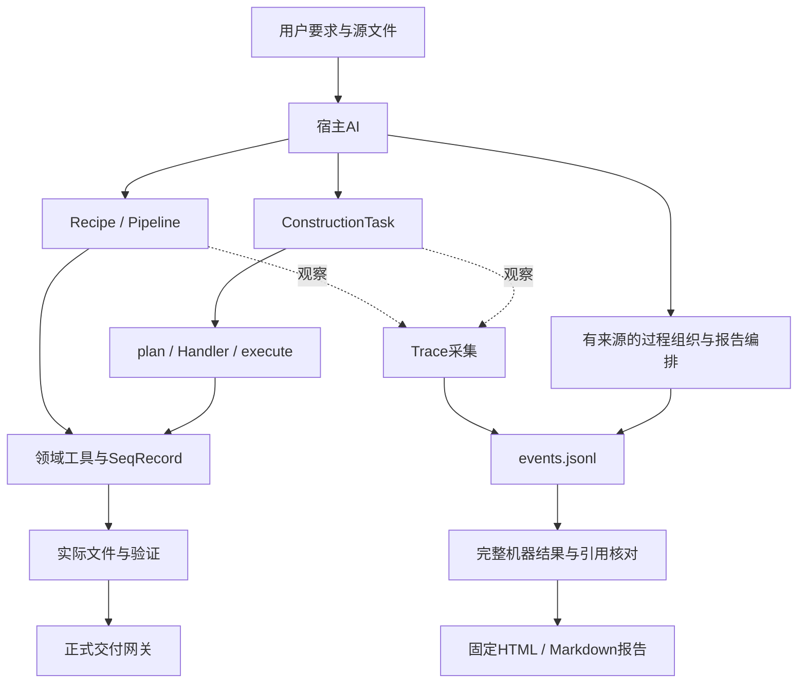
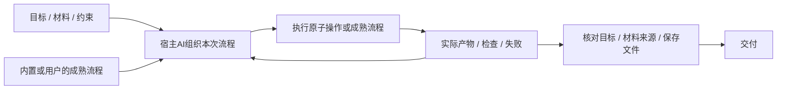

# 架构、数据与接口

本项目是宿主AI调用的本地Skill，没有内置替代宿主的推理服务。产品边界读两个spec；这里合并模块地图、数据流、集成和扩展位置。

## 目录与入口

项目/Git根是外层；`snapgene-dna-design/`是独立Skill根。下表运行路径均相对于Skill根。

| 位置 | 职责与常用入口 |
|---|---|
| `SKILL.md`、`agents/openai.yaml` | 宿主指导和元数据；不是模型本身 |
| `scripts/run_recipe.py`、`core/recipes/` | 常见制备流程，返回RecipeResult |
| `scripts/run_pipeline.py`、`agent/pipeline_agent.py` | 多步调用及真实中间产物传递 |
| `scripts/run_construction_task.py`、`core/runtime_*.py` | 结构化任务、计划、执行、验证、正式交付 |
| `core/task.py`、`core/registry.py`、`core/handlers/` | 任务契约、任务类型注册及实现 |
| `core/tools/`、`core/models/` | 反应/文件计算，保留SeqRecord、区间与注释 |
| `evidence_trace/` | 旁路采集、版本、组织检查与报告 |
| `planning/`、`agent/`、`design/`、`rules/` | 部分现用兼容接口；不能按目录名直接判定废弃 |
| `schemas/`、`references/`、`third_party/` | 数据契约、精确用法、受许可约束的后端/模型 |
| 外层`tests/`、`tools/`、`benchmarks/` | 开发检查、打包及性能测量，不随Skill交付 |

`core.registry`找任务Handler，`core.tools.registry`找原子工具。Recipe和ConstructionTask共用领域工具，但不是同一个接口。部分Core仍调用scripts中的旧计算，部分scripts转发到Core；目录名不能证明依赖方向。新领域算法放对应Core模块，CLI保持薄入口。

## DNA主线与保存数据

宿主理解用户要求，选择Recipe、Pipeline或ConstructionTask。程序从真实输入计算、写文件并检查。当前Pipeline的plan已进行模拟计算，execute负责写出；plan不能证明正式文件已交付或实验完成。



| 数据/文件 | 保存什么 | 应怎样理解 |
|---|---|---|
| `task.json` | sources、target、operation、product、约束 | 本次用户要求及原始输入 |
| `plan.json` | steps、product_features、任务/计划哈希、scope_note | 计划及计算结果；Pipeline含已计算中间体，不等同正式交付或实验完成 |
| `execution.json` | 实际产物路径、文件哈希、执行哈希 | 实际写出结果 |
| `validation.json` | artifact/computation/goal、errors、所查文件版本 | 只对应实际检查对象和范围 |
| `DELIVERY-MANIFEST.json` | 本次证据、正式文件及范围 | 不得复用旧回执授权新文件 |
| Trace `events.jsonl` | 程序事实、提交声明及追加修订 | 单写入者事实源，不保证捕获整个宿主 |
| `design_process`、`report_plan` | 有来源的阶段/步骤/分支/关系和阅读编排 | AI/人负责科学语义，代码负责引用/版本/范围核对 |

内存中的SeqRecord同时包含seq、features和annotations。位置可为复合区间；提取使用`feature.extract(record.seq)`，不能把整个变换链压成裸字符串。现代Core坐标为0-based half-open；旧入口若接受1-based closed，转换必须明确。负链不等于交换端点。

## 实际Python接口

精确签名以[Core源码](../snapgene-dna-design/core/__init__.py)和[完整示例](../snapgene-dna-design/examples/core_workflow.py)为准。

| 调用 | 返回及关键约定 |
|---|---|
| `validate_construction_task(task, base_dir=None)` | 已解析任务；错误抛TaskValidationError |
| `plan(task, base_dir=None)` | `(validated_task, plan)`二元组，后续使用返回的任务 |
| `execute(task, plan, out_dir)` | 执行记录，写实际文件并核对任务/计划版本 |
| `validate(task, plan, execution)` | 分层检查结果；必须读取errors，不能自行填写PASS |
| `finalize(task, plan, execution, validation, out_dir)` | 正式文件与清单；不满足契约抛GateRejected |

任务改变需重新计划和验证。正式提升使用本次独立临时目录及原子操作；失败不得清理其他尝试的文件。旧agent的preview交接与正式构建分开。

Recipe和ConstructionTask保留流程级信息，原子工具共享ToolResult。ToolSpec的category表达副作用；参数形状、required与default从真实签名和领域约束生成，缓存校验器供Python及注册入口使用。产品入口只有products，不再有sequence_output_key或逐工具字段猜测。Schema不能证明生物学正确。

## 流程复用与结构收敛方向

2026-10-06确认原则并记录优化建议；本节是待实现方向，当前入口仍按上文运行。本轮不改运行代码。

### 原理与最小结构

任务有目标，执行有步骤，复用有方法。这三种职责需要表达，但不要求三套执行系统。AI自编、内置和用户提供的流程区别在来源；执行相同操作时，应使用相同材料、检查和交付语义。

| 概念 | 保留职责 | 收敛方向 |
|---|---|---|
| Task | 原始目标、材料、约束和当前结果 | 提供执行上下文；方法选择后再补确需的参数，不靠固定任务分类替代AI判断 |
| Pipeline | 本次实际步骤、依赖和产物选择 | 作为可执行流程实例；支持整链调用及按观察结果调整后续步骤 |
| Recipe | 已成型的方法、候选搜索及条件判断 | 作为可组合的成熟流程；可整段复用，也可与原子操作混合 |

结构是否合理，取决于调用者是否只需说明目标、实际材料和必要条件；相同执行责任是否只维护一次。层数、类名和统一外观不是判断依据。必要边界是科学计算、完整材料传递、对实际文件的检查和交付责任；按流程来源拆开这些责任没有原理上的必要。

目标关系如下，表示职责，不要求新增同名类或框架：



### 已讨论改进与进一步优化

| 改进 | 当前依据 | 最小处理与边界 |
|---|---|---|
| Recipe可作为组合步骤 | `ToolSpec.execute`要求ToolResult，RecipeResult另有流程信息，当前Pipeline不能直接调用Recipe | 在已有组合入口接纳成熟流程，统一产物和检查交接；保留协议、警告、完成状态、内部制备链及多产物选择。verification的subject不是新构建产物 |
| 共用检查及交付编排 | Recipe CLI与Task分别组织检查和交付；已经共享部分准备文件写出及原子交付操作 | 收敛重复编排，方法特有检查仍由该方法负责；保留候选、元件、QC和完整构建的差别，不新增第二套领域算法 |
| 合并重复整链计算 | 正常Pipeline首轮plan执行一次；validate分别以recompute和再次plan核对序列、源注释；CLI未指定拓扑时还会先执行一次 | 从实际执行产物取得拓扑；用一次从原始输入独立重建的完整材料同时核对序列与注释。保留输入版本、真实反应、目标及文件回读检查，不能直接信任可变plan |
| 缩短默认宿主返回 | RecipeResult的完整分子、兼容投影和details重复序列化；已有4722 bp任务一次stdout JSON为202065 bytes | 默认返回状态、产物引用/版本、文件路径、关键检查和具体失败；完整数据保存并可按需读取。Python内部仍传完整Molecule，兼容字段迁移须检查现有调用者 |
| 从实际中间体继续 | Pipeline已有实际父版本和步骤产物，但批量入口没有逐步继续协议 | 需要局部修订时复用未改变的实际产物，只重算受影响的依赖；材料、参数或条件改变后，相关下游和检查失效。不先建设全局缓存或通用调度平台 |
| 统一能力发现 | describe_tools已有简表和按名称查询，原子ToolSpec与Recipe签名仍分开 | 在现有入口按需说明两类能力的输入、产物角色、适用条件和检查范围；先复用真实签名，不再维护第二份手工Schema |

整链3次或4次来自上述成功路径的源码调用关系，不是运行计时；202065 bytes是既有开发回放的文件大小，不是token测量或通用成本结论。实现依据见[Pipeline Handler](../snapgene-dna-design/core/handlers/composite_pipeline.py)、[验证](../snapgene-dna-design/core/runtime_validate.py)、[Pipeline CLI](../snapgene-dna-design/scripts/run_pipeline.py)、[Recipe契约](../snapgene-dna-design/core/recipes/contract.py)、[注册入口](../snapgene-dna-design/core/tools/registry.py)及[已有回放](archive/plans/real-task-usability-v2.0.2.md)。

`plan`目前已经执行计算，`execute`主要导出文件；不能把现有plan说成只有预计步骤。后续收敛须区分路线安排与已发生的计算，避免仅为生命周期字段再次运行整条链；不必为此创建另一套规划语言。Recipe中的引物搜索、条件分支和Gibson准备布局算法继续保留，不能为了变成“流程罐头”而削弱成静态表单。

先处理Recipe组合与重复编排；重复重算、宿主输出随相关调用一起收敛。逐步继续和能力发现按真实调用需求推进。用户提供的流程也需适配实际材料、参数和检查；保存的是方法，历史PASS不随流程复制。

### 判断改造是否有效

用实际混合链验证成熟流程和原子操作可以连续调用，调用者不再手工提取裸DNA再补注释；QC不会被误当成构建，零/多产物选择明确。改变路线仍满足原始目标；失败保留已产生的证据，局部继续不能沿用受影响版本的检查。

效率记录实际工具/Primer3调用次数、耗时和宿主输出字节。保持目标、反应链、材料注释与文件检查结果；错误源注释、改变的材料或失败反应仍被正确拒绝。当前记录不宣称改造已完成或性能已有提升。

## 统一分子契约目标架构

2026-10-04实施，v2公共接口。实现与最终证据见[计划](development-plans/unified-molecule-contract.md)。本节维护数据含义，计划维护验收进度。

| 实现 | 职责 |
|---|---|
| `core/models/molecule.py` | Molecule继承SeqRecord；原生FeatureLocation/CompoundLocation、FragmentEnd、strandedness、source_refs、operation及内容版本。as_molecule为输入边界；derived_molecule用于拥有新记录的生产者 |
| `core/tools/result.py` | ToolResult的products/analysis/checks；only_product拒绝零/多产物；to_wire仅供JSON/报告边界，蛋白分析携带显式类型 |
| `core/tools/registry.py` | 一份签名/约束生成工具声明和缓存运行校验；直接Python与注册调用共用；统一CoreError失败，不包装或修补DNA结果 |
| `core/io/input_resolution.py`、`molecule_codec.py` | 文件/JSON边界。GenBank/native补充缺失的ID、末端、来源及必要元数据；指纹绑定真实可见字段，编辑后拒绝旧补充覆盖新事实 |
| `core/handlers/composite_pipeline.py` | 完整产品传递和显式分析/多产品引用；制备检查沿实际版本/反应关系整理，纯注释物理等价可追到父版本 |
| `core/runtime_validate.py` | sequence_model/preparation_model/file/user_goal范围及实际对象绑定；validation_requirements指定必需范围 |

Python内部直接传Molecule。Wire包含sequence、features、annotations、dbxrefs、letter_annotations、topology、strandedness、ends、source_refs、operation、record_version和0-based-half-open坐标声明。未知用null；圆形和单链的双链自由末端不适用，ends为null；线性双链端信息缺失为对应null。端的overhang_sequence是突出单链自身5′到3′序列；参考序列包含完整上链，右侧5′突出端属于下链，不能重复加进上链。

record_version覆盖模型内容，sequence_sha256只覆盖DNA；二者不认证实体样本。输入按只读共享约定使用，生产者负责新记录及独立嵌套注释；不是Python访问控制。source_refs只引用直接父版本和映射，不嵌套整份历史。基于实际输入重算及文件字节哈希继续作为交付证据。

v2.0.2实际工作流修复：文件边界只写一份当前分子补充信息，不把旧编码块再次嵌入comment或metadata。ToolResult.analysis中的文献Reference使用同一结构化编码。Pipeline按实际父版本导出后续使用的步骤产物，保留step_id、product_index与record_version。Recipe失败JSON保留CoreError及本次候选证据；正式准入失败包含具体检查和CDS位置。注释保留比较采用写出端相同的引物规范化表示。pML104制备通过真实PCR产物和连接工具得到环形材料，注释后的分子引用该反应产物。

v2.0.1残留修复：引物分析复用as_molecule读取实际碱基；末端填补拥有独立记录，原位逐碱基值保留，延伸位点用None。连接按实际拼接映射逐位值并合并dbxrefs；记录级字段只有所有输入都提供且相等时继承，其他字段连同输入版本保留在analysis.annotation_conflicts。source_refs记录各输入到产物的坐标映射。复合提取复用sequence_ops的区间映射，汇总原feature后只判定一次partial及CDS相位。无裁剪保留原物理状态，旋转新增的拆分点精确，原外侧模糊类型保留。

制备追溯允许已核验父版本的恒等材料及确定性环状旋转：实际序列必须等于映射指定的父序列旋转，长度、拓扑、单双链和末端必须一致；仍检查整条父反应链。不存在父版本、真实碱基编辑或物理状态改变不能借用旧PASS。CLI的snapgene_status仅投影真实ToolResult.analysis；UNAVAILABLE继续表示不可用。

`$step`只允许一个products，`$step.products.1`明确选择，`$step.analysis.field`读取分析。单纯编辑的preparation_model是INCOMPLETE；显式必需该范围时不能交付。反应链通过只说明从声明输入计算成立，实体库存、实验成功和亲本/全基因组特异性不自动成立。

兼容仅保留使用中的Recipe报告投影、Task报告字段及旧CLI envelope，均从真实产品生成；既存Python工具字符串/dict和旧Pipeline字段引用迁移到新接口，旧计划重新生成。报告/CLI完成迁移后可移除这些投影，不能再用于核心交接。FASTA只有序列。Native补充支持Skill回读，桌面不能表示的order等语义不能靠补充冒充原生支持；正式网关仍核验实际native投影。

### 统一范围

全部参与流程组合的公共DNA工具共享一个分子契约，Recipe、Pipeline和ConstructionTask消费同一工具结果。工具专用参数及反应算法保持差异，宿主可自由选择、组合和修订路线。底层库可以有专用计算结构，公共交接不再靠工具名或字段猜测补救。

| 对象信息 | 必须表达的含义 |
|---|---|
| 序列与身份 | 实际碱基及对应材料版本；名称用于显示，不凭样本名认定材料身份；输入版本和生成产物可区分 |
| 注释与位置 | 复用SeqRecord/SeqFeature的能力；保留类型、qualifiers、链向、复合顺序和模糊/部分边界。内部坐标0-based half-open，外部坐标在入口/出口转换 |
| 拓扑与单双链 | 明确线性/环状和单链/双链状态；未知与不适用有独立含义，不能静默猜测。只在相关操作确需该信息时要求补齐 |
| 末端与接口 | 整合现有FragmentEnd能力，明确实际突出端、链向/表示、切点坐标及同源区；不把未知末端默认为平端，环状分子的自由末端不适用 |
| 来源与生成 | 引用实际输入版本和执行操作；中间体不重复嵌入整份历史。原材料、理论设计、供给的已制备材料和模拟反应产物的角色明确 |

既有[AssemblyFragment/FragmentEnd](../snapgene-dna-design/core/models/assembly_model.py)与[ConstructModel](../snapgene-dna-design/core/models/construct_model.py)先盘点再整合，不另保留一个需要逐工具转换的平行公共DNA格式。坐标、相位、复合片段等领域变换继续由负责实际操作的模块计算。

### 公共工具结果

所有组合工具共享以下结果骨架。示意JSON只说明字段职责，不是已上线Schema；内部直接传对象，只有边界序列化。

```json
{
  "products": [],
  "analysis": {},
  "checks": []
}
```

`products`包含完整分子产物，支持零个、一个或多个；`analysis`包含温度、翻译、切点等分析值；`checks`包含程序实际执行的检查、所查对象/版本、条件、范围和结果。分析工具可以正常返回空products；失败通过统一异常和CLI失败回执表达，不能被解释为成功的空产物。多产物在引用和最终交付中明确选定，不能静默取第一个。

Pipeline从products读取分子，标量/列表通过明确的分析字段引用。DNA、蛋白质和数值不能仅因同为字符串或字典而互换。类型及固定字段已能表达区别时，不再为每个工具增加重复类别标签；现有副作用类别仍用于控制写文件、联网等执行边界。

Recipe保留协议、文献、警告和完成状态等流程信息，但原子产物采用同一分子/结果契约。序列通过、制备链成立、文件可用、用户目标满足分别记录；检查结果不跨对象或版本复用。只请求序列模型的任务可明确范围地交付，要求制备的任务须检查供给材料或显式实际模拟反应链，不能依据成品序列推断物理准备成立。

### 变换责任与边界

公共DNA变换工具接收完整分子，产生对应新产物并同步维护序列、注释、拓扑、末端和来源。原输入与先前结果的可观察状态保持不变。截断、失效或用途改变的注释按实际变换显式处理；原注释不能直接附回新序列，不凭变换结果自造完整蛋白声明。

私有纯计算函数可以处理碱基或数值，由公共变换模块承担完整责任。只读分析不得产生意外材料修改。内部签名、前提、输出及调用者在源码可查，模块关系在此维护；Skill列公共能力，按需提供实现入口，不复制每个内部函数的第二份清单。

私有命名不是访问控制。模块调用约定和架构测试用于发现绕过；拥有任意Python执行权限的宿主仍可能直接调用内部实现，不能把提示词或下划线命名宣称为强制隔离。自写脚本也须使用完整变换及实际文件检查，声明的产物不能冒充准备证据。

核心工具之间的特殊格式适配消除。GenBank、SnapGene、Primer3等外部格式在明确边界集中转换；旧公开入口兼容只依据真实使用者保留，记录位置和移除条件。分批迁移是开发手段，最终核心交接不得长期同时接受互相猜测的新旧产物格式。

参数模型、AI可见说明、运行校验和序列化共享一份有效定义；必要反应条件和分子不变量由实现检查，不能用Schema合法代替科学正确。Pydantic是否采用需有依赖和性能依据，当前不预设。内存对象通过受控引用/只读共享及必要的新产物构造避免全量重复复制；性能不以丢信息、意外原地修改或跳必需检查换取。

核心材料生成关系引用现有源/步骤/产物标识，Trace观察这些实际数据。核心制备所需来源证据与可选Trace组织分开；Trace缺采或正常模式失败保持既有旁路语义，不反向改变生物参数或交付判断。

### 标准借鉴与当前前后对比

| 来源/职责 | 当前缺口 | 目标处理 |
|---|---|---|
| [SeqRecord](https://biopython.org/docs/latest/api/Bio.SeqRecord.html)的序列/注释绑定 | 部分旧工具将完整记录转成显示文字；切片并不自动保留所有信息 | 复用原生表示，每种变换落实保留、迁移或失效责任 |
| [GenBank](https://www.ncbi.nlm.nih.gov/genbank/samplerecord/)的注释语义 | 各入口位置与主体可能不一致 | 保留真实链向、qualifiers和边界含义，明确内部/外部坐标转换 |
| [SBOL 3.1](https://sbolstandard.org/docs/SBOL3.1.0.pdf)的身份及生成关系 | 同序列或文件名容易被当作实际材料继承 | 用实际材料版本和操作引用表达来源；本次不引入完整SBOL/RDF运行框架 |
| [Primer3 Boulder-IO](https://primer3.org/manual.html)的条件与结果 | 计算条件、默认值和适用范围分散 | 检查携带实际条件与对象，外部进程协议集中处理 |
| 公共结果骨架 | 注册表与实际产物字段可能漂移 | products成为统一产物入口，消除逐工具sequence_output_key猜测 |

标准提供可借鉴的表达，不自动证明生物学变换正确。连续操作、保存回读、独立包及性能验收由[计划](development-plans/unified-molecule-contract.md#连续操作验收矩阵)具体落实。元件误匹配和QC组合搜索仍是独立算法问题，不因数据格式统一而自动关闭。

## Trace怎样组织关系

应用边界记录真实输入、返回、错误及文件前后状态。宿主另提交用户要求、来源、公开解释和语义组织；未观察活动留作缺口。actor是提交者，不自动证明科学选择者。

AI/研究者区分“作为输入”“支持判断”“产生”“修订”等关系，不能由时间顺序推导因果。程序核对明确引用、版本、实际参数与文件，比较已填写条件；不能认证论文推论或把一份文件检查复制给全部Decision。

组织和编排也追加到日志。新事实可使旧组织陈旧；graph、HTML和Markdown可重建。机器导出用JSON引用去重，报告投影不删除原记录。导出及点击不再次调用模型。接口和提交示例读[Trace参考](../snapgene-dna-design/references/evidence-trace.md)，阅读规则读[design](trace-report/design.md)。

## 外部依赖与扩展位置

Biopython处理序列和特征；sgffp/snapgene_reader处理native文件；Primer3通过真实子进程计算。Cas-OFFinder/OpenCL及预测模型属于单独检查的可选后端。NCBI有超时/offline状态，Addgene链接辅助不等于完整序列API。数据上传遵循[隐私与同意规则](../snapgene-dna-design/references/privacy-and-consent.md)，受信任模型与许可读[归属说明](attribution.md)。

新增工具在`core/tools/registry.py`按真实副作用注册；新增Recipe检查RecipeResult、准备链和默认入口。新增task_kind同时检查任务Schema、registry及Handler映射，实现validate_contract、clarify、plan、recompute、validate_goal，并复用交付边界。预期来自原输入和要求，不能从产物反推必然成功的预期。

新增可选字段要明确缺失语义；改变含义需显式版本化或要求重生成。旧事件保留，旧组织可陈旧，报告可重建。扩展Trace需覆盖真实入口、旧日志、失败隔离和三档DNA一致性。取舍原因见[history](history.md)，具体实现和失败原件见[历史档案](archive/README.md)。
