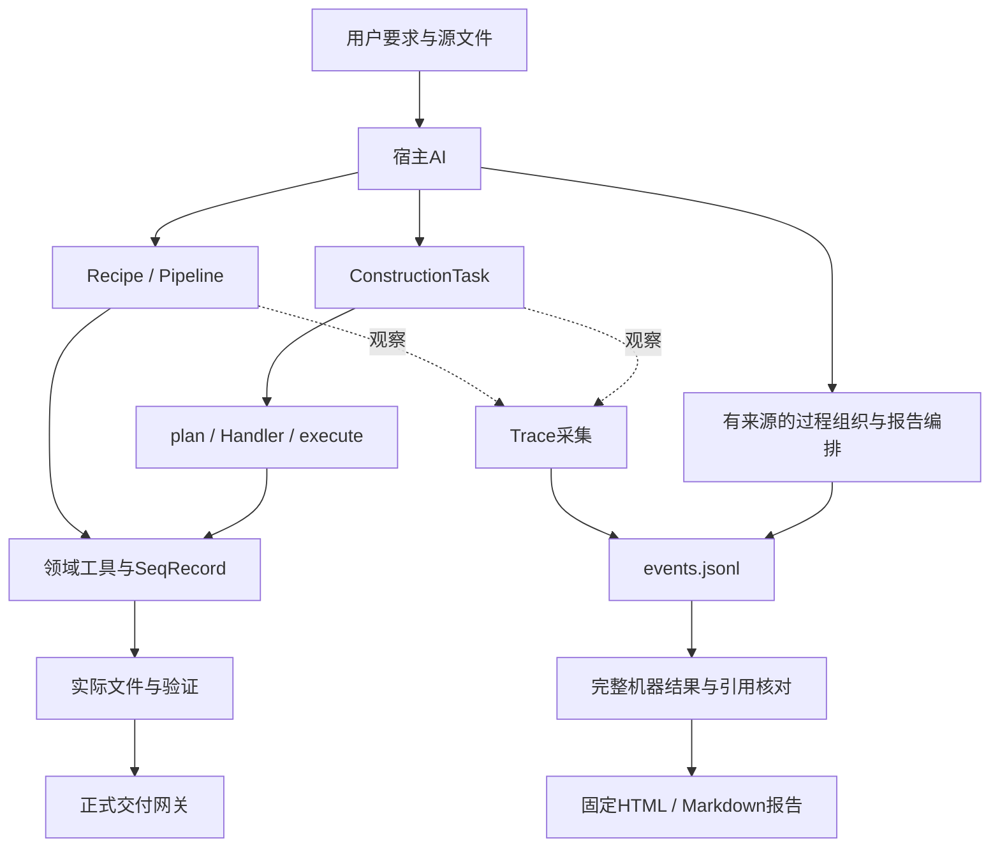

# 架构、数据与接口

本项目是宿主AI调用的本地Skill，没有内置替代宿主的推理服务。产品边界读两个spec；这里合并模块地图、数据流、集成和扩展位置。

## 目录与入口

项目/Git根是外层；`snapgene-dna-design/`是独立Skill根。下表运行路径均相对于Skill根。

| 位置 | 职责与常用入口 |
|---|---|
| `SKILL.md`、`agents/openai.yaml` | 宿主指导和元数据；不是模型本身 |
| `scripts/run_recipe.py`、`core/recipes/` | 常见制备流程，返回RecipeResult |
| `scripts/run_pipeline.py`、`agent/pipeline_agent.py` | 多步调用及真实中间产物传递 |
| `scripts/run_construction_task.py`、`core/runtime_*.py` | 结构化任务、计划、执行、验证、正式交付 |
| `core/task.py`、`core/registry.py`、`core/handlers/` | 任务契约、任务类型注册及实现 |
| `core/tools/`、`core/models/` | 反应/文件计算，保留SeqRecord、区间与注释 |
| `evidence_trace/` | 旁路采集、版本、组织检查与报告 |
| `planning/`、`agent/`、`design/`、`rules/` | 部分现用兼容接口；不能按目录名直接判定废弃 |
| `schemas/`、`references/`、`third_party/` | 数据契约、精确用法、受许可约束的后端/模型 |
| 外层`tests/`、`tools/`、`benchmarks/` | 开发检查、打包及性能测量，不随Skill交付 |

`core.registry`找任务Handler，`core.tools.registry`找原子工具。Recipe和ConstructionTask共用领域工具，但不是同一个接口。部分Core仍调用scripts中的旧计算，部分scripts转发到Core；目录名不能证明依赖方向。新领域算法放对应Core模块，CLI保持薄入口。

## DNA主线与保存数据

宿主理解用户要求，选择Recipe、Pipeline或ConstructionTask。程序从真实输入计算、写文件并检查；先有计划不等于已经执行。

| 数据/文件 | 保存什么 | 应怎样理解 |
|---|---|---|
| `task.json` | sources、target、operation、product、约束 | 本次用户要求及原始输入 |
| `plan.json` | steps、product_features、任务/计划哈希、scope_note | 预计执行和作用范围，不是执行证据 |
| `execution.json` | 实际产物路径、文件哈希、执行哈希 | 实际写出结果 |
| `validation.json` | artifact/computation/goal、errors、所查文件版本 | 只对应实际检查对象和范围 |
| `DELIVERY-MANIFEST.json` | 本次证据、正式文件及范围 | 不得复用旧回执授权新文件 |
| Trace `events.jsonl` | 程序事实、提交声明及追加修订 | 单写入者事实源，不保证捕获整个宿主 |
| `design_process`、`report_plan` | 有来源的阶段/步骤/分支/关系和阅读编排 | AI/人负责科学语义，代码负责引用/版本/范围核对 |

内存中的SeqRecord同时包含seq、features和annotations。位置可为复合区间；提取使用`feature.extract(record.seq)`，不能把整个变换链压成裸字符串。现代Core坐标为0-based half-open；旧入口若接受1-based closed，转换必须明确。负链不等于交换端点。

## 实际Python接口

精确签名以[Core源码](../snapgene-dna-design/core/__init__.py)和[完整示例](../snapgene-dna-design/examples/core_workflow.py)为准。

| 调用 | 返回及关键约定 |
|---|---|
| `validate_construction_task(task, base_dir=None)` | 已解析任务；错误抛TaskValidationError |
| `plan(task, base_dir=None)` | `(validated_task, plan)`二元组，后续使用返回的任务 |
| `execute(task, plan, out_dir)` | 执行记录，写实际文件并核对任务/计划版本 |
| `validate(task, plan, execution)` | 分层检查结果；必须读取errors，不能自行填写PASS |
| `finalize(task, plan, execution, validation, out_dir)` | 正式文件与清单；不满足契约抛GateRejected |

任务改变需重新计划和验证。正式提升使用本次独立临时目录及原子操作；失败不得清理其他尝试的文件。旧agent的preview交接与正式构建分开。

RecipeResult、ToolSpec和ConstructionTask各有自己的契约。ToolSpec的category表达副作用，parameters_schema表达形状，sequence_output_key说明可传递的DNA；分析值不能冒充最终DNA。Schema检查不能证明生物学目标正确。

## Trace怎样组织关系

应用边界记录真实输入、返回、错误及文件前后状态。宿主另提交用户要求、来源、公开解释和语义组织；未观察活动留作缺口。actor是提交者，不自动证明科学选择者。

AI/研究者区分“作为输入”“支持判断”“产生”“修订”等关系，不能由时间顺序推导因果。程序核对明确引用、版本、实际参数与文件，比较已填写条件；不能认证论文推论或把一份文件检查复制给全部Decision。

组织和编排也追加到日志。新事实可使旧组织陈旧；graph、HTML和Markdown可重建。机器导出用JSON引用去重，报告投影不删除原记录。导出及点击不再次调用模型。接口和提交示例读[Trace参考](../snapgene-dna-design/references/evidence-trace.md)，阅读规则读[design](trace-report/design.md)。

## 外部依赖与扩展位置

Biopython处理序列和特征；sgffp/snapgene_reader处理native文件；Primer3通过真实子进程计算。Cas-OFFinder/OpenCL及预测模型属于单独检查的可选后端。NCBI有超时/offline状态，Addgene链接辅助不等于完整序列API。数据上传遵循[隐私与同意规则](../snapgene-dna-design/references/privacy-and-consent.md)，受信任模型与许可读[归属说明](attribution.md)。

新增工具在`core/tools/registry.py`按真实副作用注册；新增Recipe检查RecipeResult、准备链和默认入口。新增task_kind同时检查任务Schema、registry及Handler映射，实现validate_contract、clarify、plan、recompute、validate_goal，并复用交付边界。预期来自原输入和要求，不能从产物反推必然成功的预期。

新增可选字段要明确缺失语义；改变含义需显式版本化或要求重生成。旧事件保留，旧组织可陈旧，报告可重建。扩展Trace需覆盖真实入口、旧日志、失败隔离和三档DNA一致性。取舍原因见[history](history.md)，具体实现和失败原件见[历史档案](archive/README.md)。
