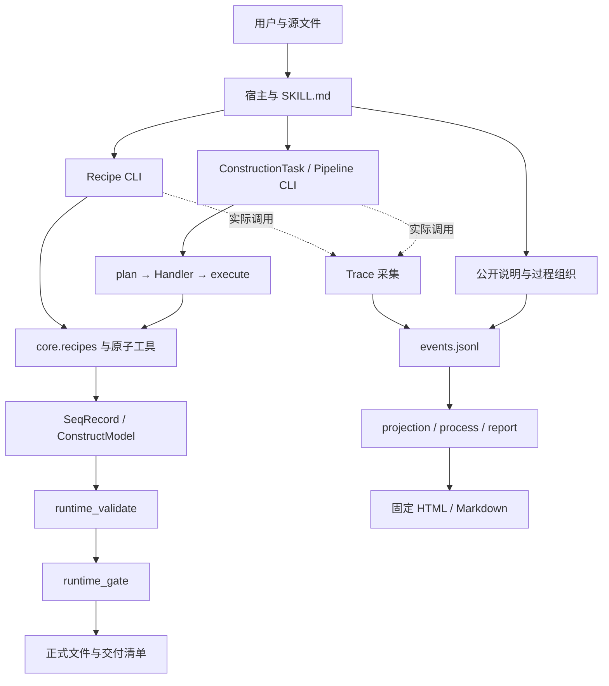

# 架构

模块是按职责组织的 Python 文件组，不是服务器。宿主模型在项目之外：它提出任务与公开说明，项目自己的确定性代码负责计算。

## 边界

- `core/tools` 负责反应与文件计算；`core/models` 保留位置/注释；输入 JSON 不等于裸字符串必须丢特征。
- Handler 是特定 task_kind 的实现；runtime 负责公共契约、验证和提升。Recipe 是另一种面向常见制备流程的入口，两者共用工具，但不是同一接口。
- `planning/` 和旧 `agent/` 仍有兼容调用，不能因与新架构相似就删除；其能力边界必须单独验证。
- Trace 只观察。来源存在、声明内容、条件比较、科学判断与程序验证分别保存。
- `scripts` 包含 CLI 适配、外部程序适配和历史辅助计算。完整源码地图见[仓库结构](repository-structure.md)。

选用现有模块加共享输入/写出契约，原因是实证缺陷来自接口不一致。没有收益证据就不拆微服务、不加数据库、不另造验证引擎。当前问题及修复依据见[审计](audit-report.md)。
