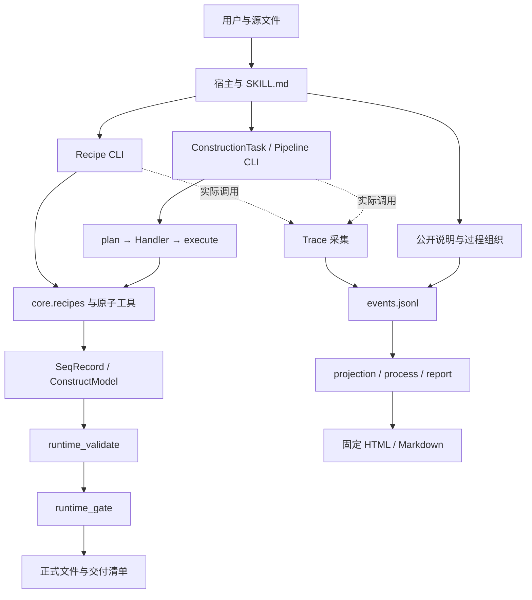

# 架构

模块是按职责组织的 Python 文件组，不是服务器。宿主模型在项目之外：它提出任务与公开说明，项目自己的确定性代码负责计算。

## 边界

- `core/tools` 负责反应与文件计算；`core/models` 保留位置/注释；输入 JSON 不等于裸字符串必须丢特征。
- Handler 是特定 task_kind 的实现；runtime 负责公共契约、验证和提升。Recipe 是另一种面向常见制备流程的入口，两者共用工具，但不是同一接口。
- `planning/` 和旧 `agent/` 仍有兼容调用，不能因与新架构相似就删除；其能力边界必须单独验证。
- Trace 只观察。来源存在、声明内容、条件比较、科学判断与程序验证分别保存。
- `scripts` 包含 CLI 适配、外部程序适配和历史辅助计算。完整源码地图见[仓库结构](repository-structure.md)。

选用现有模块加共享输入/写出契约，原因是实证缺陷来自接口不一致。没有收益证据就不拆微服务、不加数据库、不另造验证引擎。当前问题及修复依据见[审计](../reviews/audit-report.md)。

## 执行从哪里开始

1. 宿主先读SKILL和相关参考，将自然语言转换成明确参数；本仓库不提供一个替代宿主模型的推理引擎。
2. Python执行某个`scripts/*.py`入口，导入包并初始化工具注册表。`core.registry`按任务类型找Handler；`core.tools.registry`按工具名称找原子函数，两者职责不同。
3. Recipe直接组织工具；Pipeline按步骤依赖传递中间结果。Task runtime在这些计算周围执行任务校验、计划、执行、验证、交付。
4. `SeqRecord`携带序列与注释；`ConstructModel`和feature操作负责区间变换。把记录转为裸字符串只适用于确实只需碱基的计算，不能作为整个变换链的数据表示。
5. CLI边界上的Trace wrapper观察实际结果；宿主稍后补语义组织。HTML是本地文件，读取嵌入的报告数据和固定JS/CSS，无后端服务、数据库或每次点击的新模型调用。

## 状态与依赖方向

ConstructionTask及其计划/执行/验证是普通Python字典；运行状态由调用顺序和版本绑定管理，产物保存在调用方指定目录。源文件被修改后，旧验证不能继续授权交付。原子提升使用同一输出目录内的临时目录，成功才出现authoritative；失败仅清理自身临时目录。

Trace的事实状态在events.jsonl，组织修订也追加其中。graph.json、Markdown和HTML可重建。日志目前为单写入者设计，不是多用户协同数据库。全局采集设置影响之后的新采集，运行中保留已选级别。

主方向是入口→编排→领域工具/记录→外部库。Trace在入口外围观察，领域Handler不反向依赖报告。仓库并非完全分层：部分Core工具复用了scripts中的旧实现，部分scripts又转发到Core。这是迁移期间的耦合，不应凭目录名判断依赖。新增逻辑优先放对应领域模块；保留旧CLI作为薄入口，避免继续复制计算算法。

## 采用和放弃的方案

| 决策 | 原因 | 代价/后续判断依据 |
|---|---|---|
| 共享完整记录写出 | 多个Handler各自重建裸SeqRecord造成共同缺陷 | 不同变换仍必须提供正确product_features |
| 保留Recipe与Pipeline | 标准路线和自由多步组合服务不同任务 | 两条入口都需真实产物与失败测试 |
| 保留旧agent预览，禁止formal | 有兼容CLI和规则维护调用；直接删除会破坏使用者 | 明确工作区与交接包边界，不能把预览当正式构建 |
| 不新建独立验证引擎 | 当前缺陷可在已有计算与验证契约内修复 | 重算和实现仍可能共享假设，因此独立预期/源材料核验不可省略 |
| AI/人组织科学关系，代码检查引用 | 仅靠时间顺序无法推导科学依据与因果 | 组织是可审查声明，不是程序认证的科学结论 |
| 固定离线报告renderer | 可重建、可测试、交互不额外消耗模型token | 文案和可读性仍需真实使用者反馈 |

如果重新设计，会先统一数据表示与公开接口，再提供各CLI；不会先删掉仍在使用的旧入口，也不会为目前单机工作流引入微服务。变化依据与被否决方案见[history](../../history.md)。
