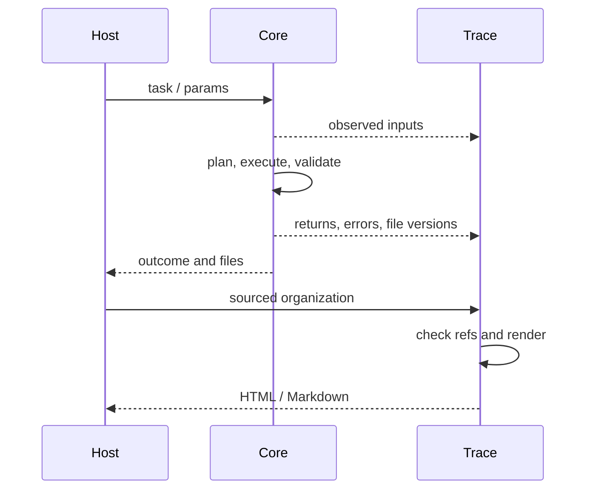

# 数据怎样流动

| 阶段 | 形状 | 谁负责 | 事实边界 |
|---|---|---|---|
| 用户输入 | 目标文字、源文件、约束 | 用户/宿主 | 未说明的动机不能推成事实 |
| 结构化任务 | ConstructionTask JSON | task/session | Schema 检查结构，不能证明科学意思正确 |
| 计划 | 操作、输入与产品约束及版本锚点 | runtime_plan/Handler | 计划不是执行 |
| 执行 | SeqRecord、中间体、文件路径与哈希 | runtime_execute/工具 | SeqRecord 同时有 sequence、features、annotations |
| 验证 | artifact/computation/goal + errors | runtime_validate | 只证明实际检查范围，异常是失败 |
| 交付 | authoritative 文件、DELIVERY-MANIFEST | runtime_gate | 必须对应这次任务、计划、执行和验证 |
| 采集 | 每行一个事件的 JSONL | Trace runtime/recorder | append-only，不等于捕获整个宿主 |
| 组织 | design_process + report_plan | AI/研究者，程序核对引用 | 科学关系来自声明，不能靠排序伪造 |
| 报告 | 完整机器图及可读投影 | process/report/render | JSON 保留事实，HTML/MD解释选定内容 |

坐标：现代 Core 是 0-based half-open，即 start 包含、end 不包含。旧 CLI 可接受 1-based closed，转换必须在入口明示。负链不等于交换两个数字；提取由 Biopython feature.extract 按生物学顺序完成。哈希用于版本绑定，不证明生物学正确。

## 同一个任务中的几种数据

运行[API例子](../../../snapgene-dna-design/examples/core_workflow.py)后，可按下表读实际JSON。这里展示关键字段，完整对象由程序保存，省略字段不等于不存在。

| 文件/对象 | 关键内容 | 读者应该问什么 |
|---|---|---|
| task.json | task_kind、sources、target、operation、product、approvals | 请求改哪里，实际输入是什么？ |
| plan.json | steps、product_features、product_sequence_sha256、task_sha256、plan_sha256、scope_note | 计划将产生什么，依据哪版任务？ |
| execution.json | product_gb/product_fasta/product_dna、artifact_hashes、execution_sha256 | 实际写了哪些文件？ |
| validation.json | artifact_valid、computation_valid、goal_valid、errors、artifact_hashes | 哪些检查真的执行了，对应哪版文件？ |
| DELIVERY-MANIFEST.json | evidence、files、scope_note | 哪些文件是这次正式交付，范围是什么？ |

程序在内存中常用`SeqRecord`，其中`seq`是碱基，`features`是带位置的注释，`annotations`包含拓扑/分子类型等记录信息。Feature的qualifiers是说明字段；位置可为多个区间。JSON输出将这些对象序列化为普通列表和字典，重新读入时必须恢复对应语义。

## Trace从零散记录到机器结果

1. 应用边界记录调用、返回、错误、文件前后状态；宿主可提交要求、来源、公开理由。程序看不到的宿主活动不会自动出现。
2. Recorder给记录分配版本，明确引用指向具体版本。`actor`表示谁提交，不自动证明谁作了科学选择。
3. 宿主/研究者提交design_process，将事实编成目标、阶段、步骤、分支与不同含义的关系；同时可提交report_plan表达阅读顺序和摘要。
4. 程序核对引用、范围、版本与记录处置；比较明确条件，产生可解释的缺口和变化影响。不会把“先发生”升级成“导致”。
5. `storage.machine_export`把重复记录改为`#/source_records/...`引用。graph.json是完整机器结果；报告只取其可读投影，不重新创造证据关系。

| 关系 | 来源 | 不能推成什么 |
|---|---|---|
| 某文件实际作为工具输入 | 程序观察到的参数/文件版本 | 文件的科学身份已被认证 |
| 一条Statement支持Claim | AI/研究者的带来源声明 | 论文存在就等于推论成立 |
| 某Validation检查某产物 | 实际检查结果和对象范围 | 同run所有Decision都被验证 |
| Decision修订影响旧依据 | 版本变化、明确/可能依赖 | 旧科学结论自动错误 |

原事件不因页面折叠而删除；新增事实可以让旧组织变为陈旧，需追加新组织。后补解释必须保留“后来补充”的来源，不能回填成当时理由。精确Schema和提交例子以[Trace参考](../../../snapgene-dna-design/references/evidence-trace.md)为准，避免在多份文档维护不同格式。
