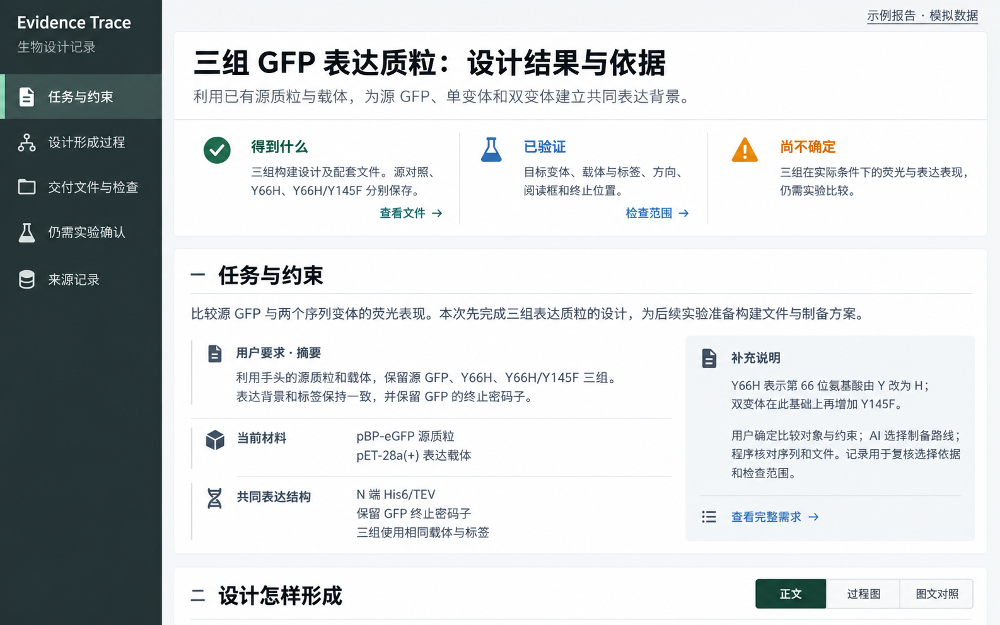

# Evidence Trace 报告视觉设计

r1 · 2026-09-19 · 按用户参考图细化；用于独立 HTML 示意，尚未接入正式 renderer。

本文只定义参考图对应的布局、文字位置和交互外观。[design.md](../../trace-report/design.md) 继续管理报告规则、来源边界与可读性验收。参考图未展示的六步追踪、证据侧栏与手机交互，沿用已讨论要求，不据此编造新数据。

## 1. 总体布局

- 左侧深灰绿色应用侧栏，桌面约 232px，宽屏可达 248px；可折叠为图标列。只保留报告身份和五章目录，选中章以浅色条、背景及文字共同标示。
- 主工作区使用浅冷灰背景，左右留白约 20px。白色章节表面、轻边线与 5px 圆角形成一级区域；不为每一段文字再套卡片。
- 页首右上角只放“示例报告 · 模拟数据”入口。标题、任务一句话摘要和结果概览合为一个白色报告头。
- 首屏结果概览三列：得到什么、已验证、尚不确定。每列为图标、标题、简要事实和相关入口；使用列间分隔线，不做三张独立 KPI 卡。
- 章节顺序仍为任务、设计过程、交付检查、待确认、来源。模式切换属于设计过程章，桌面与章节标题同一行。

## 2. 字体、颜色与图标

| 元素 | 样式与用途 |
|---|---|
| 正文 | 微软雅黑及系统中文无衬线后备；16px / 1.75；主要段落控制在 36–42em |
| 报告标题 | 36px、700；桌面不强制换行，小屏 27–28px |
| 章节标题 | 25–26px、700，1500px 以上宽屏可到 28px；步骤标题 18–19px、700 |
| 字段名 / 辅助信息 | 14px / 13px；数字沿用正文，不使用装饰性等宽字形 |
| 应用侧栏 | 深灰绿 #233638；浅文字，选中背景 #3a5351 与薄荷色边条 |
| 正文与表面 | 深墨色 #17232c；正文 #465466；白色表面，浅灰背景 #f2f5f7 |
| 首屏结果 | 绿色勾表示记录中的完成结果；蓝色烧瓶标识检查栏目；琥珀警示标识未验证事项 |
| 追踪语义 | 用户要求中性灰，AI 选择蓝色，程序操作/结果绿色，未验证琥珀色；产物保持中性，不暗示安全 |

首屏蓝色表示“检查范围”栏目；具体检查的状态与对象仍由文本交代。不能把栏目配色当作通过/失败判断。装饰性图标使用内联 SVG 并对辅助技术隐藏，所有动作另有可读文字或按钮名称；不使用 emoji、图标字体或联网资源。

## 3. 内容必须放在对应位置

| 区域 | 放什么 | 不放什么 |
|---|---|---|
| 报告标题与摘要 | 当前任务、设计对象 | 页面开发过程、模型能力宣传 |
| 结果概览 | 实际交付、真实检查范围、当前未知 | 安全评分、测试数量、未经证实的成功宣言 |
| 任务介绍 | 研究目标与本次交付任务的区别 | 导航教学和泛泛解释 |
| 用户要求 · 摘要 | 忠于原请求的简短摘要，明确标注 | AI 后来新增的取舍 |
| 当前材料 | 用户提供的源质粒与载体 | 与任务无关的文件列表 |
| 共同表达结构 | 已明确的标签、背景、终止要求 | 从文件名或论文猜出的约束 |
| 右侧补充说明 | 首次出现的变体术语、用户/AI/程序职责；完整请求入口 | 额外运行状态、重复结果概览 |
| 步骤正文与依据 | 当前动作、输入输出、理由、来源和限制 | renderer 开发注释、布局说明 |
| 示例说明 | 模拟范围、真实文献范围、未执行事项 | 分散到每一段的重复免责声明 |

任务章先用一段交代目标，下方左列约 63%：摘要、材料、表达结构三个行块；只用图标、纵向细线与行间分隔组织。右列约 37%：一块浅灰补充说明，底部进入完整请求。完整请求通过来源侧栏打开，不能用摘要冒充原话。

## 4. 过程、图文绑定与交付

- 示例保留六步：输入材料 → AI 选择 → 程序操作 → 候选产物 → 程序检查 → 交付文件。这是本案例结构，不要求所有未来任务强行凑齐六步。
- 每步显示序号、类型、名称、输入、输出和依据入口。连线说明约束传递、实际输入、生成、检查对象或交付引用，不能混成统一因果关系。
- 图文对照左列约 48%，右列约 52%；选中态覆盖整个节点。右侧顶部常驻同一节点的序号、类型与名称，滚动详情时仍可识别。
- 查看来源在侧栏展开；关闭后保留步骤、滚动与展开状态。来源核实、解释与程序验证的语义保持分离。
- 交付表按组别呈现文件和检查关系；模拟文件只提供详情，不提供无效下载。未验证荧光表现放在待确认章。

## 5. 小屏与状态

- 小于 700px：深色侧栏替换为“当前章节 + 展开目录”；展开五章纵向列表，不使用无提示横向滚动。
- 首屏三列改为纵向摘要，保留三个语义标题；任务章左右列变成上下排列，用户要求优先。
- 图文对照保留“图 / 详情”切换，共享选中节点。表格允许局部横向滚动，页面本身不得横向溢出。
- Tab、Enter、Escape 可使用目录、模式、来源侧栏和文件详情；当前状态通过文字及 aria 属性表达。
- 颜色或图标失效时，读者仍能从文字识别角色、检查范围与未知。减少动态效果设置生效。

## 6. 验收与实施记录

本次只制作独立 HTML 参考，不改 DNA Core、采集或正式 renderer，不宣称已经通过真人阅读验收。

2026-09-19 实际检查：Edge 无窗口浏览器在 1586×992 和 390×844 下生成截图，并逐张检查首屏、图文对照和手机布局；页面无横向溢出，窄屏表格单独滚动。六个节点均有输入、输出及来源入口；选中节点与详情标题一致；三模式保持选择及展开状态；来源侧栏可返回完整记录；完整需求入口显示原请求而非摘要；侧栏折叠、手机展开目录及文件详情通过交互检查。浏览器无脚本异常。完整辅助技术测试与真人理解反馈尚未执行。

本地交付：`evidence-trace-report-v6.html`，位于本任务的 `report-preview/` 可视化目录；同目录保留 `v6-desktop.png`、`v6-split.png`、`v6-mobile.png` 和自动检查记录。示例 HTML 保持独立，未作为正式 renderer 发布。
