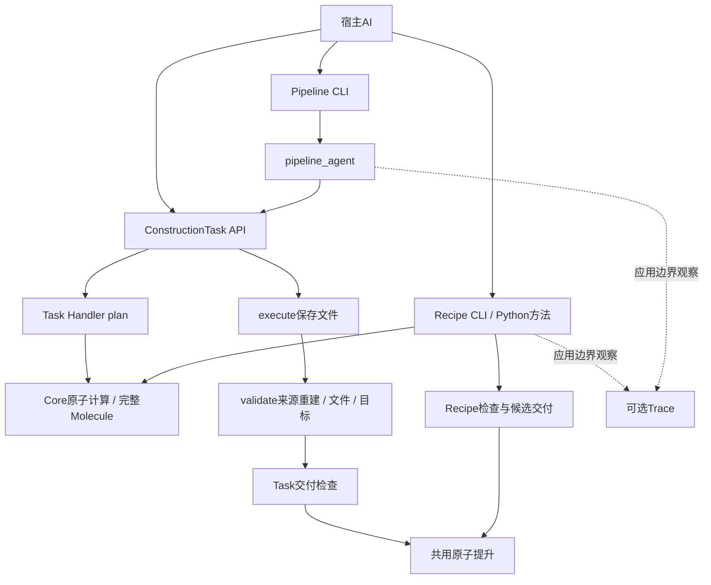

# 架构调研与现存结构审查：自由选路、成熟方法复用与正确执行

日期：2026-10-06。**Dated research evidence。此文件是有日期的研究证据，不是现行指南，也不授权运行代码重构。** 产品契约仍由 [Core spec](../../../specs/core-skill.md) 管理，模块和接口仍由 [architecture](../../architecture.md) 管理，执行范围由 [handoff](../../development-plans/README.md) 管理。

本文件保存外部资料、现存源码审查与公开入口核查。对项目的适用性和优化方向属于分析，不等于已经实施。未读取 heldout 材料、答案或逐题反馈；未安装、执行或验证外部 DNA 软件。本轮不讨论生物具体操作优化。

## 综合结论

**现有架构的领域底座合理，执行和交付接口需要收敛；现有证据不要求重建总工作流引擎。** 宿主负责理解和选路，Core负责领域计算，Recipe封装成熟算法，完整Molecule承载材料，实际文件和检查支撑交付。这些职责有具体价值。问题集中在混合调用的批量接口、重复计算、失败后继续、结果投影和目标覆盖，而不是三个名字本身。

修正上一轮讨论的力度：Recipe与原子工具已经能在Python中组合，不能称为两套完全隔离的计算系统。Pipeline不能直接调用Recipe是已复现的接口限制；补足这一接口不要求成熟Recipe先转换成静态JSON，也不要求废弃已有Task Handler。共同执行语义可以通过现有函数和少量适配落实，不预设一个新的统一执行器。

推荐保留宿主自由调用底座，按真实阻断收敛组合、错误、材料角色和交付边界；把整链重建合并为一次独立来源重建，同时核对序列和注释；保存已完成步骤的真实结果以支持局部继续。全DSL、数据库、分布式调度或内置第二个AI循环的收益，需要批量、远程、长任务或独立应用需求证明。

## 现存结构审查与本次证据

### 审查基线与方法

源码基线：`63e97a0731e77b7eaadeb1747043be4717ebf937`，v2.0.2运行代码。该提交[六环境CI成功](https://github.com/zoehanke/snapgene-dna-design/actions/runs/37359824370)。工作树原有未提交修改另存原状；审查使用Git archive在仓库外展开的该提交，不将它们混入结果。解释器为Windows/Python 3.12.4，使用该解释器实际安装的Primer3可执行程序。

盘点覆盖Core、agent、planning、design、rules、evidence_trace和scripts的173个Python文件，读取AST、导入和公开入口；重点追踪Recipe、Pipeline、Task、材料/文件、验证、准备写出、交付、工具发现和Trace的实际连接。Core目录60个Python文件，注册原子工具43个，Recipe声明7个；这些数量只说明覆盖面，不证明合理性或功能完整性。

使用独立生成的240 bp非编码软件测试输入，附一个35:95正向misc_feature；不使用用户DNA或题库答案。两次反向互补的预期直接来自输入，PCR预期为原输入30:190，注释预期为5:65。候选失败和原始输出保留，不以当前算法生成自己的验收答案。没有开展自然宿主陌生任务评测，也没有逐个证明全部领域算法正确。

### 实际调用关系

Pipeline属于Task的一种Handler，不是与Task完全并列的运行系统。Recipe已经共享Core原子计算；两条交付路径已经共享`_promote_verified_candidate`，准备文件也共享写出函数。应收敛确实重复的责任，不能因目录或入口不同断言全部算法重复。[Pipeline应用入口](../../../snapgene-dna-design/agent/pipeline_agent.py#L88)、[交付实现](../../../snapgene-dna-design/core/runtime_gate.py#L117)。

### 公开入口核查

计数包装只观察原`run_pipeline_steps`和`run_boulder`，调用原函数、不修改参数或结果。CLI通过原`run_pipeline.py`运行；成功结果实际保存的GB、FASTA、DNA回读，其中DNA使用Biopython原生格式解析作交叉核对。简单注释回读通过不等于所有native语义或桌面兼容已验证。

| 核查 | 实际结果 | 能支持的结论 |
|---|---|---|
| 线性输入两次反向互补，明确拓扑 | delivered / verified；整链3次；正式三格式序列及GB/DNA的原注释区间一致 | 材料传递有效；重复计算是实际行为 |
| 同一线性操作，不填写拓扑 | delivered / verified；整链4次；正式文件同样核对通过 | 自动拓扑推断增加一次实际计算 |
| 实际PCR制备，四个范围均要求 | sequence_model、preparation_model、file、user_goal均PASSED；整链3次，Primer3进程6次；一份实际准备行；序列和注释符合源输入预期 | 在有真实后端的正常制备链上也存在复算；不是只观察空壳或纯字符串操作 |
| Python调用成熟Recipe，再调用原子变换 | 得到完整Molecule，component_only角色明确；90 bp产物变换及features保留正确 | 方法和原语已有可组合底座，不必重写领域算法 |
| 把规范名称recipe_protein_tagging放入Pipeline步骤 | 明确失败：Unknown atomic tool | Pipeline注册入口不能直接组合成熟Recipe |
| 第二步骤增加非法参数 | 第一操作已计算，第二操作失败；目录没有第一步骤产物或可恢复步骤回执，只有失败结果与Trace | 批量入口不能从保留的成功前缀继续；不是声称所有手工Python路径都不能继续 |
| 失败JSON与CoreError交接 | CLI只保留type/message及非空details；实际输出没有error_code、missing_fields或questions；内层异常被PlanningError包裹 | 统一异常模型未完整贯通Pipeline，宿主需要从文字恢复失败原因 |
| 随机圆形输入，无质粒维持元件 | 两种拓扑选择均拒绝BIO-08；原失败保留，未改成假注释求通过 | 当前圆形最终产物使用完整质粒检查；角色适用性是后续通用化问题，不把本负例计为构建成功 |
| 非规范Recipe名称的负对照 | 原样失败并保留 | 不用名称拼写问题替代规范名称的组合证据 |
| Recipe声明与真实签名 | 7份声明的必填项及已列参数默认值核对相符；2份漏可选参数：require_pam_disruption、max_pair_checks | 手工声明存在局部漂移；describe_tools的真实签名查询仍可发现它们 |

PCR探针一次测得约1.34 s、stdout 11102 bytes；不是重复计时基准，不承诺任何加速比例。另检查既有已知回放文件尺寸：4722 bp构建stdout为202065 bytes。实际token和AI用户成本未测，不能据字节直接宣称成本降低。

本地原始记录位于 `C:\Users\祝浩淇\AppData\Local\Temp\dna-architecture-audit-20261006-gvo7fhsf`，包括源码快照、输入、全部stdout/失败和以下摘要。它们不入源码提交；临时目录保留期取决于本机，本文保留结论所需的条件和结果。

- [盘点](C:/Users/祝浩淇/AppData/Local/Temp/dna-architecture-audit-20261006-gvo7fhsf/inventory.json)
- [初始调用与负例](C:/Users/祝浩淇/AppData/Local/Temp/dna-architecture-audit-20261006-gvo7fhsf/public-entry-probes.json)
- [成功线性调用与规范Recipe负例](C:/Users/祝浩淇/AppData/Local/Temp/dna-architecture-audit-20261006-gvo7fhsf/public-entry-probes-linear.json)
- [Python混合调用、声明及正式文件回读](C:/Users/祝浩淇/AppData/Local/Temp/dna-architecture-audit-20261006-gvo7fhsf/composition-discovery-final-files.json)
- [真实Primer3制备](C:/Users/祝浩淇/AppData/Local/Temp/dna-architecture-audit-20261006-gvo7fhsf/actual-pcr-probe.json)

### 全面审查矩阵

| 方面 | 当前事实 | 判断与优化方向 |
|---|---|---|
| 宿主与领域计算 | Skill没有自己的模型服务；宿主理解请求，方法函数执行确定性计算 | 职责合理。继续保持选择自由，封装成熟搜索，不复制宿主决策循环 |
| Task、Pipeline、Recipe | Pipeline使用composite_pipeline Task；Recipe内部复用原子工具 | 目标上下文、执行记录、成熟能力的职责成立；三套并列计算架构的说法不成立 |
| 分子模型 | Molecule扩展SeqRecord并记录拓扑、单双链、末端、源版本、操作；ToolResult明确零/多产物 | 保留。格式统一不替代坐标、注释、反应和回读正确性；不将结果压成DNA字符串 |
| 成熟方法 | Gibson已有按实际PCR候选选择同源区布局的局部缓存和动态规划 | 是有价值的深模块，不为外观统一展平成静态步骤表。全流程模板与方法内部算法可各有表示 |
| 组合接口 | 直接Python组合成立，Pipeline仅收ToolResult的原子注册调用 | 优先在已有边界适配成熟方法，保留Recipe角色、subject、制备链、协议和搜索信息；不只转换products后丢其余语义 |
| 生命周期与重算 | plan已经计算；execute主要写文件；验证再次跑两个整链 | 可共享一次从原始来源重建的完整结果，同时核对序列、注释和物理字段；保持最终文件读回和目标检查。复算与计划编排分清 |
| 失败与继续 | 结果存于一次调用的局部env，失败时没有成功前缀返回；Trace主要观察task/plan应用边界 | 先保存真实已完成步骤与失败位置，再提供继续能力；不让可选Trace成为恢复必须条件 |
| 错误模型 | CoreError有结构化字段；Pipeline包裹/写出丢掉部分字段，schema错误可回显整个输入 | 传递原错误码及条件，补step/工具/材料版本上下文；默认返回可纠正的信息，详细诊断留文件。错误返回也要纳入输出优化 |
| 用户目标 | Pipeline接收必需/禁止元件；执行API未接收原始自然语言请求，normalize补raw_request为空；元件检查支持存在/排除及可选strand | 保留原要求和显式已检查覆盖，补具体任务确需的数量、相对连接等后置核验；不能把现有goal_valid理解为任意自然语言目标全部被程序理解 |
| 产物用途 | RecipeResult区分construct/component/primers/verification/protocol，verification另有subject；Pipeline结果没有同等丰富用途投影 | 共用调用/交付必须保留角色。给完整质粒、元件、QC和受检材料对应的检查与交付条件；拓扑不能独自表达用途 |
| 工具发现与提示 | 43个原子声明由真实签名和约束生成；Recipe声明手写；describe_tools支持按需查询；可选prompt builder装全量工具 | 用同一份有效方法定义生成说明，优先修真实漂移。不能把未证明实际使用的prompt builder算成每次宿主成本 |
| 性能与状态版本 | 内容版本覆盖分子数据，不自动覆盖算法实现、后端版本或检查条件；流程行同时保存完整wire结果 | 局部继续/缓存需绑定输入、参数、条件和实现版本；不能只按DNA或材料哈希复用PASS。先测实际后端、重复计算和宿主投影，不先做全局缓存 |
| 文件及共享功能归属 | 准备写出已复用，但pipeline_agent导入scripts.run_recipe；Core交付调用write_dna/validate_roundtrip脚本，Core证据读provenance，实验性CRISPR Handler调用脚本 | 共享应用功能从CLI所有者抽出有真实两个调用者；脚本依赖逐项区分格式/后端适配与重复算法，不能因Core到scripts箭头一律判错 |
| Trace与来源 | ContextVar避免嵌套调用重复开run；normal采集失败不改计算；应用层记录及AI关系组织分开 | 旁路定位合理；核心材料来源与实际运行事实为交付提供依据，Trace补解释和阅读，缺采不是领域失败。若步骤恢复需事实，放在执行结果责任内 |
| 外部工具及独立安装 | Skill完整目录可独立运行；有Python API、CLI、真实Primer3及GB/native/FASTA；上传有逐请求同意机制 | 保留独立包及调用边界。是否做wheel、MCP服务或HTTP API由使用方式决定，CLI存在不等于外部集成已经实测 |
| 评测与可靠性 | 回归、真实后端、反例、版本/交付检查都有实现；九题属于已知开发回放；无隔离陌生任务结果 | 工程底座有证据，实际选路/澄清/通用任务成功率仍需同宿主受控评测。架构优化不能替代领域算法修复和独立用户验证 |

源码依据：[分子版本](../../../snapgene-dna-design/core/models/molecule.py#L169)、[结果](../../../snapgene-dna-design/core/tools/result.py)、[Gibson布局](../../../snapgene-dna-design/core/recipes/gibson.py#L37)、[组合调用](../../../snapgene-dna-design/core/handlers/composite_pipeline.py#L87)、[重建验证](../../../snapgene-dna-design/core/runtime_validate.py#L179)、[失败回执](../../../snapgene-dna-design/scripts/run_pipeline.py#L81)、[目标检查](../../../snapgene-dna-design/core/runtime_validate.py#L28)、[Recipe角色](../../../snapgene-dna-design/core/recipes/contract.py)、[工具发现](../../../snapgene-dna-design/scripts/describe_tools.py#L16)、[Recipe声明](../../../snapgene-dna-design/core/recipes/__init__.py)、[共享准备写出](../../../snapgene-dna-design/agent/pipeline_agent.py#L185)、[Trace边界](../../../snapgene-dna-design/evidence_trace/runtime.py#L373)、[实际任务评分](../../question-bank/scoring-v0.1.md)。代码事实与公开入口核查相互支持；矩阵中的改造仍是建议。

### 对iGEM和当前截止时间的含义

官方Best Software维度包括标准互操作、验证、其他项目价值、外部集成、易用性和可维护文档，资格还涉及OSI开源许可与专属iGEM GitLab源码仓库。这些要求支持小而完整、可复用和有实证的软件，不要求Agent框架、DSL或模块数量。[官方奖项来源](https://competition.igem.org/judging/special-prizes)。这是将要求用于架构取舍的分析，不是新增正式资格核对。

本轮尝试读取用户给出的团队Software Dashboard和旧奖项URL，前者不可直接访问，后者仅返回JavaScript壳。官方搜索索引可读取上述公开维度，但团队Dashboard、专属仓库、表单提交和当下完整软件交付细则未核实。既有[要求核对](../../igem/official-requirements.md)保留其2026-09-22/23日期，不用旧记录补成今天已确认；本轮不发布Wiki或代填表单。

当前最有价值的架构证据是外部用户能安装受测包，用真实材料通过实际方法完成任务，读懂交付并继续下一步。Wiki可展示一个贯通链、一个失败换路、一个继续任务及准确的验证范围。多加框架、覆盖更多名词或增加报告长度不能补齐这些证据。完整软件规则仍需在正式提交前读取授权Dashboard。

### 优化顺序、可选方案与验收

**截止时间附近的首选是局部收敛，不进行全方法迁移。** 先统一真实调用者需要的材料/角色交接、检查及文件写出，贯通结构化错误并保留成功步骤，再处理源重建重复和默认宿主投影。Recipe进入Pipeline可以使用已有注册或组合边界的小适配；直接Python调用保持可用。只有频繁出现不能覆盖的混合任务，才扩大共同编排接口。

| 优先级 | 最小可审查成果 | 不能省掉的验收 |
|---|---|---|
| 先做 | 成熟方法与原语在已有入口组合；检查和准备写出共用；错误含步骤和原始错误码；失败保留实际成功产物 | 方法的零/多产物、QC subject、component/construct、内部制备链均不丢；原目标和既有正确入口保持 |
| 同期收敛 | 拓扑来自实际产物；一次新的源重建承担序列和注释比较；默认返回投影而完整数据可读 | 更改源、计划、文件、原引物或目标仍失败；不是把首次缓存结果当独立重建；兼容字段与真实调用者一起迁移 |
| 按实际任务继续 | 失败步骤重试、改路或局部重算；保存执行方法/条件及依赖 | 参数、后端/实现或材料改变，受影响检查及下游失效；文件提升重试不触发整链设计或在线请求 |
| 需求证实后再比较 | 大量批次、跨机器、长期恢复或流程交换引入现成workflow工具 | 支付DSL/安装/运行状态代价后，完整任务结果和总成本优于现有实现；独立Skill仍可运行 |

推荐最小验收面是“纯成熟方法、纯原语、成熟方法与原语混合、根据失败改路/继续、用户流程换材料”五种调用；另核对零/多产物、源注释矛盾、无解搜索、后端不可用、源/参数/文件改变和原子交付碰撞。目标正确性来自原输入与独立要求；过程记录来自真实调用。现有开发回归和新的同宿主独立评测分别报告，不将成功计数混为通用可靠率。

优化衡量实际任务是否完成、调用者手工适配量、后台计算/Primer3次数、总时间、stdout字节、实际token和人工介入。重复计时和宿主指标未取得前，不预测节省比例。若小适配已经消除问题，就停在已有接口；若共同接口让多数方法增加特判，缩小公共部分。后续代码授权与实施范围由handoff管理，本报告不自动启动全部建议。

## 外部研究正文

## 研究范围与证据强度

查阅原始论文、作者课程材料、官方技术文章、版本化规范及维护者文档/公开源码。覆盖模块划分、Agent 与 workflow、组合接口、代码与声明式流程、恢复和重试、上下文与工具结果、科学数据及来源、DNA 专用软件、任务验收。文末记录每项来源、阅读日期、所读正文和支持命题。

规范说明某种表示或执行语义应该怎样工作。原始实验说明其研究条件下发生了什么。维护者文档说明产品声明及接口意图。公开源码可以确认所读版本的局部行为。它们都不能直接证明本项目的任务成功率或某个重构方案的收益。

2024 年 Anthropic Agent 文章已注明工具版图发生变化，因此同时阅读 2026 年 Managed Agents 材料。MCP 使用明确的 2025-06-18 规范；SBOL 使用明确的 3.1.0 规范，不称它们为所有领域的最新标准。Biopython、Snakemake、LangGraph、pydna 的网页版本不等于项目安装版本。pydna 来源导出页属于 v6 alpha 文档，并明确尚未覆盖全部方法。

## 1. 模块应按需要隐藏的知识划分

Parnas 用同一 KWIC 问题比较两种分解：按处理阶段拆分，会让多个模块共同依赖存储格式等细节；按易变设计决策分解，可以把改变局限到对应模块。论文还指出，良好分解与分层依赖是两个独立性质，接口过细也可能带来执行开销。[原始论文](https://doi.org/10.1145/361598.361623)，[所读原文副本](https://www.cs.lafayette.edu/~gexia/cs301/resources/parnas.html)。

Ousterhout 的作者课程材料以功能与接口复杂度的关系评价抽象，既支持封装常用完整任务，也支持职责清晰的原语；只被一处使用的模块可以保持具体，复用事实出现后再推广。[作者课程正文](https://web.stanford.edu/~ouster/cgi-bin/cs190-spring15/lecture.php?topic=complexity)。

**对项目的推断**：材料解释、分子变换、成熟方法搜索、检查、文件交付，各自藏着不同的知识，分开有依据。“先规划、再执行、再验证”是一次运行的时间顺序，不能仅凭这条顺序证明三个独立架构有必要。Task、Pipeline、Recipe 可以表达不同责任；其名称、类数和入口数不是合理性的证据。

反过来，把全部功能塞进一个巨大 `run_workflow()`，要求调用者理解所有 task_kind、结果类型、后端和异常，也违反同一原则。应比较调用者需要知道什么、同一种规则在几处修改、局部替换是否牵动别处，不能只比较文件或类的数量。

## 2. AI 的自由与成熟 workflow 可以共存

ReAct 在多个任务上研究交替获取观察与采取动作，支持根据环境反馈更新计划；论文同时报告信息获取不足和推理行为限制。它没有证明某个 DNA 工具集可靠，也没有要求每一步都产生冗长推理文字。[ReAct 原论文，方法与限制](https://arxiv.org/html/2210.03629)。

Anthropic 把预先规定代码路径与模型动态选路区分，建议依据可预测性和开放程度选择或组合模式，只有结果改善才值得增加复杂度。这是第一方工程经验，不是通用最优架构定理。[Building effective agents](https://www.anthropic.com/engineering/building-effective-agents)。2026 年的后续材料进一步把稳定接口与可更换 harness 实现分开，并举出旧模型需要的干预在新模型上成为额外负担的实例。[Managed Agents](https://www.anthropic.com/engineering/managed-agents)。

**对项目的推断**：宿主已经提供 AI 决策循环，Skill 的关键价值是领域计算、成熟方法、明确失败和可交付结果。默认不应再复制一个调用模型、保存聊天记忆、限制推理顺序的内置 Agent。除非确实要支持脱离宿主的独立应用，且能够承担模型调用、状态、成本和验证责任。

“解放 AI”也不等于让模型重写已成熟的引物搜索、候选排序和组装算法。更合理的自由是选择整套方法、组合大步骤与原语、观察实际结果后换路，同时保持必须完成的用户目标。

## 3. 方法代码、流程模板、执行记录是不同东西

CWL 的 process 可以是命令工具、workflow 或表达式工具，workflow step 可以调用工具或子流程；依赖由实际输入输出连接表达。规范还区分临时失败、永久失败、条件跳过和可选复用。[CWL v1.2.1，Execution model、WorkflowStep、WorkReuse](https://www.commonwl.org/v1.2/Workflow.html)。

Snakemake 把规则的依赖声明与外部 Python 脚本分开，并用 checkpoint 在结果出现后重新确定 DAG。它并非“所有算法必须预先展开成固定 JSON”，也不要求为正常的下游参数计算都使用 checkpoint。[Snakemake Rules，External scripts、Data-dependent conditional execution](https://snakemake.readthedocs.io/en/stable/snakefiles/rules.html)。

**对项目的推断**：Recipe 的内部算法可以保持 Python；可复用流程模板负责适用条件、参数与步骤连接；执行记录负责某次真实输入、选择、产物和检查。三者可以互相引用，无须同一种表示。一张描述预期步骤的图，不能冒充实际执行链。

| 对象 | 应记录的内容 | 不能替代的内容 |
|---|---|---|
| 用户任务 | 原要求、材料、条件、当前未决问题 | 具体方法计算 |
| 可复用方法/模板 | 输入要求、参数、适用条件、输出角色、方法检查 | 本次材料已适配的证明 |
| 本次执行 | 实际参数、产物版本、输入输出依赖、失败位置 | 用户目标是否完整达成 |
| 检查结果 | 主体、版本、条件、范围、结论或缺失 | 其他主体的检查，实验成功 |

该表是本项目建议，不是外部标准强制的类设计。必要参数能避免科学含义缺失；无关的预先分类和一次填满所有未来参数，会增加宿主负担。应分别检验，不能把“表单”整体视为错误。

## 4. 三种候选架构的条件比较

下表综合前述资料，属于架构选择推断。外部资料不提供本项目三方案的实测排名。

| 方案 | 主要收益 | 主要代价 | 适合条件 | 当前审查应证明什么 |
|---|---|---|---|---|
| A. 宿主自由调工具，方法和工具共用领域契约 | 低迁移成本；新路线自由；成熟代码保留 | 宿主要管理连接、产品选择与失败后继续；各入口交付可能漂移 | 短任务为主；宿主强；已有工具能正确连接 | 错误主要来自工具接口，还是来自手工串联？若现有公共函数足以消除重复，未必需要新执行器 |
| B. 宿主自由选路，复用方法和原语共用组合/检查/交付语义 | 方法可以作大步骤；公共行为集中；保留步骤结果后易继续 | 适配旧结果、作用域和交付语义有真实迁移成本 | 混合流程频繁；重复编排和手工结果转换已形成阻断 | 两条实际路线能否少写专用胶水，又不丢 QC 主体、准备链和失败信息？是否只复用现有边界而非新造总框架？ |
| C. 全 DSL 工作流引擎，统一计划、调度、状态和持久化 | 可交换模板、批处理、跨机器运行、依赖调度成熟 | DSL 学习、插件、迁移、环境和状态管理；特殊算法仍需代码模块 | 大量批次、远程长任务、跨团队交换是已确认需求 | 规模和失败成本是否足以支付引擎代价？独立 Skill 是否仍可安装和运行？是否只是为未来需求付出当下复杂度？ |

**暂定选择**：A 保留为可用底座，B 按已出现的接口阻断逐步收敛，C 保留为有条件的后续选项。这里的 B 指相同的输入解释、结果角色、检查和交付责任，不意味着一个万能状态机，也不意味着全部方法必须调用同一个内部 step DSL。

可推翻该选择的证据：若混合任务只需少量已有函数复用就能稳定完成，保持 A 更省；若大量耗时批任务、远程执行、模板交换已成为主需求，现成 C 比自造简化引擎可能更省。若 B 的公共接口迫使多数方法增加特判，应缩小公共部分。

## 5. 同领域软件给出的支持与反证

pydna 把双链状态、末端、环状性和 features 放入 Biopython 派生分子对象，通过可执行 Python 表达构建并产生中间体。它支持“领域对象 + 可组合方法”的方向，没有要求内置任务分类器。[pydna 官方仓库正文](https://github.com/pydna-group/pydna)。

其当前来源文档展示：代码操作可保存 `source`，运行产物可导出为 `CloningStrategy`，供 OpenCloning 显示。该页明确并非全部方法已生成来源，且属 alpha 版，因此不能当作已经完备可靠的现成替代品。[pydna history 文档](https://pydna.readthedocs.io/latest/notebooks/history.html)。

OpenCloning 将 molecules 的 `sequences` 与产生它们的 `sources` 分开；多种可能产物由用户明确选取，选中的真实产物继续进入下一操作。其标准化交换模型还记录 schema/backend/frontend 版本。[OpenCloning 项目正文](https://github.com/OpenCloning/OpenCloning)，[CloningStrategy 模型](https://opencloning.github.io/OpenCloning_LinkML/CloningStrategy/)。

DNA Cauldron 提供成熟 assembly 对象和多层 AssemblyPlan，允许上一构建作为下一输入。所读源码建立依赖、检查循环、按层调用各方法，保留实际结果，并将计算与报告拆开。[项目正文](https://github.com/Edinburgh-Genome-Foundry/DnaCauldron)，[AssemblyPlan 源码](https://edinburgh-genome-foundry.github.io/DnaCauldron/_modules/dnacauldron/AssemblyPlan/AssemblyPlan.html)，[结果和报告 API](https://edinburgh-genome-foundry.github.io/DnaCauldron/ref/user_classes.html)。

**对项目的推断**：已有 Molecule 与明确产物选择值得保留；成熟 Recipe 可以继续封装计算；实际材料依赖和交换视图可以从真实运行生成。构建方法、输入产物、计算检查、文件交付四者连接可靠，比统一名称更重要。

**不足与风险**：上述库的文档/代码不能证明它们具备本项目所需的全部完整引物、模板适用性、注释保留、用户目标核验或最终文件验证。Cauldron 对台架表现的愿景不是每次实验成功的证据。更换库前必须逐项验证领域语义、许可、可选依赖和真实入口，不能用竞争软件宣传替换测试。

## 6. 工具接口应减少调用负担，完整数据仍需保留

Anthropic 的工具工程文章支持少量用途明确的工具、把常用链封装为一个调用、提供不同详略返回、以及具体可纠正的错误。它同时强调不同模型和响应格式需要实测，不能直接迁移其 token 收益数字。[Writing tools for agents](https://www.anthropic.com/engineering/writing-tools-for-agents)。上下文文章建议保留轻量引用，在需要时读取内容，同时指出按需探索会增加延迟。[Context engineering](https://www.anthropic.com/engineering/effective-context-engineering-for-ai-agents)。

MCP 明确允许 `structuredContent`、输出 schema、资源链接及协议错误/执行错误的区分。资源由引用读取，并有独立的发现和读取接口。协议不证明领域结果正确，也不要求 Skill 必须改为 MCP 服务。[MCP Tools](https://modelcontextprotocol.io/specification/2025-06-18/server/tools)，[MCP Resources](https://modelcontextprotocol.io/specification/2025-06-18/server/resources)。

**对项目的推断**：默认宿主返回应突出产物名称、角色、长度/拓扑、版本与路径，实际通过/失败/缺失的检查，下一步需要的参数和具体错误。完整 Molecule、注释、准备链和搜索详情留在 Python 返回值或可读取的完整文件中。精简的是宿主投影，不是分子模型。

不可用盲目截断实现精简：若丢失失败要求、不同产物角色、父版本或计算条件，宿主会做出错误决定。资源链接也不是免费上下文优化，额外读取数、路径可达性和阅读成本应一起测。现有机器调用者若依赖 full JSON，需要明确兼容方式，不能悄悄改默认字段。

统一 capability 描述可降低 Recipe 与原语之间的查找成本。优先复用现有签名和注册元数据，说明输入、产物角色、适用条件、准备覆盖和错误。不应先建设新的工具市场、第二注册体系或复杂的 schema 语言。

## 7. 恢复、重试、部分重算与验证重放不能混用

LangGraph checkpointer 会保存运行状态，恢复时可跳过已成功节点；从旧 checkpoint 重放后续节点时，模型调用和 API 请求也会再次执行。其同步/异步/退出持久化模式有不同开销和丢失窗口。[LangGraph Checkpointers](https://docs.langchain.com/oss/python/langgraph/checkpointers)。Temporal 的 replay 以命令与事件历史的一致性恢复执行，完成的 Activity 不因 workflow replay 再执行；未报告完成的活动可能被重试，因此业务副作用需要幂等设计。[Temporal Workflow execution](https://docs.temporal.io/workflow-execution)，[Activity definition](https://docs.temporal.io/activity-definition)。

| 行为 | 目的 | 所需事实 | 不能宣称 |
|---|---|---|---|
| 从保存产物继续 | 不重复已完成工作 | 输入版本、方法、条件、实际产物、当前依赖 | 后续目标已通过 |
| 重试失败步骤 | 应对可恢复执行失败 | 失败分类，副作用边界 | 同样输入的领域无解会自动变成有解 |
| 改参数后部分重算 | 只重算受改变影响的分支 | 明确依赖与失效范围 | 旧 PASS 可直接复制到新版本 |
| 用原输入再次计算 | 检出被改计划、产物或接口不一致 | 原输入/要求独立可读，版本固定 | 同一有缺陷算法的两次一致证明科学正确 |
| 独立验收 | 判断任务与领域结果成立 | 独立来源/预期、正确正负边界、实际文件 | 一个运行引擎的 replay 替代独立 oracle |

该表是本项目的职责分析。领域无解、无效输入、后端不可用和瞬时进程/文件故障应分开。对文件写出或最终提升的重试，不应连带重新调用在线服务或重新设计整个构建。

**最小适用路线**：先让现有实际步骤结果、输入版本和失败位置可继续使用；优先每次运行内的保存与续接。若没有长任务、并发或跨进程恢复需求，未证明值得引入数据库、全局 cache 或分布式引擎。

**对上一轮建议的约束**：合并重复重建可以降低开销，但必须保留原验证独立读取源数据与核对不同语义的责任。不能把第一次计算的结果缓存成“独立重放”。同一个核心算法复算主要证实一致性；算法错误仍要独立预期、变换性质或其他已验证方法揭露。

## 8. 科学数据契约需要语义，不能只统一字段

Biopython SeqRecord 将序列与 features、记录注释、逐位数据关联；切片只保留适用的部分信息，通常丢弃大部分记录注释和 dbxrefs，需要调用方明确处理。[SeqRecord 正文](https://biopython.org/docs/latest/api/Bio.SeqRecord.html)。SeqFeature 支持复合区间、链向和模糊位置，跨原点特征的 `start/end` 外包络不能代替其各段。[SeqFeature 正文](https://biopython.org/docs/latest/api/Bio.SeqFeature.html)。

INSDC Feature Table 明确 1-based 坐标、`join`、`order`、`complement`、模糊端点和远程序列引用；它们的含义不同。NCBI 明确 accession 与 accession.version 不同，序列变动改变版本；部分注释的翻译是计算性的。[INSDC 原规范，DDBJ 官方发布](https://www.ddbj.nig.ac.jp/ddbj/feature-table.html)，[GenBank 官方记录解释](https://www.ncbi.nlm.nih.gov/genbank/samplerecord/)。

**对项目的推断**：复用 SeqRecord 是合理底座，继承类不会自动保证变换、序列化和回读正确。工具需要明确保持、迁移、裁剪、冲突披露或失效的责任。机器可接受的 schema 或字节相同的文件，只证明相应范围，不证明完整构建、准备或用户目标成立。

验证至少需要保持不同层次：格式/类型、坐标/状态等领域不变量、实际反应输入输出、用户目标、最终文件回读。共用边界能统一状态和报告；方法专属条件仍须对应方法，不能用一个通用 `validate()` 抹平。

## 9. 来源模型可以借鉴，完整标准不必成为运行依赖

PROV 把 entity、activity、agent、usage、generation、derivation 分开，并特别指出“被使用且产生了另一对象”不足以自动推出派生关系。约束规范核对时间顺序、唯一性等一致性，处理变化时固定对象状态。它们支持可解释来源，不能认证论文解释、实验事实或算法正确。[PROV-DM](https://www.w3.org/TR/prov-dm/)，[PROV constraints](https://www.w3.org/TR/prov-constraints/)。

SBOL 3.1.0 分开结构/序列设计、物理 Implementation 和 ExperimentalData，并支持 PROV 来源关系。规范中的验证与交换规则不等于实验验证；完整 RDF/IRI 模型是交换需求的选择，不能直接推出本项目必须引入 SBOL runtime。[SBOL 3.1.0，6.3、6.4、6.6、6.7、Appendix A](https://sbolstandard.org/docs/SBOL3.1.0.pdf)。

**对项目的推断**：继续区分计算产物、物理材料和实验结果；来源引用绑定版本和实际活动。核心准备证明必须来自确实运行的模型与输入，不能依赖可选报告的语义整理。Trace 与程序运行之间保留边界，同时避免把同一材料来源再次复制成另一套执行事实。

当前最低目标是能回答“这个产物用了哪个实际输入、运行什么方法和条件、检查了什么范围”。只有确实需要跨系统交换复杂设计时，才评价完整 PROV/SBOL 导出。没有这项需求，不应因标准知名度扩大系统。

## 10. 架构验收必须看任务产物与代价

Anthropic 的 2026 评测文章区分 transcript 与环境中的最终 outcome、能力评测与回归评测，并建议隔离试验状态、保留多次 trial、避免把特定工具路径当成唯一正确答案。[Demystifying evals](https://www.anthropic.com/engineering/demystifying-evals-for-ai-agents)。SWE-bench 的原论文把修复目标测试与保持已有测试通过同时纳入 resolved 判定；该判定仍受测试集覆盖限制，不能照搬成 DNA 成功率。[SWE-bench，Evaluation metrics](https://arxiv.org/html/2310.06770)。

Liu 等的原始实验支持用多样变换关系发现 oracle 不易获得时的错误，其研究对象为有限组算法程序与变异故障，不证明若干性质通过即可覆盖全部 DNA 软件。[原始研究与作者机构全文](https://vuir.vu.edu.au/33046/8/TSEmt.pdf)。Sandve 等的作者原则强调保存实际输入、参数、程序版本和可执行过程；可复现仍不同于独立复制或正确性。[Reproducible computational research](https://journals.plos.org/ploscompbiol/article?id=10.1371/journal.pcbi.1003285)。

**建议验收设计，待独立实施**：

1. 先定义产品 outcome：原要求保留，真实材料可连接，实际中间体被使用，最终文件可读，准备与检查在声明范围内成立。
2. 比较自由原语、整套 Recipe、混合步骤和用户流程适配。允许不同正确路线；复用现成材料的任务不要求强行新设计。
3. 同时测失败边界：歧义产物、过期来源、注释矛盾、后端不可用、真实无解、文件变动和下游输入改变。
4. 用源码独立预期、规范导出的不变量和独立正负输入核对；同一待测算法不得生成自己的验收答案。旋转等价、反向互补往返、表示往返只能验证各自已定义的性质。
5. 冻结代码、包、宿主条件和 rubric；已知回归、人工纠正、独立陌生任务分开报告，保留全部重试。开发者不访问独立管理的 heldout 内容。
6. 效率一起报：完整任务时间、原语/方法调用数、实际后端调用数、序列解析与复制成本、宿主返回字节和实测 token、恢复重算范围、人工介入数。减少必要检查不能记为性能收益。

该清单给测量维度，不要求本轮建立新评测框架。现有评测工具能记录时应优先复用。只有 outcome 保持或改善，才把接口更短、类更少、JSON 更小称为产品优化。

## 11. 建议的收敛顺序与反证问题

建议顺序属于本项目推断，需与源码审查交叉确认：

| 顺序 | 要解决的问题 | 最小候选措施 | 暂缓的扩大 |
|---|---|---|---|
| 1 | 混合调用丢语义或要手工转换 | 成熟 Recipe 与原语可组合；保留完整产物、角色、主体、准备链；复用现有检查与交付边界 | 全方法改写、全 DSL、新总 Agent |
| 2 | AI 阅读量和错误恢复负担 | 默认高信号投影，按需完整结果；一致的实际入口说明与可行动错误 | 另一目录索引系统或工具市场 |
| 3 | 同一实际链被重复计算 | 按调用链明确各次重建目的，合并重复工作；保留独立来源核对与验收 | 把第一次结果当作重放，跨运行全局 cache |
| 4 | 一处失败迫使整链重做 | 保存真实成功产物与依赖；继续或局部重算；失效下游检查 | 分布式持久化和聊天记忆系统 |
| 5 | 批量、远程或跨系统需求已出现 | 根据规模比较 CWL/Snakemake 等现成方案与轻量本地实现 | 在需求未出现前承担迁移和运维 |

审查时必须允许否定前一轮提议：

- 现有 Recipe 与 Pipeline 是否已经共享核心算法和部分交付？若是，记录确切剩余重复，不称它们完全独立。
- 哪些“不同结果类型”确实表达 construct、component、QC 设计、协议、受检对象的差异？适配必须保留这些含义。
- 重算分别防哪种可变计划、源数据或文件篡改？可以共享一次独立重建，不应消失的责任是什么？
- AI 的真实失败是不会选路、工具不接受完整材料、引物/反应算法错误，还是交付假阳性？框架整齐不能修复所有算法问题。
- 需要降低的是时间、token、用户学习量还是维护改动范围？没有测量就不能许诺百分比收益。
- 原子计算是否真正无副作用？导出、在线访问、Trace 采集或最终交付是否藏在方法里，导致重放产生额外结果？
- 现有宿主能否完成短任务？若能，为什么程序还需要自己的模型决策循环？

核心推荐是减少调用者必须知道的内部规则，把可重复的领域知识留在成熟算法内，把真实输入输出与检查接好。源码证明哪处重复或交接有问题，再决定公共部分的大小。

## 一手来源登记

以下登记30项外部研究资料及1项iGEM公开规则来源，不代表31项独立实验或对本项目的外部认证。所有阅读日期均为 **2026-10-06**。表中的“支持命题”限定引用范围；正文另说明适用性和不能推出的结论。

| ID | 标题与链接 | 来源类型 | 阅读日期 | 所读正文与支持命题 |
|---|---|---|---|---|
| S01 | [On the Criteria To Be Used in Decomposing Systems into Modules](https://doi.org/10.1145/361598.361623)；[原文副本](https://www.cs.lafayette.edu/~gexia/cs301/resources/parnas.html) | Parnas 原始论文，1972；全文副本 | 2026-10-06 | 两种分解、The Criteria、Efficiency、Hierarchy；按隐藏设计决策分解。出版页/CMU 存档正文未直接获取，副本自述不保证转录完全准确 |
| S02 | [Managing Complexity](https://web.stanford.edu/~ouster/cgi-bin/cs190-spring15/lecture.php?topic=complexity) | Ousterhout 作者课程材料，2015 | 2026-10-06 | Abstraction、Classes Should be Thick、Simplicity、Generality；控制接口复杂度，依据真实复用决定通用化 |
| S03 | [Building effective agents](https://www.anthropic.com/engineering/building-effective-agents) | 第一方工程经验，2024，页面附更新说明 | 2026-10-06 | workflow/agent 区别、框架取舍、模式组合、ACI；不是本项目最优方案实验 |
| S04 | [ReAct](https://arxiv.org/html/2210.03629) | 原始研究论文，ICLR 2023 | 2026-10-06 | 方法、任务设置、结果与行为限制；观察反馈支持计划调整，不能外推 DNA 成功率 |
| S05 | [Writing tools for agents](https://www.anthropic.com/engineering/writing-tools-for-agents) | 第一方技术文章，2025 | 2026-10-06 | 工具选择、上下文、详略返回、token、错误与描述；接口效果需真实任务评测 |
| S06 | [Effective context engineering](https://www.anthropic.com/engineering/effective-context-engineering-for-ai-agents) | 第一方技术文章，2025 | 2026-10-06 | 提示适度、工具、按需读取及其延迟取舍；不能把少返回等同于正确性提升 |
| S07 | [Scaling Managed Agents](https://www.anthropic.com/engineering/managed-agents) | 第一方系统设计经验，2026 | 2026-10-06 | 稳定接口、可换 harness、session 与 context 分开；不外推托管服务规模到本地 Skill |
| S08 | [CWL Workflow Description v1.2.1](https://www.commonwl.org/v1.2/Workflow.html) | 官方版本化规范 | 2026-10-06 | Process、Execution、WorkflowStep、失败、子流程、WorkReuse；组合语义可借鉴，不要求引入执行框架 |
| S09 | [Snakemake Rules](https://snakemake.readthedocs.io/en/stable/snakefiles/rules.html) | 官方软件文档，所读页面 9.27.0 | 2026-10-06 | Python rules、External scripts、Data-dependent conditional execution；算法代码与依赖声明可共存 |
| S10 | [LangGraph Checkpointers](https://docs.langchain.com/oss/python/langgraph/checkpointers) | 官方软件文档 | 2026-10-06 | 保存状态、pending writes、Replay、durability；部分恢复有状态与存储代价 |
| S11 | [Temporal Workflow Execution](https://docs.temporal.io/workflow-execution) | 官方执行语义文档 | 2026-10-06 | Definition/Execution、Replay、Event History、cache；恢复性 replay 不等于科学复核 |
| S12 | [Temporal Activity Definition](https://docs.temporal.io/activity-definition) | 官方执行语义文档 | 2026-10-06 | Idempotency、已完成活动与重试、粗细粒度代价；副作用责任仍在应用 |
| S13 | [MCP Tools，2025-06-18](https://modelcontextprotocol.io/specification/2025-06-18/server/tools) | 官方版本化协议 | 2026-10-06 | input/output schema、structuredContent、resource_link、错误；数据接口并不保证领域正确 |
| S14 | [MCP Resources，2025-06-18](https://modelcontextprotocol.io/specification/2025-06-18/server/resources) | 官方版本化协议 | 2026-10-06 | URI、发现、读取、模板、注释；完整资料可通过引用按需读取 |
| S15 | [Bio.SeqRecord](https://biopython.org/docs/latest/api/Bio.SeqRecord.html) | 官方 API 文档，所读页面 1.88 | 2026-10-06 | 对象字段、切片、连接；派生类型和切片不自动承担完整注释语义 |
| S16 | [Bio.SeqFeature](https://biopython.org/docs/latest/api/Bio.SeqFeature.html) | 官方 API 文档，所读页面 1.88 | 2026-10-06 | Simple/CompoundLocation、extract、strand、fuzzy positions；位置不应降为一个外包络 |
| S17 | [PROV-DM](https://www.w3.org/TR/prov-dm/) | W3C Recommendation，2013 | 2026-10-06 | 核心实体/活动/责任、使用与派生；使用/生成不自动等于派生 |
| S18 | [PROV Constraints](https://www.w3.org/TR/prov-constraints/) | W3C Recommendation，2013 | 2026-10-06 | 状态变化、validity、event ordering；来源一致性与科学正确性不同 |
| S19 | [SBOL 3.1.0](https://sbolstandard.org/docs/SBOL3.1.0.pdf) | 官方标准，2022 | 2026-10-06 | 数据模型、Implementation、ExperimentalData、PROV；设计、物理实现和实验数据需分开 |
| S20 | [DDBJ/ENA/GenBank Feature Table](https://www.ddbj.nig.ac.jp/ddbj/feature-table.html) | INSDC 原规范，官方 DDBJ 发布 | 2026-10-06 | 3.4 Location、operators、examples；坐标、join/order、链向与模糊含义 |
| S21 | [Sample GenBank Record](https://www.ncbi.nlm.nih.gov/genbank/samplerecord/) | NCBI 官方格式解释 | 2026-10-06 | ACCESSION、VERSION、Feature location、translation；稳定标识与序列版本区别 |
| S22 | [pydna 官方仓库](https://github.com/pydna-group/pydna) | 维护者公开项目与接口材料 | 2026-10-06 | Dseq/Dseqrecord、可执行策略、中间体、末端及 features；声明范围，未安装执行 |
| S23 | [pydna Cloning history](https://pydna.readthedocs.io/latest/notebooks/history.html) | 维护者可执行文档，v6 alpha | 2026-10-06 | source、history、CloningStrategy 导出；代码操作与可交换记录可并存，覆盖尚不完整 |
| S24 | [DNA Cauldron 官方仓库](https://github.com/Edinburgh-Genome-Foundry/DnaCauldron) | 维护者公开项目与接口材料 | 2026-10-06 | Assembly/AssemblyPlan、实际上游产物输入；不把实验愿景视为通用证明 |
| S25 | [DNA Cauldron Useful classes](https://edinburgh-genome-foundry.github.io/DnaCauldron/ref/user_classes.html) | 维护者 API 文档 | 2026-10-06 | Repository、AssemblyPlanSimulation、report；构建模拟与结果报告职责分开 |
| S26 | [DNA Cauldron AssemblyPlan 源码](https://edinburgh-genome-foundry.github.io/DnaCauldron/_modules/dnacauldron/AssemblyPlan/AssemblyPlan.html) | 维护者公开源码文档 | 2026-10-06 | 依赖图、循环检查、simulate；局部执行逻辑有源码支持，未做全程序验收 |
| S27 | [OpenCloning 项目](https://github.com/OpenCloning/OpenCloning)；[CloningStrategy](https://opencloning.github.io/OpenCloning_LinkML/CloningStrategy/) | 维护者项目和生成模型正文 | 2026-10-06 | sequences/sources、显式多产物选择、版本字段；同领域可交换运行表示 |
| S28 | [Demystifying evals for AI agents](https://www.anthropic.com/engineering/demystifying-evals-for-ai-agents) | 第一方评测经验，2026 | 2026-10-06 | task/trial/transcript/outcome、隔离、能力/回归、路径偏置；必须检验真实结果 |
| S29 | [SWE-bench 原论文](https://arxiv.org/html/2310.06770) | 原始研究论文，ICLR 2024 | 2026-10-06 | task setup、FAIL_TO_PASS/PASS_TO_PASS、Evaluation metrics；功能目标与已有行为同时验收，受测试覆盖限制 |
| S30 | [Metamorphic testing 原始实验](https://vuir.vu.edu.au/33046/8/TSEmt.pdf)；[Reproducible computational research](https://journals.plos.org/ploscompbiol/article?id=10.1371/journal.pcbi.1003285) | 作者机构全文的 TSE 原始实验，2014；作者实践原则，2013 | 2026-10-06 | 必要变换关系、研究边界、真实输入/参数/程序版本；重复一致不等于正确性，复现记录可轻量实现 |
| S31 | [iGEM Special Awards](https://competition.igem.org/judging/special-prizes) | 官方公开页面的搜索索引正文 | 2026-10-06 | Best Software公开维度及许可/仓库资格；直接打开页面需JavaScript，未读取团队Dashboard或核实完整软件提交细则 |

S27 与 S30 各包含两个明确列出的原始条目，为相关命题联合引用。阅读覆盖按主题评价，条目数量不代表独立证据强度。

## 获取限制

Parnas 出版页与 CMU 存档正文直接获取受限，采用大学托管的原论文转录并注明其准确性声明。Ousterhout 的书摘是扫描 PDF，本轮不依赖未读书摘，改读作者可获取的课程正文。pydna 2015 论文 DOI/PMC 全文获取受限，不依赖未读全文作论据。AqBuild 搜索未找到可信的 DNA 软件一手来源，不列为对照。部分 INSDC 主站请求超时，采用合作机构 DDBJ 的原规范。动态文档可能后续变化；此研究记录已读日期与网页版本，实施时应按实际依赖版本复核。
