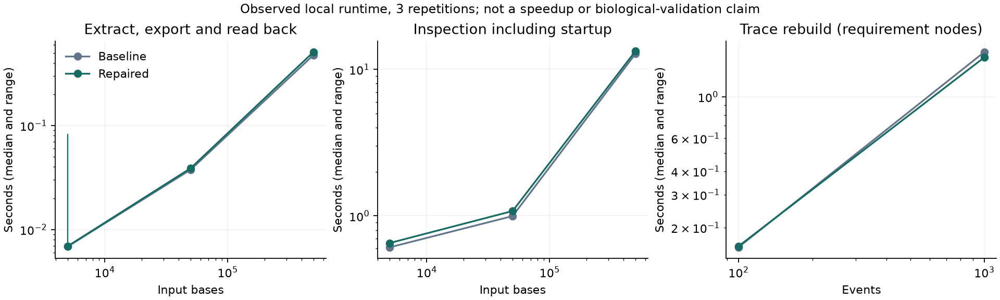

# 性能测量

本轮使用固定种子的合成数据，避免把可用性写成测试数量或固定满分。原始样本、Python/依赖/平台和CPU信息在 [baseline](../results/engineering-audit-20260922/baseline-benchmarks.json) 与 [final](../results/engineering-audit-20260922/final-benchmarks.json)。数据属于本机，不外推为性能保证。

```text
python -X utf8 -B benchmarks/runtime.py output/benchmark.json
python -X utf8 -B benchmarks/construction.py --output output/construction-benchmark.json
python -X utf8 -B benchmarks/plot_results.py
```

## 方法

每项3次，报告全部样本、中位数和Python分配峰值。5k/50k/500k bp随机序列固定种子，注释密度固定；测切片、Native导出/读回及包含新Python进程启动的inspect。Trace测100/1000个合成Requirement节点的图与报告重建，不代表相同规模复杂科学网络。tracemalloc不含外部程序/native分配；没有把它叫整个机器RSS。

基线b87a1d8与修复工作树，依赖未盲目升级。期间机器可能有并行验证负载，重复数少且未随机化执行顺序，因此不主张微小差异是代码优化。没有新增缓存服务。

| 测量 | bp或事件数 | 基线中位秒 | 修复后中位秒 |
|---|---:|---:|---:|
| extract-export-readback | 5000 | 0.0069 | 0.0069 |
| inspect-cli-including-startup | 5000 | 0.6098 | 0.6525 |
| extract-export-readback | 50000 | 0.0376 | 0.0389 |
| inspect-cli-including-startup | 50000 | 0.9961 | 1.0788 |
| extract-export-readback | 500000 | 0.4770 | 0.5110 |
| inspect-cli-including-startup | 500000 | 12.7770 | 13.3466 |
| trace-rebuild | 100 | 0.1572 | 0.1590 |
| trace-rebuild | 1000 | 1.7310 | 1.6211 |



## 完整任务与正确性

另用3000bp带CDS的线性合成源，实际调用plan→execute→validate→finalize，各3次。基线序列正确但CDS丢失；修复后序列和CDS都保留。耗时见 [before](../results/engineering-audit-20260922/baseline-construction.json)/[after](../results/engineering-audit-20260922/final-construction.json)。独立检查来自预设单碱基变更与源坐标，不以返回的verified作正确答案。该任务是文件编辑模型，不是PCR实验性能。

[Sanger/MSA小输入对照](../results/engineering-audit-20260922/auxiliary-benchmarks.json)：Sanger检查两个方向，耗时约增加一倍；MSA保留原碱基而无显著速度变化。接受的是正确性修复，不宣传提速。动态规划仍不适合任意大基因组全对全比对。

12个mutation测试、6600个属性案例和90个场景契约属于软件测试，不是性能或生物学成功率。
