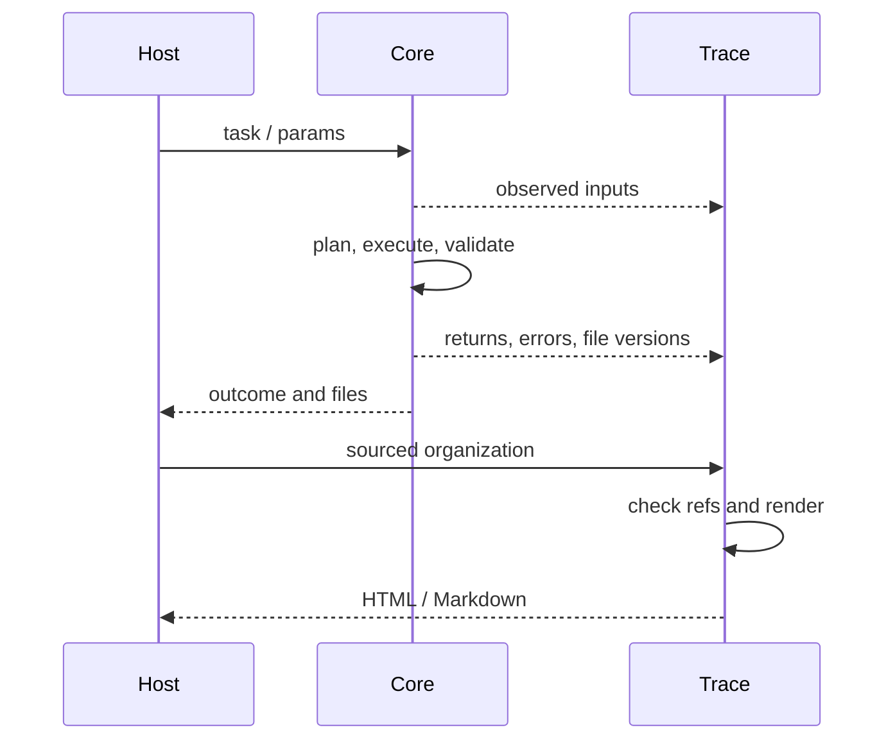

# 数据怎样流动

| 阶段 | 形状 | 谁负责 | 事实边界 |
|---|---|---|---|
| 用户输入 | 目标文字、源文件、约束 | 用户/宿主 | 未说明的动机不能推成事实 |
| 结构化任务 | ConstructionTask JSON | task/session | Schema 检查结构，不能证明科学意思正确 |
| 计划 | 操作、输入与产品约束及版本锚点 | runtime_plan/Handler | 计划不是执行 |
| 执行 | SeqRecord、中间体、文件路径与哈希 | runtime_execute/工具 | SeqRecord 同时有 sequence、features、annotations |
| 验证 | artifact/computation/goal + errors | runtime_validate | 只证明实际检查范围，异常是失败 |
| 交付 | authoritative 文件、DELIVERY-MANIFEST | runtime_gate | 必须对应这次任务、计划、执行和验证 |
| 采集 | 每行一个事件的 JSONL | Trace runtime/recorder | append-only，不等于捕获整个宿主 |
| 组织 | design_process + report_plan | AI/研究者，程序核对引用 | 科学关系来自声明，不能靠排序伪造 |
| 报告 | 完整机器图及可读投影 | process/report/render | JSON 保留事实，HTML/MD解释选定内容 |

坐标：现代 Core 是 0-based half-open，即 start 包含、end 不包含。旧 CLI 可接受 1-based closed，转换必须在入口明示。负链不等于交换两个数字；提取由 Biopython feature.extract 按生物学顺序完成。哈希用于版本绑定，不证明生物学正确。
