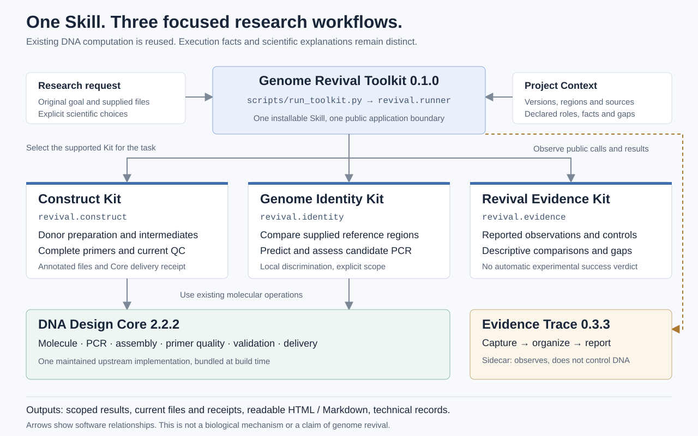

# Genome Revival Toolkit: Software Wiki draft

**Tianjin 2026 | English manuscript | 2026-10-11 | Not published**

Target: [Tianjin /software](https://2026.igem.wiki/tianjin/software). Official source repository: [igem-tianjin2026](https://gitlab.igem.org/2026/software/tianjin/igem-tianjin2026).

This manuscript organizes the team's supplied research objectives and documented engineering work. Team members must review scientific substance, contribution statements and every result before publication. Toolkit 0.1.0, DNA Design Core 2.2.2 and Evidence Trace 0.3.3 are implemented local candidates. Public-interface project calculations and independent positive/negative cases have run. The complete regression, final source/package identity and normal-host outcomes are still pending. The official repository still contains its template, so these links do not imply that this candidate has been submitted.

---

## Why does Genome Revival need software?

Our project asks whether an inactive donor genome can recover function in a living cellular environment. We approach this through protoplast fusion and a parallel genetic strategy investigating the elimination of host genetic material.

These questions depend on molecular work that can be checked precisely: preparing genetic constructs, distinguishing the supplied donor and host reference regions, designing diagnostic assays and keeping observations connected to their controls. They also demand careful interpretation. Growth, fluorescence or a PCR result at one locus may support a limited observation without demonstrating genome revival or complete host-genome elimination.

Genome Revival Toolkit focuses on this molecular work. It turns a small set of recurring research tasks into executable workflows and inspectable reports. It does not simulate cell revival or predict whether a revival experiment will succeed.

The software builds on our existing DNA Design Core rather than replacing its sequence algorithms. Project specialization comes from the research workflows, material context and limits on interpretation. We have not trained or fine-tuned a new language model.

## What can researchers ask it to do?

A single installable Skill contains three Kits. A researcher supplies available materials and a goal; the AI host chooses the relevant workflow and submits explicit inputs. Deterministic code performs the supported calculations.

| Research need | Kit | Result to inspect |
|---|---|---|
| Prepare a donor for a defined genetic change and check its structure | Construct | Computed preparation intermediates, primers, quality checks, annotated DNA and a delivery receipt |
| Determine whether supplied reference regions or a proposed PCR assay distinguish two backgrounds | Genome Identity | Sequence differences, predicted products for each supplied background and the exact scope of discrimination |
| Compare reported observations with controls without overstating their meaning | Revival Evidence | A sourced comparison, missing controls and conclusions supported or not supported by the supplied records |

The first release has a deliberately limited scope. Genome Identity analyzes supplied regions; it is not a whole-genome ancestry platform. Revival Evidence organizes reported observations; it does not independently authenticate raw experiments or establish biological causality.

A suitable user request states the objective, available files and constraints. For example, a researcher may ask for a donor targeting an explicitly defined reference interval, or ask whether a primer pair distinguishes two supplied regions. The user does not need to provide a complete construction script. Missing target identity, ambiguous boundaries or inadequate material remain visible input gaps.



One public entry, `scripts/run_toolkit.py`, selects a Kit through `revival.runner`. `revival.context` loads the shared material/version context; `construct`, `identity` and `evidence` implement the three scoped workflows. Construct and Identity invoke the existing Core. `revival.reporting` organizes actual execution facts and explicitly submitted explanations through the shared Trace. The arrows above describe software relationships, not a mechanism of genome revival.

## How is material identity preserved?

The three Kits share a lightweight Project Context. It records declared strain roles, reference versions, file sources, relevant markers, research route and the status of each statement. A confirmed file fact, a design assumption and an untested experimental condition remain different kinds of information.

A file hash identifies the version used in a calculation. It does not establish that a laboratory culture has that genotype. Likewise, the public SY14 reference, the team's actual stock and a proposed insertion site must not be treated as interchangeable.

This distinction mattered in our source review. The available project descriptions include unresolved strain identities and experiments requiring additional controls. Some promotional wording claims more than the underlying records establish. We use the research aims to motivate the software, but do not use those claims as evidence of experimental success. The SY14 URA3 insertion site is not established by the materials reviewed for this release.

## How does Construct Kit work?

Construct Kit reuses the existing donor, PCR, assembly, primer-quality, validation and delivery functions. Inputs identify the reference record, intended interval, cargo region and applicable preparation conditions.

The workflow connects the intended change to actual sequence operations. Where PCR preparation is selected, the simulated products come from the supplied templates and complete primers. Assembly uses those products, not a separately invented target fragment. Features, orientation, topology and preparation history remain part of the molecular records.

Checks have defined scopes. A sequence-model check verifies the modeled structure. A preparation check examines supported operations and intermediates. A file check rereads the saved output. Goal coverage compares explicitly declared requirements with the actual result. One successful check cannot stand in for all four.

Final delivery binds the files actually selected to their checked versions. Editing a sequence, annotation or supplementary order after verification requires applicable checks again. A failed quality check or an unverified requirement is reported rather than converted into a completed construct.

The project case uses the supplied S288C chromosome-I reference and an existing XT2/URA3 donor. With an explicitly selected target interval, cargo and arm length, the public Construct CLI prepared a 1,802 bp linear donor and eight complete oligos. Independent inspection confirmed the saved sequence equals the original donor's first 1,802 bases and the source-derived left arm, cargo and right arm. Both donor-boundary checks and current Core/Toolkit file receipts were verified.

Off, Observed and Full produced the same DNA, topology, features, order, quality conditions and four validation scopes. The boundary-PCR products were predicted as 372 and 288 bp. These are sequence computations, not observed laboratory bands or evidence of genomic integration. The case used developer-supplied regions and parameters; it is not an autonomous host result and does not establish a SY14 insertion site.

## How does Genome Identity Kit work?

Genome Identity compares the supplied reference regions and tests proposed assays against each background. Results explain which differences were found, which products are predicted and where an assay is ambiguous.

This prevents several common overinterpretations. A best local alignment does not establish a unique genomic location. An in-silico absence of a PCR product is not an observed laboratory negative. A distinguishing product in two supplied regions does not prove specificity across either entire genome.

The Kit therefore reports reference identity, checked intervals, product predictions and unexamined backgrounds together. Researchers can use that output to decide what additional references, controls or experiments are needed.

In the supplied S288C/SY14 region case, the first developer-selected assay spanned the whole region and predicted PCR products, but its complete-primer hairpins exceeded the unchanged default 47°C limit. That failed candidate remains recorded. A different developer-selected interval on the same material produced 650 and 374 bp predictions. Independent binding-site calculations and complete-sequence thermodynamic checks confirmed those predictions and acceptable quality under the reported conditions. This is an assisted candidate-selection result, not proof of autonomous design, actual gel separation or whole-genome specificity.

## What does Revival Evidence Kit add?

Revival Evidence accepts structured records of experimental groups, controls, colony counts and genetic observations with sources. It compares what the supplied records report and separates supported observations, inadequate evidence, contrary observations and untested conclusions.

The software cannot recover missing raw data or decide that a report is authentic merely because its fields are complete. It also cannot convert cell growth, fluorescence or a positive local PCR into proof of genome revival. Those broader conclusions require the appropriate experimental design, controls and independent interpretation.

The lightweight Kit makes these boundaries explicit without creating another statistical or governance platform.

For the current project-material review, the available meeting and description documents did not supply a traceable raw colony-count or genotype-results table. The Kit therefore returned `incomplete` and `NOT_TESTED` conclusions without inventing counts or a revival rate. Separate synthetic engineering examples test descriptive arithmetic and contradictory controls; those examples are labeled synthetic rather than presented as project experiments.

## What can Evidence Trace make reviewable?

Evidence Trace is shared across the three Kits. It connects the user's goal, input versions, submitted choices, actual operations, current checks and resulting files.

Its three responsibilities remain separate:

1. **Capture:** record calls and results observed through supported execution paths.
2. **Organization:** connect those facts using explicit references and sourced explanations supplied by the host or researcher.
3. **Reporting:** generate readable HTML and Markdown through deterministic code.

The report begins with the task and actual outcome. It then explains the recorded process, significant choices, applicable checks, failures or gaps, and file locations. Detailed technical records remain accessible without overwhelming the default reading view.

A public explanation records what the AI or researcher submitted; it is not proof of the model's private reasoning. An unobserved script or external file modification remains a capture gap. New facts or file versions can make earlier organization stale; the report must not silently preserve an outdated success claim.

Independent public-entry tests exposed two recording defects. A second real write of the same bytes had been treated as mere file presence; it now receives a current-run write record backed by the actual writer result. A normal-mode settings failure had allowed an old Trace to appear complete for a new invocation; a missing current invocation now remains incomplete. Tests retain the original failures and distinguish these repairs from DNA computation. Rebuilding a report uses recorded events without adding new scientific explanations, and modified files do not inherit their old checks.

Off creates no new Trace. Observed captures supported facts without requiring additional AI explanations. Full adds short submitted public explanations where available. Full does not mean that all host activity was observed. Trace integrity, DNA correctness and experimental conclusions are reported separately; no safety score or safe/unsafe verdict is produced.

## How are reliability claims tested?

We test several distinct questions instead of counting every green test as a completed research task.

- **Engineering tests:** independent positive, negative and ambiguous inputs check public interfaces and failure behavior. Expectations come from original inputs or separately derived facts.
- **Project calculations:** supplied research materials are processed through a complete supported workflow, and resulting files are independently inspected.
- **Normal-host use:** a real installed host begins with a natural request and original materials, without a developer supplying the complete route. Actual tools, outputs and failures are retained.
- **Package and Trace checks:** an extracted standalone package is exercised, including successful and failed workflows, report links, file changes and Off/Observed/Full equivalence.

Developer-assisted runs are labeled separately from autonomous host outcomes. Known development cases are not heldout evaluations. A host's final message or zero exit code is not a successful biological result.

Earlier testing of the general Core exposed missed goals and failed final delivery even when individual operations were correct. Those records informed this release's scope and limits; they do not prove the new Toolkit has passed its own tests. No new claim of user efficiency, general task success rate or wet-lab effectiveness is made without corresponding evidence.

**Current release verification:** independent checks have covered the Kits' valid, invalid and ambiguous inputs, source changes, stale receipts, actual public calls and Trace failures. The real developer-assisted Construct and Identity cases described above are inspectable. They do not stand in for the pending complete suite, extracted-package tests, normal-host run or human/experimental validation. Final source and package identity will be added after freezing.

## Installation, formats and reuse

The Toolkit is one standalone Skill. Its package includes the selected version of the DNA Design Core and Trace, built from their maintained sources. It does not depend on the developer's private directories, test answers or laboratory records.

The existing Core supports GenBank, FASTA and native SnapGene exchange through its documented interfaces. Feature coordinates and strands must remain meaningful through operations and file round trips. Native file interoperability is evaluated within the supported reader/writer scope; it is not a claim to preserve every unknown desktop-specific packet. SBOL support is not implemented.

Primer calculations require the documented, actually available backend. Backend availability, skipped integrations and unsupported cases are disclosed. The current independent Windows environment uses the external Primer3 executable; an observed native primer3-py import failure is recorded separately rather than hidden.

The implemented README and workflow reference provide installation, explicit inputs and a minimal command sequence:

```text
python -m pip install -r requirements.txt
python -X utf8 -B scripts/run_toolkit.py inspect --context project-context.json
python -X utf8 -B scripts/run_toolkit.py describe identity
python -X utf8 -B scripts/run_toolkit.py identity --context project-context.json --request request.json --out-dir results
python -X utf8 -B scripts/run_toolkit.py verify --out-dir results --receipt-sha256 RETURNED_SHA
```

The dependency file uses the selected Core's pinned tested requirements. `inspect` checks provided references, `describe` documents accepted inputs, and `verify` checks current reports/input versions together with the applicable Core delivery. `RETURNED_SHA` is the receipt hash returned by the actual run, not an example credential. Trace reports can be rebuilt through `rebuild-report`. Source, parameters, versions and outputs accompany internal cases; public research materials still require redistribution approval.

## Limitations and responsible use

The current scope is molecular computation and reviewable research records. It does not confirm an actual strain's identity, establish an unknown insertion locus, authenticate experiments, prove complete genome elimination or certify biosafety.

Natural-language understanding and scientific choices remain responsibilities of the host and researcher. Explicit goal coverage helps reveal omissions but cannot prove that every part of an arbitrary request has been understood. A host can also use unobserved scripts or present unchecked files; supported delivery and capture paths make the recommended workflow verifiable without claiming control over every host action.

Independent reader comprehension, external users and software-linked wet-lab outcomes remain unverified. These limits define the release claim rather than being filled with predictions.

## Availability, contribution and AI disclosure

Original project code uses MIT, while dependencies, external programs and supplied materials retain their own licenses. Software and Wiki licenses are distinct. Source availability on the official repository remains pending the team's reviewed upload.

OpenAI Codex has assisted with implementation, review, test construction and documentation preparation. The actual host model ID was not obtained for this development run; subagents inherited the host model without an override, and no model version is inferred from informal names. Real official DeepSeek Flash with maximum reasoning effort has been used for recorded general-Core host pilots; Toolkit host validation must be reported separately. No new model weights were trained. Vendor training data are not independently available to the team. Human contributions must be confirmed from the team's records before final disclosure.

The manuscript's project objectives come from the team's supplied research requirements. Code, calculations, references and scientific statements still require appropriate human review. AI-assisted engineering checks are not described as independent human or expert endorsement.

The team will disclose AI use, third-party support and student contributions through the official Attributions process. The responsible human must review and perform official account actions and final submission, as required by [iGEM's AI policy](https://igem.org/legal?tab=ai-policy).

---

## Internal publication check, not Wiki body

### Evidence that must be frozen

| Item | Current source | Publication condition |
|---|---|---|
| Project aims and unresolved experiments | Reviewed original project files; local `project-materials.md` | Team confirms role/strain statements and publication rights |
| Architecture and supported scope | [Toolkit spec](../../specs/genome-revival-toolkit.md), [Core spec](../../specs/core-skill.md), [Trace spec](../../specs/safety-module.md) | Match actual frozen implementation |
| Construct case | Local `public-construct/RESULTS.md`, three-mode outputs and `public/real-record-review.json`; [Toolkit plan](../development-plans/genome-revival-toolkit-v0.1.md) | 1,802 bp, eight oligos, actual preparation/readback and current receipts checked; assisted parameters, not autonomous or experimental |
| Identity case | Local `identity/RESULTS.md`, original failed assay and `developer-alternative-independent.json` | 650/374 bp assisted candidate checked; first quality failure retained; given regions only |
| Evidence case | Local `evidence/RESULTS.md`, sourced documents and missing-data result | `incomplete`/`NOT_TESTED`, no invented project measurements |
| Normal host | New isolated official DSH run on frozen Toolkit | Keep natural request, tools, actual artifacts and public final outcome; do not use Core pilots as Toolkit proof |
| Package/release | Commit, SHA-256, manifest, dependencies, installation and applicable suites | No private material or developer-machine dependency |
| Official upload | [GitLab handoff](gitlab-migration.md) | Human upload, official main/CI and receipt actually verified |

### Required figures and files

1. **Architecture figure:** one Skill, three Kits, Project Context, reused Core and shared Trace. Generate from the actual architecture, label it as a software diagram.
2. **Construct workflow:** actual source, intermediate, checked donor and delivered-file lineage. Do not replace a missing run with an imagined successful route.
3. **Identity result:** real region alignment and per-background predictions, with interval/assay scope.
4. **Trace screenshots:** genuine screenshots of one success and one failure, with readable default view and usable details links.
5. **Reproducibility links:** final README, source/commit, approved downloadable package and computational evidence.

All Wiki assets must use approved iGEM hosting. Use code-generated figures from documented computations and genuine screenshots. Do not generate or retouch images to imitate research evidence.

### Remaining human actions

Confirm project facts, authorship and redistribution; review the English scientific substance and AI disclosure; perform official GitLab/Wiki operations, form entries and final submission; inspect published links and receipts. The [official requirements](official-requirements.md) own the rules and dates.
